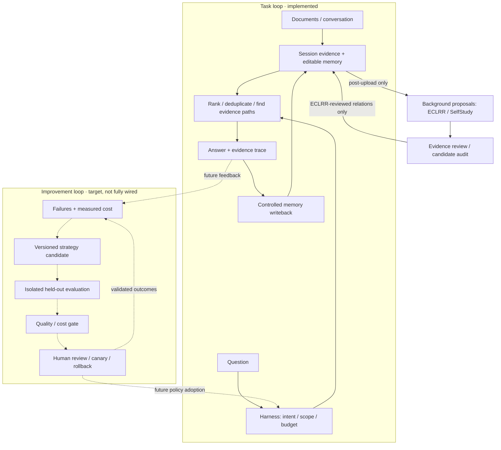

<div align="center">


# DocThinker

Latest engineering snapshot: [October 20 acceptance and known gaps](docs/RELEASE_ACCEPTANCE_2026-10-20.md). Personal events now enter ordinary answers and long tasks through a bounded evidence-obligation controller: directed links → targeted source lookup → model-assessed support/counterevidence/unknown → version-bound follow-up suggestions. This is not verified causal understanding or a production-quality certificate.

2026-10-13 second performance pass: single-snapshot reads, bounded lexical features and batched proofs now accompany N+1-free live history, read-only warm evidence checks, request-local prompt rendering, and vector reuse separated from legacy candidate admission. No evidence-budget reduction. Final backend contracts: 4,460 passed, five skipped; synthetic retrieval/prompt comparisons retain outputs, not a real-model speed or quality pass. See [measurements, cold-preparation overhead and remaining limits](docs/PERFORMANCE_STRUCTURES_2026-10-13.md).

**From evidence and memory to verifiable self-improvement.**

A research path toward recursive self-improvement (RSI)

[English](README.md) · [中文](README.zh-CN.md) · [Quick start](#quick-start) · [Architecture](docs/ARCHITECTURE.md) · [RSI roadmap](docs/RSI_ROADMAP.md)

[](pyproject.toml)
[](https://github.com/Yang-Jiashu/Doc-thinker/actions/workflows/ci.yml)
[](https://arxiv.org/abs/2603.05551)
[](LICENSE)

</div>

Downloaded an invitation source ZIP? Use the [invitation deployment guide](deploy/invite/README.md), not the full-repository installation below. This package contains the restricted profile's build inputs and selected reports; development tests, historical evaluation datasets and optional full graph/voice stacks require the complete workspace. It is not an already hosted service.

## Why this project exists

### Product direction

Build a **personal agent**, not a paper-only assistant: retain user-confirmed context, connect changes and events, organize evidence, and continue approved personal projects. Research is one use case alongside work and everyday planning. Reuse this core for ToB workspaces only after organization permissions, explicit sharing, and operational acceptance tests exist; bounded task checkpoints are not a general enterprise job system.

**The DocThinker workbench:** turn material into work you can verify, revise, and continue within a long-term project. Project briefs, editable task starters, and source-aware saved answers form one workflow—not separate reasoning modes. See the [workbench design, official product references, and implementation boundaries](docs/WORKBENCH_PRODUCT_DESIGN.md). Product workflow improvements do not change the quality limitations reported below.

**Persistent research projects (October 13):** save up to six dependent analysis questions, explicitly approve a bounded run, pause, restart, and continue valid checkpoints. Changed sources invalidate affected questions and their dependents; versioned reports are assembled locally from currently accessible answer references, without another model call. This is a user-approved research DAG—not unattended multi-day autonomy or a factual-quality guarantee. See the [runtime limits and a real-project acceptance workflow](docs/LONG_PROJECT_RUNTIME.md).

**Appendable personal projects:** a Project/Phase manifest now sits above each bounded DAG, with explicitly approved successor phases and revocable cross-phase references. Current admission still limits a session to 20 documents; appendable phases are not an unlimited paper library or autonomous weeks-long execution. See the [implemented phased runtime and remaining limits](docs/LONG_PROJECT_RUNTIME.md).

The full graph service, private mobile service, invitation beta, and offline demo are separate profiles. Invitations default to chat/history; an explicit **bounded research core** connects projects → PDF/TXT/MD import → ordinary chat and writing with inspectable sources → editable temporal memory → restart recovery. Memory recall searches an indexed retained lifetime, rather than only the newest 100 notes. Users do not choose a reasoning mode. The latest experimental helper retrieves by question facets, reranks locally, and selects bounded original passages without appending generated analogical, deductive, or inductive conclusions. Legacy reasoning modules remain separate from this evidence-reselection path. See the [implemented design and measurements](docs/RESEARCH_GROUNDED_DESIGN.md#0-2026-10-10-已实现的证据重选路径), [core architecture](docs/ARCHITECTURE.md#有界研究核心2026-10-10), and [acceptance milestones](docs/PRODUCTIZATION.md).

Task knowledge now includes checks against the actual fitted excerpts: citation labels, duplicate passages, and document diversity. Natural-language method prerequisites remain unverified. Complete method cards and their plan share the existing budget, with user evidence taking priority. See [Super Skills: design and implementation boundaries](docs/SUPER_SKILLS.md) for evidence-obligation planning, independent evaluation, and the remaining experience-learning work.

Storage can be expanded; context stays bounded. Event-time history, corrections and archival preserve what changed, while deletion and source revocation suppress future recall. Exact quotations are distinguished from unverified paraphrases; analogy remains a hypothesis and induction remains a sample finding. The short Chinese/English relation and rule parser is intentionally incomplete. This is not an unlimited-capacity claim, a hosted production release, or evidence of RSI.

**Cost and scheduling:** without local neural assets, the default research lane competes original windows using bounded lexical/structure hints: 4,096 scanned chunks, 48 candidates, eight base excerpts / 12 KB. Insight may append two excerpts within that same evidence budget. Nomination and organization share one nonqueued worker and a one-second foreground wait; a late thread keeps its slot until completion. The optional neural lane uses local embeddings, at most 48 reranking pairs and optional local translation, with an eight-second wait. Both add zero provider generation calls, but consume local resources. Generated answers use at most one provider call and 24,576 UTF-8 prompt bytes. The fitted task budget is 2,048 output tokens for ordinary chat, 8,192 for grounded research. Bytes are not billed tokens. See the [default lane and its limits](docs/RESEARCH_GROUNDED_DESIGN.md#012-2026-10-12-无本地语义模型时的默认选证路径).

**October 13 invitation build:** bounded model-free selection now preserves source-local operation conditions and complementary windows without increasing context limits. The V14b input audit recovered real temporal-conflict handling, but five real Step 5 Preview requests still failed acceptance: roadmap OFF 66.25 / AUTO 60, design 60 / 60; the brief AUTO returned empty content at its output limit, so the remaining request was not sent. Total reported usage was 51,210 tokens, with no retry. See the [frozen source-grounded review](benchmarks/research_real/result_insight_operation_repair_v14_20261013.md). Subsequent software fixes do not rewrite those failures. This is private-beta deployment source, not an already hosted or commercially certified product; see [software, quality and deployment acceptance](docs/RELEASE_ACCEPTANCE_2026-10-12.md).

Explicit pilot requests now use a bounded, model-neutral TrialSpec inside the same generation: fixed comparison arms, all-planned-question denominators, and complete, non-overlapping decision intervals are checked without another model call. A deterministic table shows the proposal; malformed or unknown output stays a draft. This validates internal structure—not factual support, experiment quality, execution permission, or a new real-model quality pass. Ordinary chat stays ordinary; see the [delivery contract](docs/RESEARCH_GROUNDED_DESIGN.md#015-2026-10-13-把明确要求的试点交付变成有限对象).

**Historical neural-helper V6 boundary (October 10, 2026):** the frozen helper completed 26 real Step 5 Preview calls for 12 paired questions plus a separate diagnostic (150,906 reported tokens). Two independent agent reviewers—not human experts—found gains on eight development questions: mean quality 78.91 → 81.95, fully retrieved required facts 9/23 → 20/23. However, four held-out questions on two new papers regressed: quality 81.72 → 75.47 and full facts 7/13 → 6/13. Overall quality was 79.84 → 79.79; mean total tokens increased 5743 → 5841.75 and full-answer time 33.98 → 42.29 seconds. A central experimental-control error and increased source noise fail the development gate; the new-paper split also fails quality, evidence and token gates. Two ON timeouts remain in the primary results; ten helpers actively changed evidence. **Neither split passed; the experimental switch remains off by default.** Reviewer-order counterbalancing was incomplete, and this small pilot is not generalization proof. See the [V6 report](benchmarks/research_real/result_evidence_trace_20261010.json). The 8,192-token experiment cap did not change the product default of 2,048.

**Historical V5 boundary:** in eight real Step 5 Preview paired questions over four papers, the new helper reduced mean total tokens by about 44.6%, but AI blind-review scores fell from 74.06 to 71.41 and fully retrieved required facts fell from 9/23 to 6/23. **The quality gate has not passed.** Assistance actually ran; this is not a disabled-helper comparison. The service's experimental switch remains off by default, and no quality improvement has been released on these results. The experiment used an 8,192-token output cap, not the product default. See the [experiment report](benchmarks/research_real/result_faceted_20261010.json) for costs, failures, and pilot limitations.

**Launch foundations (October 10, 2026):** invitation chat now has one-shot request receipts, reconnect status reads, submission deduplication, deterministic input/output bounds and persistent daily quotas. Answers can be explicitly copied with bounded source excerpts. Run `python deploy/invite/manage.py preflight` to check local configuration and H5 assets; real HTTPS, model permissions/credit, mobile access, recovery and billing limits still require acceptance tests. See the [invitation boundaries](docs/INVITE_WEB_BETA.md) and [deployment guide](deploy/invite/README.md).

**DocThinker's destination is RSI, not just a bigger knowledge graph or another document chatbot.** The research question is how an agent can learn from tasks, propose changes to how it works, verify that those changes help, and use the validated results to improve its next round of improvement.

The starting point is a document-grounded agent: inspectable evidence, editable memory, bounded retrieval, and background knowledge organization. These provide a testable environment for improvement; knowledge growth alone does not demonstrate increased capability.

**Working today:** document QA, layered memory, bounded user-approved research tasks, controlled reasoning paths, candidate generation, and an offline quality/cost gate. **Next milestone:** versioned candidates → isolated evaluation → reviewed adoption → rollback. This deployment loop is not yet wired end to end. See the [RSI milestones and acceptance criteria](docs/RSI_ROADMAP.md).

## Use it today

| Your task | Runtime behavior |
|---|---|
| Answer from a document | Retrieve source evidence; disclose gaps instead of substituting inferred relations |
| Understand a multi-step relationship | Search a bounded directed neighborhood for continuous paths and sources; connectivity is not proof of causality |
| Explore related ideas | Rank and diversify graph associations while keeping hypotheses separate from facts |
| Remember preferences and rules | Inspect, edit, delete, and restore long-term memory independently of ordinary chat history |
| Continue a research project | Explicitly approve scoped questions, retain valid checkpoints, and rebuild a source-aware report after reviewing affected inputs |
| Run controlled comparisons | Toggle memory, history, LLM cache, and evolution separately; inspect policy and budget traces |

Documents supply evidence; memories supply context; generated associations remain candidates. Post-upload learning is wired. Episodic overnight consolidation is a separate experimental workflow, not the same thing as the upload trigger.

## Two loops, one direction



Solid arrows show implemented connections; dashed arrows show the planned improvement loop. Its gate already exists as an [offline tool](docs/SELF_EVOLUTION_EVALUATION.md), but it does not execute experiments or deploy changes.

Code supplies the skeleton: isolation, selection, paths, budgets, scheduling, and admission checks. Models supply semantic extraction, answer generation, and optional proposals. **The first improvement target is the harness and retrieval strategy, not model weights.**

## Quick start

Python 3.11 is recommended. Install from a repository checkout in editable mode. Parsing dependencies are substantial; initial installation and model downloads can take a while.

```bash
git clone https://github.com/Yang-Jiashu/Doc-thinker.git
cd Doc-thinker
python3.11 -m venv .venv
source .venv/bin/activate
python -m pip install -e ".[all]"
cp -n env.example .env
```

Edit `.env` with services you can access. Never commit API keys.

| Settings | Check |
|---|---|
| `LLM_BINDING_HOST`, `LLM_BINDING_API_KEY`, `LLM_MODEL` | Answer model and compatible endpoint |
| `KEYWORD_LLM_MODEL`, `ENTITY_EXTRACTION_LLM_MODEL` | Models available at that endpoint; may match the answer model |
| `EMBEDDING_BINDING_HOST`, `EMBEDDING_BINDING_API_KEY`, `EMBEDDING_MODEL`, `EMBEDDING_DIM` | Configured dimensions must match embedding output |
| `VLM_MODEL` | An available vision model when using multimodal processing |
| `RAG_WORKDIR` | Defaults to `./rag_storage_api`, including the long-horizon SQLite database |

Use two terminals, initially listening only on localhost:

```bash
# Terminal 1: backend
python -m uvicorn docthinker.server.app:app --host 127.0.0.1 --port 8000

# Terminal 2: UI (port 5000 may be occupied by macOS)
UI_HOST=127.0.0.1 UI_PORT=5001 python run_ui.py
```

Open [Chat](http://127.0.0.1:5001/query), [Knowledge & memory](http://127.0.0.1:5001/knowledge-graph), or [API docs](http://127.0.0.1:8000/docs). The UI proxy expects local port 8000. Configure authentication, reverse proxying, and access controls separately before remote deployment.

**First run:** create a session → upload one TXT → wait for ingestion → ask in faithful mode → inspect the memory/evidence trace. Start with text before PDF/image processing. Startup probes, extraction, and background learning may call models; query controls do not globally disable model use.

## Interface and experiments

**Invite deployment bundle:** the H5 client, invitation login, and isolated per-user workers have a [Docker Compose package](deploy/invite/README.md). Localhost/chat-only remains the default. `up --research`, with `--research-uploads` enabled per account, exposes bounded document import, grounded answers and explicit project memory. Parsing, retrieval and memory edits make no model calls; answering makes at most one generation call, without automatic graph growth or learning. Voice, team sharing and public hosting are not enabled by this profile. Packaging is not a live hosted release.

**Mobile development preview:** [WeChat mini-program and Android/iOS app resources](docs/MOBILE_APP.md) share a uni-app client with a zero-network demo mode. Optional [speech transcription and read-aloud](docs/VOICE_MODELS.md) use a separate, authenticated private API. This is not a signed app, a published mini-program, or a multi-tenant customer release.

The mobile UI uses the Evidence Window identity and five tabs: Assistant, Documents, Memory, Graph, and Settings. In research mode, Documents shows processing, original text and retries; Memory supports explicit confirmation, correction, temporal search, history, archival and deletion. The assistant stays a normal chat/writing interface, without a reasoning-mode picker; answers can expose literal sources and optional supporting material separately. Deleting a source invalidates dependent findings and proof references. Legacy summaries remain read-only and are not verified user preferences. [WeChat guest test project](docs/WECHAT_MINIPROGRAM.md): run `npm run build:mp-weixin` inside `clients/mobile`, then import `dist/build/mp-weixin` into WeChat DevTools. Phone preview and experience releases remain unverified and require your own authorized AppID.

[Android/iPhone home-screen installation](docs/MOBILE_INSTALLATION.md) requires an HTTPS deployment; native APK/IPA distribution still requires signing and device testing. [Design rationale](docs/MOBILE_DESIGN.md) · [Six logo directions](clients/mobile/public/brand/index.html)

Graph views now offer an explicit Standard / Immersive switch that carries the session, search, and selected node. Both consume the same gesture runtime with precision/presentation modes and shared local preferences. Camera access is opt-in; mouse controls remain available. See [graph navigation and gesture behavior](docs/GESTURE_INTERACTION.md).

**Model settings:** open `/config` to choose a provider and search built-in models by role, instead of typing model IDs and endpoints. The local catalog includes **13 providers/channels and 73 preset entries**, with capability labels, official setup links, and a custom-model escape hatch. The catalog-wide check date remains September 19, 2026; only StepFun entries were incrementally checked on October 10. Saved changes require a backend restart; changing embeddings also requires reindexing. Presets do not prove account access. Earlier personal connectivity checks returned 403 on Step Plan / 402 on the standard API; after account changes, the October 12 Insight V4 run completed six real `step-5-preview` generations on Step Plan. That does not verify other channels/providers or establish general answer quality. See the [actual development report](benchmarks/research_real/result_insight_v4_development_review_20261012.md) and [model compatibility boundaries](docs/MODEL_CONFIGURATION.md).

The workspace uses a neutral, Codex-inspired layout: a session sidebar, a focused conversation area, a compact composer, and an on-demand evidence panel. It uses DocThinker's own branding and is not affiliated with OpenAI.

Answer intent is visible on the main screen: automatic, faithful, path, or exploratory. Retrieval depth and experiment controls are progressively disclosed; retrieving more should not be mistaken for greater reliability.

- Memory, history, cache, and evolution controls are independent. Disabling history does not disable long-term memory.
- Compact context is enabled by default. Extra LLM path completion and reviewed inferred-relation retrieval are opt-in.
- The memory trace exposes the current policy, budget, and evidence, including on mobile.
- Faithful mode excludes expanded hypotheses; ordinary conversation may still use enabled history and memory.

See the [query runtime guide](docs/QUERY_RUNTIME.md) for parameters and a copyable baseline request.

## How far does self-improvement go?

| Status | Capability |
|---|---|
| Wired | Session isolation, layered memory, evidence retrieval, budgets, controlled writeback, and Memory Trace |
| Wired; efficacy needs evaluation | Post-upload ECLRR review; SelfStudy graph-change candidates are audit-only and do not overwrite source descriptions; experiences are stored separately |
| Offline tool | Per-question-family candidate checks covering quality and cost; advisory only, no automatic deployment |
| Experimental | Episodic linking, reinforcement, decay, and pruning; separate SEAL / TriGraph paths |
| Not yet a complete loop | Independently validated policy adoption, whole-system rollback, and demonstrated RSI |

The objective is **measurable task improvement under quality and cost constraints**. Keep useful exploration, but do not let it contaminate faithful answers. The next stage must change and evaluate a strategy, not merely append more relations. See the [architecture assessment](docs/ARCHITECTURE.md) and [RSI roadmap](docs/RSI_ROADMAP.md).

## Efficiency: what is improved, what remains

- Online work is bounded: request budgets, local graph traversal, batch reads, cached per-request edge scores, and diversified evidence selection.
- Background work is controlled: per-session upload learning is coalesced and serialized, with bounded cross-session concurrency; SelfStudy has call/time limits and estimated token admission checks.
- Algorithmic work stays algorithmic: scope checks, routing heuristics, PPR, MMR, and path search do not require a generation call.
- Research tasks now retain approved DAG checkpoints; general autonomous/background jobs, provider-wide usage accounting, incremental graph updates, large-dataset profiling, and a complete version/evaluate/adopt/rollback loop remain unfinished.

This is not a claim that every performance bottleneck is solved. Operation-count tests are not end-to-end speed or billed-token benchmarks. Read the [cost boundaries](docs/ARCHITECTURE.md#效率边界与验证方法) before using the system for large experiments.

## Development and validation

```bash
python -m pip install -e ".[all,test]"
python -m pytest tests/ -q --ignore=tests/debug_db.py

# No LLM call. Input format and independent review requirements are in the guide.
python -m docthinker.evaluation --baseline baseline.json --candidate candidate.json
```

For a UI-only preview, run `PYTHONPATH=. python tests/ui_preview.py` and open the [local preview](http://127.0.0.1:5055/query). It serves mock data without model calls or real document storage; it is not an answer-quality benchmark.

Unit tests use model doubles and synthetic evidence; they do not establish real answer quality or provider-token savings. Lexical scores are screening proxies, not tests of negation, causality, or factual support.

## Documentation

| Guide | Contents |
|---|---|
| [Architecture and efficiency](docs/ARCHITECTURE.md) | Online/background responsibilities, cost boundaries, remaining gaps |
| [Persistent research projects](docs/LONG_PROJECT_RUNTIME.md) | User-approved DAGs, checkpoints, source invalidation, bounded handoff, report versions and acceptance |
| [RSI roadmap](docs/RSI_ROADMAP.md) | Improvement targets, algorithmic loop, milestones, acceptance criteria |
| [Query runtime](docs/QUERY_RUNTIME.md) | Modes, controls, budgets, A/B requests |
| [Self-evolution evaluation](docs/SELF_EVOLUTION_EVALUATION.md) | Held-out data, review rubric, admission input format |
| [Memory plugin guide](docs/MEMORY_PLUGIN_GUIDE.md) | Embed `AgentMemoryCore` in another agent |
| [Contributing](CONTRIBUTING.md) | Development workflow |

Main entry points: `docthinker/harness.py` for policy; `docthinker/memory_core/` for memory; `graphcore/` for evidence; `docthinker/server/routers/ingest.py` for post-upload learning; `docthinker/ui/` for interaction.

## Citation and license

```bibtex
@article{yang2026autothinkrag,
  title={AutothinkRAG: Complexity-Aware Control of Retrieval-Augmented Reasoning for Image-Text Interaction},
  author={Yang, Jiashu and Zhang, Chi and Wuerkaixi, Abudukelimu and Cheng, Xuxin and Liu, Cao and Zeng, Ke and Jia, Xu and Cai, Xunliang},
  journal={arXiv preprint arXiv:2603.05551},
  year={2026}
}
```

Current releases use the [PolyForm Shield License 1.0.0](LICENSE). Previously MIT-licensed releases retain their original license.
