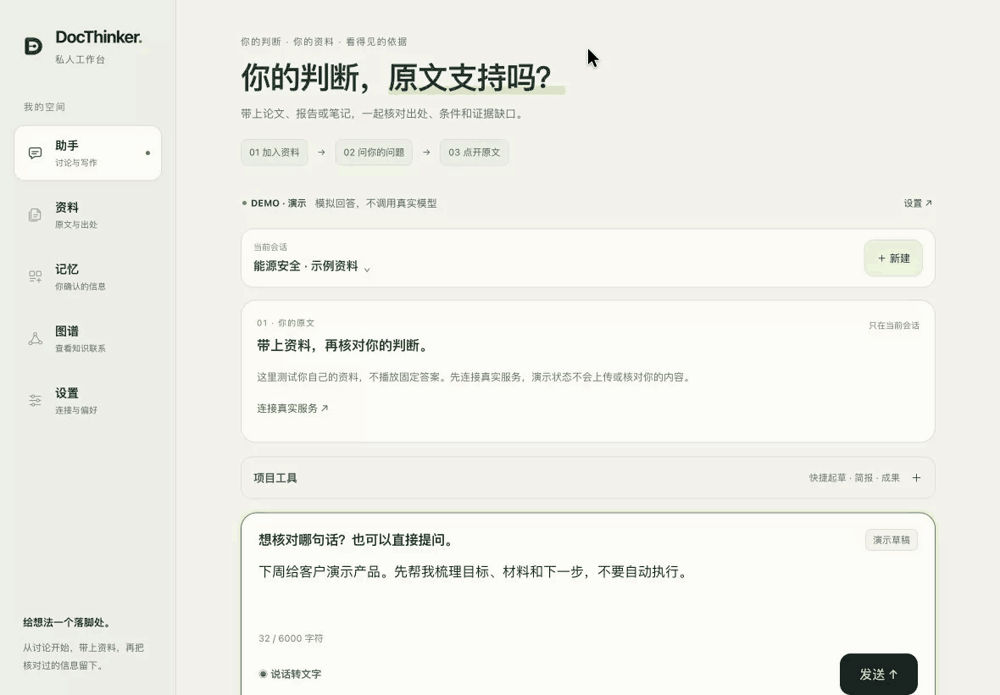
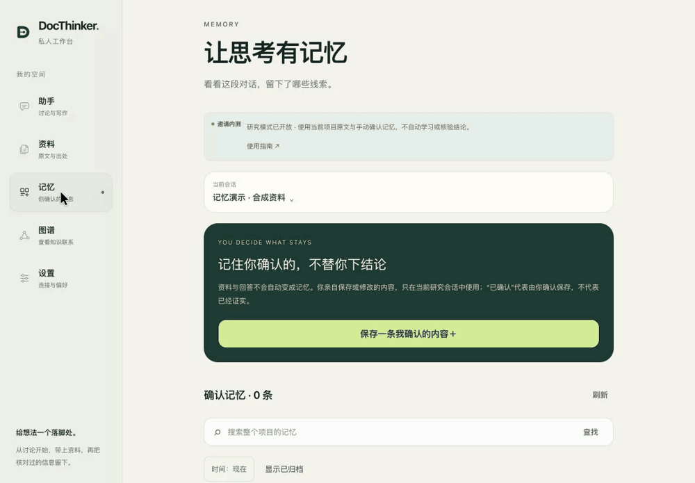
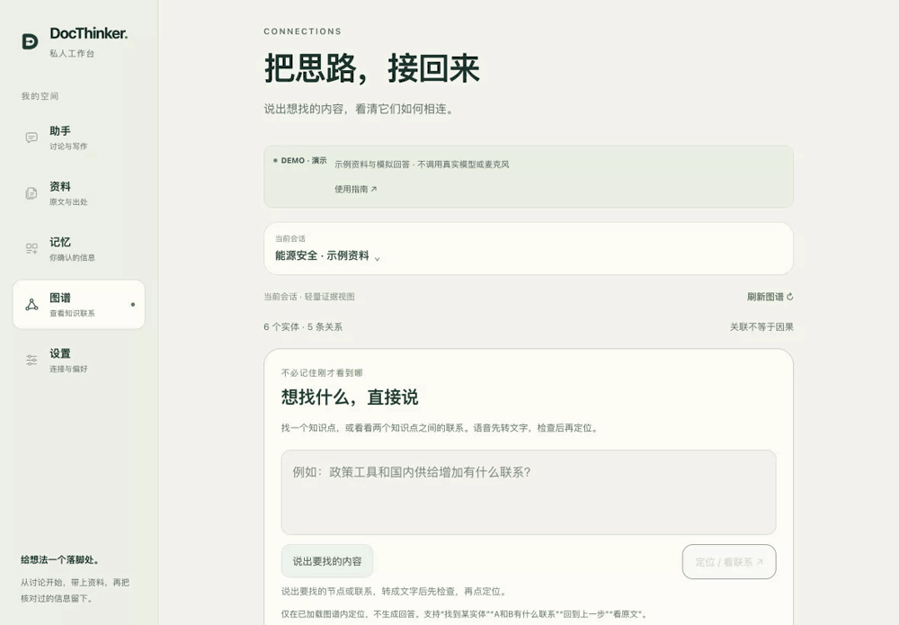
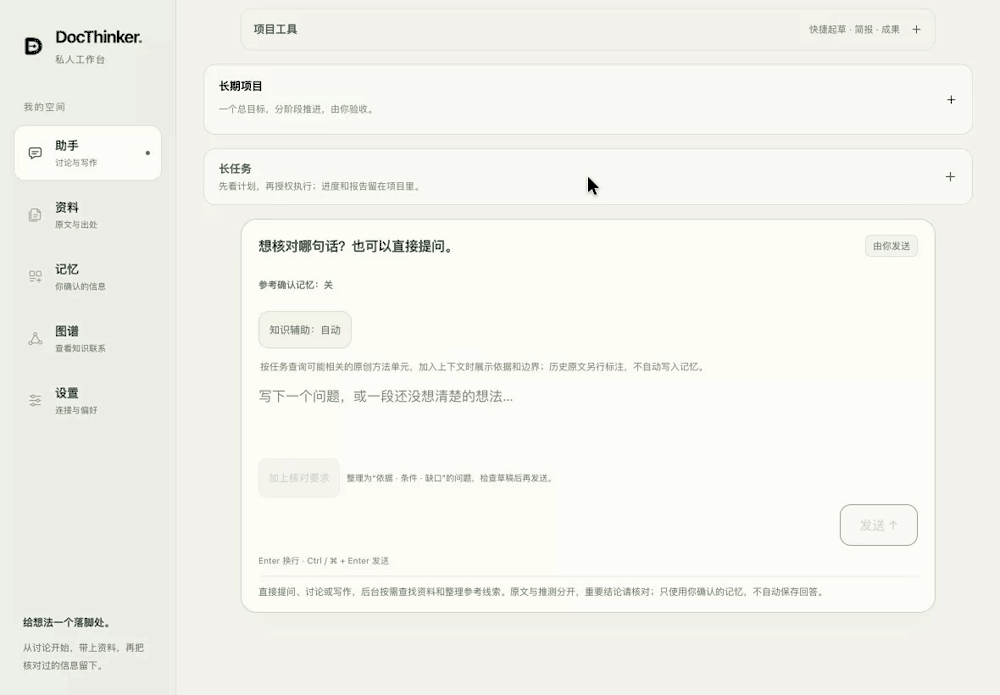

<div align="center">


# DocThinker 2.0

**A personal agent with a memory you can inspect — and work you can continue.**

[English](README.md) · [中文](README.zh-CN.md) · [Try it](#quick-start) · [Architecture](docs/ARCHITECTURE.md) · [Acceptance](docs/RELEASE_ACCEPTANCE_2026-10-20.md)

[](pyproject.toml)
[](https://github.com/Yang-Jiashu/Doc-thinker/actions/workflows/ci.yml)
[](https://arxiv.org/abs/2603.05551)
[](LICENSE)


</div>

*Original brand artwork, preserved unchanged; current runtime capabilities are shown below.*

## The current 2.0 interface, in action

Actual browser recordings of the current H5 client, not interface mockups; each clip states its data and runtime boundaries. [Recording and reproduction notes →](docs/UI_SHOWCASE.md)

### 01 · Start with your own task

<p align="center">
  <a href="docs/assets/current-ui-workspace.gif"></a>
</p>

*Offline sample: write a personal-task draft and append a recipe; no question is sent, no model is called and no task is started.*

### 02 · Keep what you confirm — and what you change

<p align="center">
  <a href="docs/assets/current-ui-memory.gif"></a>
</p>

*Isolated test service: save a preference, confirm its revision and inspect both versions through the real gateway and SQLite; no model call or automatic preference learning.*

### Explore the graph

<p align="center">
  <a href="docs/assets/current-ui-graph.gif"></a>
</p>

*Fixed offline sample: 6 nodes and 5 edges, with actual path navigation and node inspection; passages are simulated, connections are not causal proof and no graph is built from real documents here.*

### 04 · Saved progress, an explicit stop

<p align="center">
  <a href="docs/assets/current-ui-projects.gif"></a>
</p>

*Isolated test service: inspect a previously approved plan, saved steps and an explicit blocked state. The local model double cannot handle the independent review request; the UI does not present a final report or retry an uncertain call automatically. This is a failure-handling demonstration, not successful AI delivery.*

## Remember what matters. Pick up where you left off.

Your materials, confirmed memories and ongoing projects belong in one conversation — for work, everyday planning, research and writing.

[](docs/assets/docthinker-v2-overview.svg)

*Conceptual workflow, not a screenshot or benchmark; dotted connections remain unverified.*

## 01 · One Harness, a clear division of work

[](docs/assets/architecture-system.svg)

Code handles scope, search and execution budgets. Models interpret and write, with Insight Schema assisting evidence gathering in the background.

## 02 · A memory you can correct, not just accumulate

[](docs/assets/architecture-memory.svg)

**Sources are evidence; confirmed memories are personal context; relationships retain their conditions.** Correct or withdraw an input, and dependent results become stale; storage can expand while each retrieval and prompt stays bounded.

## 03 · Continue the project, not the entire transcript

[](docs/assets/architecture-task-loop.svg)

**Approve → compose → check → fill evidence gaps → revise → deliver.** Restart restores state, not permission to spend: further paid work needs approval, and changed sources invalidate only affected dependency branches.

## Historical UI — the previous version

These original desktop assets remain visible and unchanged; **they are not the current 2.0 interface shown above.**

### Previous chat and graph views

<p align="center">
  
  
</p>

*Previous full-desktop demonstrations; the invitation default is chat/history, with research documents and confirmed memory explicitly enabled, not full graph, voice or automatic learning.*

### Previous memory observability and GPU graph

<p align="center">
  
  
</p>

*Previous desktop demonstrations, not features enabled by default in the invitation profile; a traceable connection is not proof of causation.*

### Previous memory editor

<p align="center">
  <a href="docs/assets/ui_memory_editor_screenshot.png"></a>
</p>

*Previous memory-editing interface; the current save, revision and history flow is recorded above.*

## Original framework reference — historical

Historical diagrams are retained unchanged. The three maps above describe current runtime connections; the artwork below is not an accepted feature list for every deployment.

### Layered memory

[](docs/assets/agentic_memory_architecture.png)

*The original memory framework.*

### Document processing

<p align="center">
  <a href="docs/assets/pipeline.png"></a>
</p>

*Portrait reference diagram; click to inspect at full resolution. Full multimodal parsing is not part of the restricted invitation profile.*

### Memory lifecycle

[](docs/assets/lifecycle.png)

*How the original design organized memory over time.*

### Evolution research

[](docs/assets/multi_agent_evolution.png)

*Historical research design, not evidence that autonomous RSI is complete.*

### Graph-query reasoning

<p align="center">
  <a href="docs/assets/sparql_cot.png"></a>
</p>

*Analogy, deduction and induction supply conditional analytical leads, not new facts or proof of general causal reliability.*

## Quick start

**Explore the interface:** [build the local browser preview](#local-interface-preview) — labelled samples, no model calls or microphone access.

**Try your own material:** [deploy a private invitation instance](deploy/invite/README.md) — separate accounts, server-held API keys, HTTPS required for remote use.

**Explore the full graph:** [run the desktop workbench](#full-graph-workbench) — a separate developer profile with optional multimodal, gesture and voice components.

The invitation default is chat/history; explicitly enabling its research core adds PDF/TXT/MD, confirmed memory and approved project phases, **not** full graph growth, gesture or voice. Private hosting is not end-to-end encryption: operators and configured model providers may process submitted content.

Try a changing task: “Help me prepare next week's project review.” Add notes, confirm a preference, correct a deadline, inspect stale results, then continue an approved phase; the [long-project guide](docs/LONG_PROJECT_RUNTIME.md) explains the real workflow.

## Technical details, installation and acceptance

The integration baseline passed **7,140 backend tests on each Python version** and **999 client tests**; frozen real-model acceptance remains **accepted with caveats**, not a universal quality claim.

<details>
<summary id="local-interface-preview">Local interface preview · commands</summary>

Requires Node.js 22 and Python 3; dependency installation accesses npm.

```sh
git clone https://github.com/Yang-Jiashu/Doc-thinker.git
cd Doc-thinker/clients/mobile
npm ci --ignore-scripts
npm run build:h5
npm run preview:h5
```

Open [localhost:5175](http://127.0.0.1:5175). The default demo uses labelled sample data, does not read real documents and is not an answer-quality evaluation; use the static preview rather than a publicly exposed development server.

For invited users, follow the [Docker Compose guide](deploy/invite/README.md), including configuration, user creation and HTTPS; a source bundle does not create a public URL or grant permission to resell a model subscription. Downloaded invitation ZIPs use that guide, not full-workspace development commands.

</details>

<details>
<summary id="full-graph-workbench">Full graph workbench · developer installation</summary>

From the repository root, with Python 3.11 recommended:

```sh
python3.11 -m venv .venv
source .venv/bin/activate
python -m pip install -e ".[all]"
cp -n env.example .env
```

Configure accessible chat, embedding and optional vision models in `.env` before starting; never commit credentials. Then use two terminals with the environment activated:

```sh
# Terminal 1
python -m uvicorn docthinker.server.app:app --host 127.0.0.1 --port 8000

# Terminal 2
UI_HOST=127.0.0.1 UI_PORT=5001 python run_ui.py
```

Open [localhost:5001/query](http://127.0.0.1:5001/query) and start with TXT before heavier multimodal parsing; do not expose this original desktop service as an authenticated invitation gateway.

[Model configuration](docs/MODEL_CONFIGURATION.md) · [Graph and gestures](docs/GESTURE_INTERACTION.md) · [Optional voice](docs/VOICE_MODELS.md) · [Mobile / mini-program builds](docs/MOBILE_APP.md)

</details>

<details>
<summary>What was tested · software, real-model results and retained failures</summary>

Integration baseline: [main `0cda681`](https://github.com/Yang-Jiashu/Doc-thinker/commit/0cda681); software contracts and answer quality are different checks.

| Check | Recorded result |
|---|---|
| [Backend CI](https://github.com/Yang-Jiashu/Doc-thinker/actions/runs/39445691276) | Python 3.10 / 3.11: **7,140 passed each**, 9 optional skips each |
| [Client / product contracts](https://github.com/Yang-Jiashu/Doc-thinker/actions/runs/39445691569) | **999 client tests passed**; invitation and preservation contracts passed |
| [Long-project integration](docs/RELEASE_ACCEPTANCE_2026-10-20.md) | **30 phases, 3 restarts**; withdrawal, dependent-result invalidation and tenant isolation, using local model doubles |
| [Frozen real-model acceptance](benchmarks/runtime_algorithms/goal_evidence_staged_result_20261020.json) | **8 Step 5 Preview calls delivered** across work, home and a real paper; **accepted with caveats** |

The real-model run belongs to frozen production fingerprint `88f08e28…`, not a new run on the merged commit; reviewers found two overstrong paraphrases. It is not a held-out quality win or causal-reliability proof, and [full acceptance](docs/RELEASE_ACCEPTANCE_2026-10-20.md) retains failures, including [earlier helper regressions](benchmarks/research_real/result_evidence_trace_20261010.json).

</details>

<details>
<summary>Deployment boundaries, privacy and the research roadmap</summary>

This is a self-hosted preview, not a certified production service; memory and project storage have explicit capacity limits. Public HTTPS operation, dependency/security review, signed apps, real-phone experience and sustained customer use require deployment-specific acceptance.

Models may misinterpret sources or event relations; inspect evidence before relying on consequential conclusions. Source withdrawal suppresses future use and dependent results, but cannot erase already copied content, provider records or backups; operators and configured model providers may process submitted content, and self-hosting is not end-to-end encryption.

RSI is the research direction: independent evaluation, validated strategy adoption and complete rollback are not a finished autonomous improvement loop. See the [RSI roadmap](docs/RSI_ROADMAP.md), [runtime contract](docs/LONG_PROJECT_RUNTIME.md), [evaluation protocol](docs/SELF_EVOLUTION_EVALUATION.md) and [performance measurements](docs/PERFORMANCE_STRUCTURES_2026-10-13.md).

</details>

The shared client retains its existing  Evidence Window identity; no original logo or demonstration asset was replaced.

[Architecture and algorithms](docs/ARCHITECTURE.md) · [Insight Schema](docs/INSIGHT_RUNTIME_DESIGN.md) · [Source-grounded retrieval](docs/RESEARCH_GROUNDED_DESIGN.md) · [Memory plugin](docs/MEMORY_PLUGIN_GUIDE.md) · [Contributing](CONTRIBUTING.md)

<details>
<summary>Citation</summary>

```bibtex
@article{yang2026autothinkrag,
  title={AutothinkRAG: Complexity-Aware Control of Retrieval-Augmented Reasoning for Image-Text Interaction},
  author={Yang, Jiashu and Zhang, Chi and Wuerkaixi, Abudukelimu and Cheng, Xuxin and Liu, Cao and Zeng, Ke and Jia, Xu and Cai, Xunliang},
  journal={arXiv preprint arXiv:2603.05551},
  year={2026}
}
```

</details>

Current releases use the [PolyForm Shield License 1.0.0](LICENSE); previously MIT-licensed releases retain their original license.
