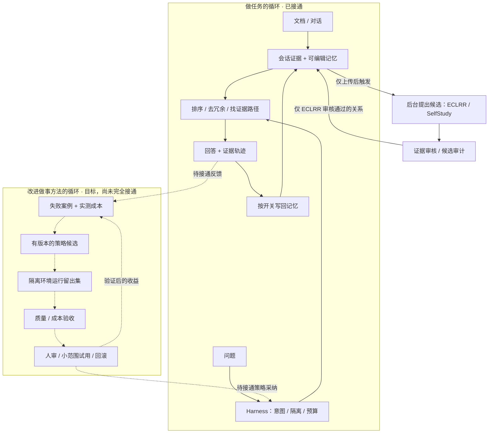

<div align="center">


# DocThinker

最新工程快照：[10 月 20 日验收与已知缺口](docs/RELEASE_ACCEPTANCE_2026-10-20.md)。个人事件已通过有界证据控制器进入正常回答和长期任务：按方向列出证据义务 → 定向补查 → 模型评估支持／反证／未知 → 绑定版本的待查与改计划建议。这不等于因果理解已验证或整体产品已达到生产质量。

2026-10-13 第二轮无损数据层优化：单快照读取、有界倒排特征、历史/证明批读之外，去掉历史 N+1 查询与热索引写锁，复用本次提示词格式和向量计算；向量的物理复用与旧候选准入分开，不减证据预算。最终 4460 项后端合同通过、5 项跳过，合成对照保持检索/提示词结果；不是模型速度或真实质量通过。见 [完整实测、冷准备开销与剩余瓶颈](docs/PERFORMANCE_STRUCTURES_2026-10-13.md)。

**从证据与记忆出发，走向可验证的递归自我改进。**

一条面向 RSI（Recursive Self-Improvement）的研究路径

[English](README.md) · [快速开始](#快速开始) · [架构](docs/ARCHITECTURE.md) · [RSI 路线图](docs/RSI_ROADMAP.md)

[](pyproject.toml)
[](https://github.com/Yang-Jiashu/Doc-thinker/actions/workflows/ci.yml)
[](https://arxiv.org/abs/2603.05551)
[](LICENSE)

</div>

如果下载的是邀请源码 ZIP，请按[邀请部署指南](deploy/invite/README.md)操作，不要套用下方完整仓库安装命令。本包仅含受限版本的构建输入与指定报告；开发测试、历史评测数据和完整图谱／语音扩展需完整工作区，不随包分发。源码包不是已经上线的网址。

## 为什么做这个项目

### 产品化方向

定位是 **personal agent（私人助手）**，不限于论文：记住用户确认的背景，关联事件与变化，整理可靠依据，继续已批准的个人项目。科研、工作和日常安排是不同应用场景。再复用到 ToB 团队工作空间；企业版还需要组织权限、共享范围和运维验收，有界任务检查点不等于通用企业作业系统。

**DocThinker 工作台：围绕你的长期项目，把资料变成能核对、能修改、能接着做的成果。** 项目要求、可编辑任务草稿和带来源状态的答案收藏连成一条工作流，不增加独立推理模式。详见[工作台设计、官方产品调研与实现边界](docs/WORKBENCH_PRODUCT_DESIGN.md)。交互改进不改变下方真实评测尚未达标的结论。

**10月13日持续研究任务：**可保存至多 6 个有依赖的分析问题，明确批准本次执行上限，暂停、重启后继续有效检查点；资料变化只让受影响问题及其下游失效。版本化报告从当前可访问的回答引用本地组装，不再增加总结模型调用。这是用户批准的有界研究 DAG，不是无人值守的多天自主研究，也不保证事实正确。[运行边界与真实项目验收流程](docs/LONG_PROJECT_RUNTIME.md)

**可追加的长期个人项目：**局部 DAG 之上现已有 Project/Phase 目录、明确批准的后续阶段和可撤回的跨阶段依赖。目前仍限制每会话 20 份文档，不是无限论文库，也不是数周无人值守执行。[已实现的分阶段流程与剩余边界](docs/LONG_PROJECT_RUNTIME.md)

本地完整图谱服务、私人移动服务、邀请内测和离线演示是不同交付形态。邀请版默认只开放聊天与历史；显式启用**有界研究核心**后，任务链是：建立项目 → 导入 PDF/TXT/MD → 正常聊天与写作、核对出处 → 确认/纠正时间化记忆 → 下次继续。记忆检索已改为搜索完整保留期的索引，不再只看最近 100 条。用户不必选择推理模式。最新实验性后台辅助按问题要点找原文、用本地模型重排并选择有限证据，不附加生成式类比、演绎或归纳结论；旧推理模块仍保留，但不代表新证据重选路径的输出。实现与测试边界见 [证据重选设计与实测](docs/RESEARCH_GROUNDED_DESIGN.md#0-2026-10-10-已实现的证据重选路径)、[核心架构](docs/ARCHITECTURE.md#有界研究核心2026-10-10) 和 [产品化设计](docs/PRODUCTIZATION.md)。

知识方法包已接入当前材料的结构检查：检查标签、重复节选及文档数量，方法的语义前提仍待核对。计划与完整方法卡共用原有预算，优先保留用户原文；它不代表方法已执行或效果已验证。[超级 Skills 的算法设计与实现边界](docs/SUPER_SKILLS.md)说明后续证据义务规划、独立评测及经验改进路线。

记忆容量随存储扩容，每次上下文保持有限；有效时间、修订和归档保存变化，删除与原文撤回会阻止后续召回。连续原句与未经语义验证的改写分开展示，类比仍是待检验假设，归纳仍是样本结论。短中文/英文关系和规则解析器尚不能理解任意论文；这里不承诺物理容量无限、公网已上线或已实现 RSI。

**成本与调度：**没有本地神经模型资产时，默认研究路径按词面和原文结构竞争窗口：最多扫描 4,096 chunks、48 候选、8 条基础来源 / 12 KB。Insight 至多再加 2 条，仍共享同一个原文预算；提名和组织共用单工作槽、零等待队列、1 秒前台等待，超时线程真实结束前仍占槽。可选神经路径使用本地嵌入、最多 48 对精排及可选查询翻译，等待上限 8 秒。两路径都不新增供应商生成调用，但有本地资源成本。正常回答最多一次生成、24,576 UTF-8 输入字节；按最终任务选择普通聊天 2,048 / 研究 8,192 输出 tokens。字节不等于计费 token。详见[默认路径及限制](docs/RESEARCH_GROUNDED_DESIGN.md#012-2026-10-12-无本地语义模型时的默认选证路径)。

**10月13日邀请版本：**无模型选证已保留局部操作条件和互补窗口，不提高上下文额度。V14b 来源核验补回真实时间冲突处理，但五次真实 Step 5 Preview 请求仍未通过验收：路线题 OFF66.25/AUTO60，设计题60/60；短报告 AUTO 在输出上限内正文为空，剩余请求按协议未发。合计51,210上报tokens，零重试。见[冻结来源复核](benchmarks/research_real/result_insight_operation_repair_v14_20261013.md)；随后软件修复不回写为这轮成功。本版是邀请内测部署源码，不是已经公网发布或商用认证的产品，软件、质量和部署边界见[验收记录](docs/RELEASE_ACCEPTANCE_2026-10-12.md)。

用户明确要求试点时，同一次生成使用有限 TrialSpec：程序检查固定对照、全部计划问题分母，以及互不重叠且没有空档的判定区间，再渲染方案表，不加模型调用。未知或格式不合规的输出保留为草稿。这只验证内部结构，不验证正文事实、实验质量或执行许可，也不是新增真实模型质量通过；正常聊天不变。见[交付合同](docs/RESEARCH_GROUNDED_DESIGN.md#015-2026-10-13-把明确要求的试点交付变成有限对象)。

**历史神经辅助 V6 质量边界（2026-10-10）：**冻结版本完成真实 Step 5 Preview 的 12 组主问题及 1 组独立诊断，共 26 次调用、150,906 个上报 tokens。两位独立代理盲评（非人工专家）显示，8 道开发回归题均分 78.91 → 81.95，完整关键事实 9/23 → 20/23；但两篇新论文的 4 道保留题退步：均分 81.72 → 75.47，完整事实 7/13 → 6/13。总体均分 79.84 → 79.79，平均总 tokens 5743 → 5841.75、完整回答耗时 33.98 → 42.29 秒。开发组存在中心实验控制错误且来源噪声增加；新论文组同时未通过质量、证据和 token 门槛。2 次 ON 超时回退仍计入主结果，另有 10 次辅助实际改变证据。**两个分组均未通过验收，实验开关默认关闭不变。**评审呈现顺序未完全平衡，小样本也不是泛化证明，详见 [V6 报告](benchmarks/research_real/result_evidence_trace_20261010.json)。实验输出上限 8192 未改变产品默认 2048。

**历史 V5 边界：**真实 Step 5 Preview + 四篇论文的 8 组配对先导中，新辅助平均总 tokens 减少约 44.6%，但 AI 盲评均分 74.06 → 71.41、完整关键事实覆盖 9/23 → 6/23，**未通过质量放行**。这不是关闭辅助后的测试，也不能宣称已解决漏召回。服务的实验开关默认仍关闭，未据此发布质量提升。实验输出上限为 8192，不等同于产品默认；完整成本、失败案例及小样本限制见[实验报告](benchmarks/research_real/result_faceted_20261010.json)。

**上线基础（2026-10-10）**：邀请聊天已接入单次请求回执、断线结果查询、重复提交去重、确定性输入/输出预算与持久日配额；回答可带有限来源片段显式复制。`python deploy/invite/manage.py preflight` 可检查本地配置和 H5 资产；真实 HTTPS、模型许可/余额、手机联调、恢复与费用限额仍须验收。详见 [邀请内测边界](docs/INVITE_WEB_BETA.md) 和 [部署说明](deploy/invite/README.md)。

**DocThinker 的最终目标是探索 RSI，不只是做一个文档聊天工具，也不只是让知识图谱越来越大。** 我们要研究的是：系统能否从任务中积累经验，提出对自身工作方法的改动，验证改动确实有用，再利用这些结果提高下一轮的改进能力。

文档问答是起点与试验场。可追溯的证据、可编辑的记忆、有预算的检索、后台知识整理，为这条路径提供基础；但“知识更多”不自动等于“能力更强”。

**现在能运行：**文档问答、分层记忆、受控推理路径、候选生成、离线质量与成本验收。**下一个里程碑：**候选版本化 → 隔离评测 → 审核采纳 → 可回滚。这个部署闭环尚未全部接通，具体交付标准见 [RSI 路线图](docs/RSI_ROADMAP.md)。

## 现在可以用它做什么

| 你想做的事 | 系统如何处理 |
|---|---|
| 按原文回答 | 检索原始证据；缺证据时说明缺口，不靠补边凑答案 |
| 理清多步关系 | 在有限图邻域中寻找有方向、连续的路径，展示来源；连通不等于因果成立 |
| 探索新思路 | 用图排序与去冗余选择关联线索，保留其“假设”身份 |
| 记住规则和偏好 | 长期记忆可查看、编辑、删除和版本恢复，并通过独立开关控制 |
| 做对照实验 | 分别关闭记忆、聊天上下文、LLM 缓存、自进化，并查看本轮策略与预算 |

文档是证据，记忆是辅助信息，模型生成的关联是候选，三者不能混为一谈。已有上传后后台学习；情景记忆的“夜间巩固”仍是独立实验流程，与上传触发不是同一个机制。

## 两个循环，一个方向



实线是已有接线，虚线是待接通的改进闭环。其中质量 / 成本验收已提供 [离线工具](docs/SELF_EVOLUTION_EVALUATION.md)，但不会代替实验执行与部署。

骨架由程序负责：隔离、筛选、路径、预算、调度、验收。LLM 负责语义提取、回答表达和可选候选生成。**第一阶段改进的是 Harness 与检索策略，不要求先改模型权重。**

## 快速开始

推荐 Python 3.11，从仓库以 editable 模式安装。解析依赖较大，首次安装与模型下载可能较慢。

```bash
git clone https://github.com/Yang-Jiashu/Doc-thinker.git
cd Doc-thinker
python3.11 -m venv .venv
source .venv/bin/activate
python -m pip install -e ".[all]"
cp -n env.example .env
```

编辑 `.env`，使用你实际可访问的服务；不要提交密钥。

| 配置 | 要检查什么 |
|---|---|
| `LLM_BINDING_HOST`、`LLM_BINDING_API_KEY`、`LLM_MODEL` | 回答模型与兼容的服务地址 |
| `KEYWORD_LLM_MODEL`、`ENTITY_EXTRACTION_LLM_MODEL` | 同一服务可用的模型；可以与回答模型相同 |
| `EMBEDDING_BINDING_HOST`、`EMBEDDING_BINDING_API_KEY`、`EMBEDDING_MODEL`、`EMBEDDING_DIM` | 输出维度必须与配置一致 |
| `VLM_MODEL` | 使用图像 / 多模态处理时可用的视觉模型 |
| `RAG_WORKDIR` | 默认 `./rag_storage_api`；长期记忆默认保存在其中的 SQLite 文件 |

启动两个终端，先只监听本机：

```bash
# 终端 1：后端
python -m uvicorn docthinker.server.app:app --host 127.0.0.1 --port 8000

# 终端 2：界面，避开 macOS 可能占用的 5000 端口
UI_HOST=127.0.0.1 UI_PORT=5001 python run_ui.py
```

打开 [对话界面](http://127.0.0.1:5001/query)、[知识图谱与记忆](http://127.0.0.1:5001/knowledge-graph) 或 [API 文档](http://127.0.0.1:8000/docs)。UI 代理默认连接本机 8000 端口。远程部署前需另行配置认证、反向代理与访问控制。

**第一次使用：**新建会话 → 上传一份 TXT → 等待处理完成 → 选择“忠实原文”提问 → 打开“回答依据”查看证据。确认文本流程后再配置 PDF / 图像处理。启动探测、上传提取和后台学习可能调用模型；查询开关不是全局停用模型的开关。

## 界面与实验

**邀请内测部署包：**网页、邀请码登录和每用户独立后台已整理为 [Docker Compose 封装](deploy/invite/README.md)。默认聊天模式只监听本机；`up --research` 配合账号的 `--research-uploads` 可启用受控论文导入、证据回答和用户确认记忆。上传/检索/记忆管理不调用模型，回答最多一次生成调用，不自动补边或学习。语音、团队共享和公网部署未在此模式开放；部署包不等于已上线服务。

**移动端开发预览：**新增[微信小程序与 Android/iOS App 工程](docs/MOBILE_APP.md)，共用 uni-app 界面，默认离线演示；可选[语音转写与答案朗读](docs/VOICE_MODELS.md)，通过独立、带访问码的私人接口连接后端。当前不是已签名安装包、已发布小程序或多客户上线版。

移动界面采用「证据之窗」品牌、暖白与墨绿设计，五个入口为**助手、资料、记忆、图谱、设置**。研究模式的资料页展示解析状态、原文和重试；记忆页只保存用户明确确认的偏好、决定与结论，可修订/删除，来源删除后相关结论失效。助手保持普通聊天与写作，不要求选择推理模式；原文出处与可选分析材料分别呈现。旧模式的会话摘要仍为只读，不混成已确认画像。[微信游客测试版](docs/WECHAT_MINIPROGRAM.md)：在 `clients/mobile` 运行 `npm run build:mp-weixin`，再把 `dist/build/mp-weixin` 导入微信开发者工具。无 AppID 可先准备本地游客工程；手机预览和体验版尚未验收，需自己的有效 AppID。

[安卓 / iPhone 主屏幕安装说明](docs/MOBILE_INSTALLATION.md)：网页 App 需部署到可信 HTTPS 地址；原生 APK/IPA 仍需账号、签名和真机验收。[设计依据与边界](docs/MOBILE_DESIGN.md) · [六个 Logo 方向](clients/mobile/public/brand/index.html)

图谱顶部可在标准与沉浸视图间切换，保留会话、搜索和选中节点。两边共用精准/演示手势算法及本机偏好；摄像头需主动开启，鼠标始终可用。详见[图谱与手势交互](docs/GESTURE_INTERACTION.md)。

**模型设置**：在 `/config` 先选服务商，再按用途搜索预设模型，不必手填 ID 与地址。目前内置 **13 个厂商/渠道、73 个条目**，保留自定义配置。整体目录核查日期仍为 2026-09-19；10-10 仅增量核对 StepFun，未全量重核其他服务商。保存后重启生效；更换嵌入模型或维度需重建索引。预设不代表账号有权限。较早的个人连通检查返回 Step Plan 403 / 普通 API 402；账户处理后，10-12 的 Insight V4 已完成 Step Plan 上六次真实 `step-5-preview` 生成，不代表其他渠道或模型已验证，更不等于质量全面达标。见[实际开发报告](benchmarks/research_real/result_insight_v4_development_review_20261012.md)及[兼容边界](docs/MODEL_CONFIGURATION.md)。

采用 Codex 风格的克制工作台：灰白侧栏、会话列表、专注的对话区域、简洁输入框，以及按需展开的证据面板。保留 DocThinker 自身标识，与 OpenAI 无隶属关系。

回答目标放在主界面：自动、忠实原文、查找路径、探索关联。检索深度与实验参数放在进阶面板，避免把“查得多”误当成“答得更可靠”。

- 四个开关分别控制，互不替代；关闭上下文不等于关闭长期记忆。
- 精简上下文默认开启；额外 LLM 补链、已审核补边参与默认关闭。
- “回答依据”展示本轮策略、预算和证据，手机上也可打开。
- “忠实原文”不使用扩展假设；普通聊天仍可使用已启用的历史和记忆。

完整参数与可复制请求见 [查询运行指南](docs/QUERY_RUNTIME.md)。

## 自进化实现到了哪一步？

| 状态 | 能力 |
|---|---|
| 已接通 | 会话隔离、分层记忆、证据检索、查询预算、受控写回与 Memory Trace |
| 已接通，效果待验证 | 上传后 ECLRR 候选审核；SelfStudy 的图修改候选仅保留审计，不覆盖原文节点描述；经验另行保存 |
| 离线工具 | 分题型、兼顾质量与成本的候选验收；只给复核建议，不自动修改线上策略 |
| 实验模块 | 情景巩固的连接、强化、衰减、剪枝；SEAL / TriGraph 等独立路径 |
| 尚未形成 | 独立评测驱动的策略晋升、完整版本回滚、持续验证的 RSI 闭环 |

**目标是在质量与成本约束下，让任务能力真正提高。** 探索模式保留有用的发散，忠实模式不被联想污染。下一阶段必须能修改并评测一种做事策略，而不只是增加关系。瓶颈见 [架构评估](docs/ARCHITECTURE.md)，实施顺序见 [RSI 路线图](docs/RSI_ROADMAP.md)。

## 效率：改了什么，还缺什么

- 在线请求有边界：上下文预算、局部图遍历、批量读取、请求内边评分复用、证据去冗余。
- 后台学习有约束：同会话上传学习合并、串行执行，不同会话限制并发；SelfStudy 增加调用次数、超时与估算 token 准入控制。
- 能用算法的步骤不额外调用生成模型：隔离检查、规则路由、PPR、MMR、路径搜索。
- 研究任务已具备批准式 DAG 检查点；仍需完善通用自主/后台作业、所有模型入口的真实费用计量、增量图更新、大数据性能实测，以及版本化—评测—采纳—回滚闭环。

这不表示“整个架构已优化完”。操作次数减少不等于真实时延或账单同比下降；大规模实验前请先看 [成本边界与验证方法](docs/ARCHITECTURE.md#效率边界与验证方法)。

## 开发与验证

```bash
python -m pip install -e ".[all,test]"
python -m pytest tests/ -q --ignore=tests/debug_db.py

# 不调用 LLM；输入格式和独立评分要求见评测指南
python -m docthinker.evaluation --baseline baseline.json --candidate candidate.json
```

只想先看新版界面，可运行 `PYTHONPATH=. python tests/ui_preview.py`，再打开 [本地预览](http://127.0.0.1:5055/query)。这是模拟数据，不连接模型、不保存真实资料，也不能用来验证回答质量。

单元测试使用模拟模型与合成证据，不证明真实回答质量或实际 token 节省。词面评分只用于初筛，不能判断反义、因果成立或真实事实支持。

## 文档导航

| 文档 | 内容 |
|---|---|
| [架构与效率](docs/ARCHITECTURE.md) | 在线 / 后台职责、成本边界、当前缺口 |
| [持续研究任务](docs/LONG_PROJECT_RUNTIME.md) | 批准式 DAG、检查点、资料失效、有界交接、报告版本与验收 |
| [RSI 路线图](docs/RSI_ROADMAP.md) | 改进对象、算法闭环、里程碑与验收条件 |
| [查询运行指南](docs/QUERY_RUNTIME.md) | 模式、开关、预算与 A/B 请求 |
| [自进化评测](docs/SELF_EVOLUTION_EVALUATION.md) | 留出集、评分标准、离线验收格式 |
| [记忆集成指南](docs/MEMORY_PLUGIN_GUIDE.md) | 将 `AgentMemoryCore` 接入其他 Agent |
| [贡献指南](CONTRIBUTING.md) | 开发协作 |

主要入口：`docthinker/harness.py` 管查询策略；`docthinker/memory_core/` 管记忆；`graphcore/` 管证据；`docthinker/server/routers/ingest.py` 管上传后的学习；`docthinker/ui/` 管界面。

## 引用与许可

```bibtex
@article{yang2026autothinkrag,
  title={AutothinkRAG: Complexity-Aware Control of Retrieval-Augmented Reasoning for Image-Text Interaction},
  author={Yang, Jiashu and Zhang, Chi and Wuerkaixi, Abudukelimu and Cheng, Xuxin and Liu, Cao and Zeng, Ke and Jia, Xu and Cai, Xunliang},
  journal={arXiv preprint arXiv:2603.05551},
  year={2026}
}
```

当前版本采用 [PolyForm Shield License 1.0.0](LICENSE)，使用与分发请遵守许可条款。历史 MIT 版本继续适用其原始许可。
