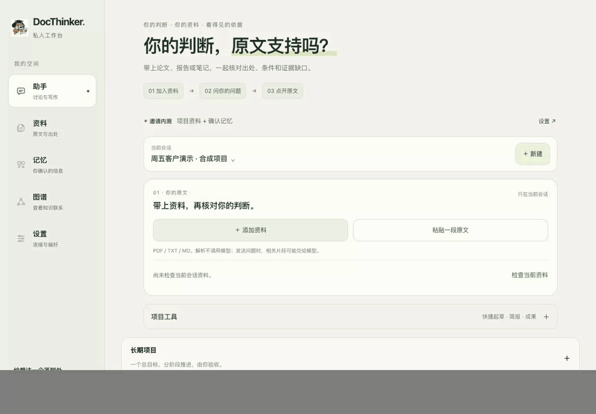
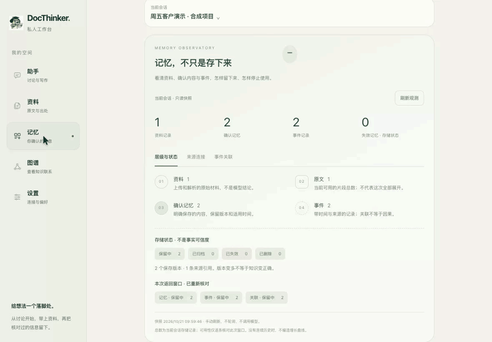
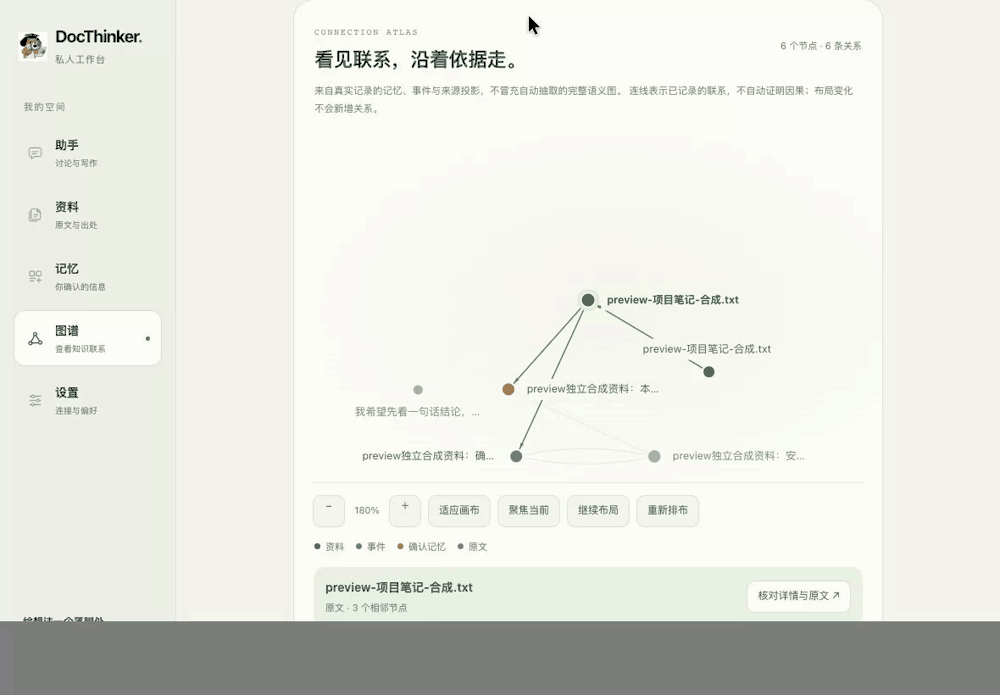

<div align="center">


# DocThinker 2.0

### 记得你，也接得住你的事。

长期记忆 · 可追溯证据 · 持续任务。一个不用每次从头认识你的私人助手。

[English](README.md) · [开始体验](#开始体验) · [看懂架构](docs/ARCHITECTURE.md) · [验收记录](docs/RELEASE_ACCEPTANCE_2026-10-20.md) · [历史素材](docs/HISTORY.md)

[](https://github.com/Yang-Jiashu/Doc-thinker/actions/workflows/ci.yml)
[](pyproject.toml)
[](LICENSE)
[](https://arxiv.org/abs/2603.05551)

</div>

## 让记忆看得见，也让依据找得到

新版 H5 把记忆观测与**同一画布的两条数据入口**接通：**记忆与来源**、**知识关系 · 完整服务**。邀请研究只开放有界来源／事件投影；连接也已开启研究能力的私人完整服务时，可在同一画布切换 GraphCore 知识关系窗口，是否可用以服务能力为准。

**看清记忆：**确认内容、来源与版本分层展示，不把模型猜测冒充事实。**沿图找依据：**点开可访问的记录与原文，不凭空制造新联系。

### 从你的要求开始，不打断思路



先写自己的要求，再打开 **项目工具 → 继续项目 → 追加到草稿**，原问题不会被覆盖。这里连接真实隔离服务，但这段操作不发送问题，也不调用模型。

### 记住了什么，为什么留下，都看得清



切换 **层级、来源、事件**，再回看一条确认记忆的版本。记录来自真实隔离存储中的合成材料；总数只属当前会话，未提供的指标保留未知，有界快照不冒充长期增长实测。

### 不必盯着一堆文字，沿着联系找依据



拖拽、缩放、选择节点，再打开它能访问的原文。录屏展示研究服务的有界来源／事件投影；私人完整服务还能在**同一画布**切换 GraphCore 知识关系窗口，按需读取节点邻域。两者都不是全库导出，也不证明因果成立；不把原 GPU 渲染器、摄像头手势说成已迁移。

三段均为真实浏览器交互、合成数据，**外部模型调用为零**；不冒充效果跑分、摄像头手势迁移、手机真机或语音验收。[录制方式与边界 →](docs/UI_SHOWCASE.md)

前版实录、原 Demo 和原框架完整保留在[默认展开的历史页](docs/HISTORY.md)，字节不变，不再代表当前产品界面。

## 不止回答这一次

[](docs/ARCHITECTURE.md)

你确认过的偏好和决定成为后续任务的背景，答案保留依据，没做完的事按批准计划继续；工作、生活、写作与研究共用同一底座。

*概念示意，非实测截图或效果跑分；虚线保留待核实身份，不把关联当成因果。*

## 一张图，看懂整个系统

[](docs/ARCHITECTURE.md)

**Harness 是执行骨架，Insight Schema 在后台补充知识与证据要求。** 检索、预算、版本和恢复交给程序，理解与表达交给兼容的模型；原完整图谱服务与邀请研究路径分开。

## 记忆不是越堆越多，而是用得对

[](docs/ARCHITECTURE.md)

原文是证据，确认记忆是个人背景，事件关系保留方向、条件与出处；类比、演绎、归纳只是后台分析线索。更正或撤回沿实际依赖使旧产物失效，未确认候选不自动写成永久记忆。

## 长程任务，不靠把聊天无限拉长

[](docs/LONG_PROJECT_RUNTIME.md)

目标拆成有检查点的阶段，写作与核对分开，缺口回到同范围补查；需要新一轮模型调用时重新批准。重启恢复状态、不偷偷续费，步骤跑完也不冒充结论正确。

*以上三图是当前有界研究路径的逻辑架构示意，不是所有产品入口的功能清单，也不构成复杂因果可靠性的证明。*

## 设计演进，完整保留

[查看原 Demo、原框架与前版界面实录 →](docs/HISTORY.md)。所有原素材在历史页默认可见、字节不变，不再用旧界面冒充当前产品。

## 开始体验

先看本地离线交互，再接自己的材料或部署私密邀请；三个入口不是同一组权限。

<details>
<summary><strong>01　无 Key 看交互：本机移动网页</strong></summary>

需要 Node.js 22 与 Python 3。克隆仓库，构建并在本机预览：

```bash
git clone https://github.com/Yang-Jiashu/Doc-thinker.git
cd Doc-thinker/clients/mobile
npm ci --ignore-scripts
npm run build:h5
npm run preview:h5
```

打开 **[本机体验入口](http://127.0.0.1:5175/)**，体验导航、资料、记忆与图谱交互。默认是离线样例，**不调用真实模型，不验证回答质量**；微信游客与 App 资源构建见[移动端指南](docs/MOBILE_APP.md)，资源构建不等于已发布小程序或签名安装包。

</details>

<details>
<summary><strong>02　给少量用户试用：私密邀请网页</strong></summary>

试用者无需安装开发环境，也无需填写模型 Key；部署者需要 Docker Compose、允许该用途的模型服务，以及对外访问时的可信 HTTPS。

[部署与创建受邀账号 →](deploy/invite/README.md)　[上线前检查 →](docs/INVITE_WEB_BETA.md)

默认只开放聊天与历史；文档、确认记忆与长期阶段需要显式启用研究核心及相应权限。邀请研究画布显示权限范围内的有界来源／事件投影，不是原 GraphCore 完整图谱、自动增长、手势或语音；不能把离线演示当作现场建图与推理效果。

下载的是邀请源码 ZIP？请按部署包指南操作；全仓库开发命令不适用于精简包，源码包也不等于已经上线的网址。

</details>

<details>
<summary><strong>03　开发者：完整图谱与桌面工作台</strong></summary>

在仓库根目录使用 Python 3.11。完整解析依赖较大，先测试 TXT，再配置 PDF／图像处理。

```bash
python3.11 -m venv .venv
source .venv/bin/activate
python -m pip install -e ".[all]"
cp -n env.example .env
```

按 `env.example` 配置实际可用的回答、嵌入与可选视觉模型，不要提交密钥。分别在两个终端运行：

```bash
# 终端 1
python -m uvicorn docthinker.server.app:app --host 127.0.0.1 --port 8000

# 终端 2
UI_HOST=127.0.0.1 UI_PORT=5001 python run_ui.py
```

[对话](http://127.0.0.1:5001/query) · [图谱与记忆](http://127.0.0.1:5001/knowledge-graph) · [API](http://127.0.0.1:8000/docs)

新建会话 → 上传 TXT → 等待处理 → 提问 → 查看回答依据。完整图谱、移动私人连接与邀请服务是不同运行模式，不能混用配置或权限，也不要直接把完整开发服务暴露到公网。

</details>

## 工程与验证

当前是**可部署、可邀请测试的工程版本**，不是已完成商用验收或 RSI 的成品。

<details>
<summary>展开查看：通过了什么、还没有证明什么</summary>

代码验收快照 [main `0cda681`](https://github.com/Yang-Jiashu/Doc-thinker/commit/0cda681) 通过 [完整 CI](https://github.com/Yang-Jiashu/Doc-thinker/actions/runs/39445691276) 与[产品契约检查](https://github.com/Yang-Jiashu/Doc-thinker/actions/runs/39445691569)：

- Python 3.10／3.11：**各 7,140 项通过、9 项可选跳过**；另有 13 个 subtest 通过。
- 客户端 **999 项通过**；三个真实浏览器视口通过；H5、微信游客及 App 资源构建通过。
- **30 阶段、3 次重启**，以及真实网关／双 worker 的续做、报告、来源撤回与租户隔离检查通过；模型为本地替身，不是回答质量测试。

真实 `step-5-preview` 的 8 次调用属于先前冻结快照，结果为 **accepted_with_caveats**，仍有转述措辞风险；后续兼容修复没有冒充新模型跑分。历史失败、token 与耗时都保留在[验收记录](docs/RELEASE_ACCEPTANCE_2026-10-20.md)。

公开 HTTPS、手机真机、签名安装包、长期客户使用与生产容量需独立验收；来源链成立不等于因果判断已被证明。模型服务商和运营者可能处理所提交内容，**不宣称端到端加密**，也不宣称无人批准的自主执行。

记忆可以随存储扩容，但单次检索、上下文与批准调用有上限。Insight Schema 把任务相关知识与证据义务接进检索、分析和交付，不是独立聊天模式，不要求每步额外调用模型，也不把知识卡、候选关联或助手旧回答升级为原文事实。

RSI 仍是研究方向：候选策略需经过独立评测、审核采纳及可回滚验证；记忆增长与候选关联**不是已实现 RSI 的证据**。[路线与验收条件 →](docs/RSI_ROADMAP.md)

```bash
python -m pip install -e ".[all,test]"
python -m pytest tests/ -q --ignore=tests/debug_db.py
python scripts/check_release_preservation.py
```

</details>

## 深入了解

[架构与算法](docs/ARCHITECTURE.md) · [长期任务](docs/LONG_PROJECT_RUNTIME.md) · [Insight Schema](docs/INSIGHT_RUNTIME_DESIGN.md) · [记忆集成](docs/MEMORY_PLUGIN_GUIDE.md) · [图谱与手势](docs/GESTURE_INTERACTION.md) · [语音](docs/VOICE_MODELS.md) · [模型配置](docs/MODEL_CONFIGURATION.md) · [评测方法](docs/SELF_EVOLUTION_EVALUATION.md) · [贡献](CONTRIBUTING.md) · [许可](LICENSE)

应用统一使用  原狗狗品牌；原图字节与历史素材继续受保护，安装图标仅做等比缩放与留白，不重新绘制。
