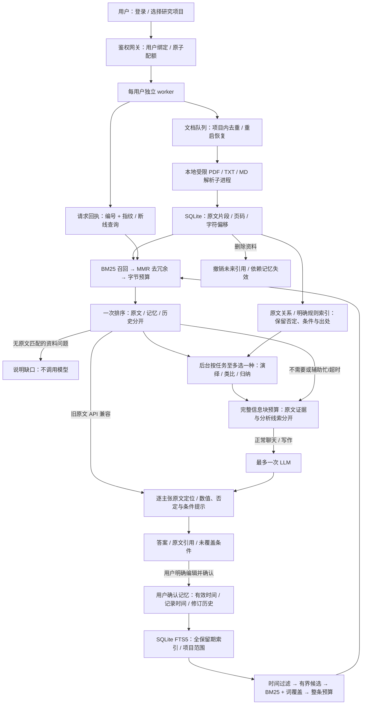
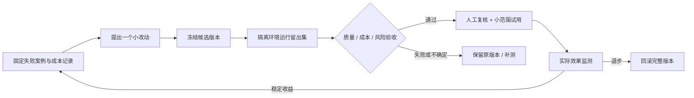

# DocThinker 2.0 · 图解架构

[中文首页](../README.zh-CN.md) · [English overview](../README.md) · [查询参数](QUERY_RUNTIME.md) · [评测协议](SELF_EVOLUTION_EVALUATION.md)

**记得你，找得到依据，也能把没做完的事接着做。** 三张图分别看系统、记忆和长期任务；点击图片可单独打开、放大。

## 01 · 一张图看全貌

实线是数据与执行流，金色虚线是辅助控制。图中主线是**显式开启的有界研究路径**：邀请模式默认仍只有聊天与历史；完整 GraphCore、手势和语音的部署边界见[体验入口](../README.zh-CN.md#开始体验)。

## 02 · 记忆如何变成有依据的回答

**原文是证据，确认记忆是个人背景，事件关系与后台推导保留条件。** 存储可以扩容，检索与上下文始终有界；一条联系有来源，不等于已经证明因果。

## 03 · 长期任务如何续做与补缺口

**恢复状态，不擅自恢复付费执行。** 核对不改写冻结草稿；缺口需要新分析时先展示计划，由用户确认、批准。来源变化只让受影响的依赖分支失效，不重做全部工作。[完整运行契约 →](LONG_PROJECT_RUNTIME.md)

## 04 · 当前 UI：同一画布，两条只读数据入口

新版 H5 图谱页在同一交互画布中区分**记忆与来源**、**知识关系 · 完整服务**。前者展示来源引用与显式事件关系，后者展示原 GraphCore 的知识关系窗口；不把两类边混成同一种语义证明。邀请研究仅开放前者；私人完整服务可读取知识关系窗口，在研究能力也开启时可切换两者。

| 页面 / 数据入口 | 当前接线与边界 |
|---|---|
| 记忆观测 | [`MemoryObservatory.vue`](../clients/mobile/src/components/MemoryObservatory.vue) → [`memory-observability.js`](../clients/mobile/src/services/memory-observability.js) → `GET /api/v1/mobile/research/observability`。读取会话存储总数及重新核对的有界返回窗口；未提供的指标保留 `null`。 |
| 来源／事件画布 | [`graph/index.vue`](../clients/mobile/src/pages/graph/index.vue) 将上述投影交给 [`GraphCanvas.vue`](../clients/mobile/src/components/GraphCanvas.vue)。点选时重新核对当前快照，再按来源 ID 调用研究 `source` 接口，最多读取三条关联原文；指针合法不等于原文支持全部结论。 |
| GraphCore 知识关系窗口 | 私人完整服务通过 [`api.js`](../clients/mobile/src/services/api.js) → `GET /api/v1/mobile/graph` 复用原图谱 `scope=summary`，摘要最多 200 节点；`focus_node` 按需读取所选节点邻域。原文沿 `/chunks` 读取，不伪造为研究来源 ID，也不一次加载全库。 |
| 原服务会话摘要 | `GET /api/v1/mobile/memory/dashboard` 只读本会话活跃摘要，标为“会话摘要”，不冒充用户确认记忆；未提供的资料、版本和事件指标不填零。该旧存储适配不对邀请开放。 |
| 后端只读投影 | [`research_observability.py`](../docthinker/server/research_observability.py) 与 [`routers/mobile.py`](../docthinker/server/routers/mobile.py) 负责鉴权后的会话范围、来源状态与窗口限制；不调用模型、不触发学习、不改写使用次数。 |

会话或身份切换会清除旧视图并丢弃迟到响应；刷新和原文读取是显式操作，不新增后台轮询。此层是 **UI 与只读投影的接通**，不改写上面 Harness、Insight、检索与推理算法，也不增加付费授权。新交互画布属于 H5；其他端保留列表导航，手机真机仍需单独验收。原 GPU 渲染器、摄像头手势与旧观测全套不因此视为已迁移；关联可追溯仍不等于因果已证明。

按图找代码

| 图中位置 | 当前实现 |
|---|---|
| 执行骨架与有界研究协调 | [`harness_runtime.py`](../docthinker/harness_runtime.py) · [`research_service.py`](../docthinker/server/research_service.py) |
| 原文与时间化记忆 | [`research_store.py`](../docthinker/server/research_store.py) · [`research_memory.py`](../docthinker/server/research_memory.py) |
| 事件与定向证据检索 | [`personal_events.py`](../docthinker/server/personal_events.py) · [`research_event_reasoning.py`](../docthinker/server/research_event_reasoning.py) |
| Insight 与后台材料组织 | [`insight_runtime.py`](../docthinker/server/insight_runtime.py) · [`research_context_assist.py`](../docthinker/server/research_context_assist.py) |
| 持久计划与检查点 | [`project_task_runtime.py`](../docthinker/server/project_task_runtime.py) · [`long_project_store.py`](../docthinker/server/long_project_store.py) |
| 核对与缺口反馈 | [`research_review_stage.py`](../docthinker/server/research_review_stage.py) · [`project_evidence_controller.py`](../docthinker/server/project_evidence_controller.py) |

三张图是代码结构示意，不是性能跑分或因果正确性证明。程序管理范围、版本、预算与调度；模型承担语义理解和表达。RSI 的独立评测、采纳与完整回滚仍是[研究路线](RSI_ROADMAP.md)，没有画成已上线功能。

原始框架图（原素材保留）

此图为保留的原框架素材；当前运行连接与产品边界以上面的三张图和下方工程参考为准。

工程参考：详细算法、预算、限制与历史设计

以下保留原有工程说明及章节锚点，便于核对具体参数。它不是第二套与图解并行的新架构。

后续算法设计及文献依据见 [基于相关工作的图谱、增长与自改进设计](RESEARCH_GROUNDED_DESIGN.md)。该文区分研究证据、实现现状和待验证方案，不表示下面列出的缺口已经修复。

## 结论

**最终方向是 RSI；现有架构是起点，还不是完整闭环。** 文档证据、可编辑记忆和可控检索适合作为可验证自我改进的基础。当前最大结构性问题是：有多个产生新知识的模块，却没有一个贯通候选版本、独立评测、策略采纳与完整回滚的控制闭环。

因此下一步不是继续增加学习模块，而是把它们收敛为受统一规则约束的候选产生器。文档问答只是第一块试验场，改进对象会从知识与检索策略逐步扩展到改进方法本身。具体见 [RSI 路线图与验收条件](RSI_ROADMAP.md)。

需要优化的目标是：在忠实性不退步的约束下，提高解决任务的能力、减少成本。边数、记忆条数、使用次数只能是过程指标，不能替代这个目标。

## 持续研究任务（2026-10-13）

研究核心外新增的是用户批准的持久 DAG，不是另一套规划/反思模型。`project_task_store.py` 保存最多 6 个原问题、各自显式写作／核对节点（合计最多 12 个分析节点）、资料清单及本地报告步骤；`project_task_runtime.py` 按依赖顺序领取、检查快照、保存检查点；`project_task_bridge.py` 复用原 ResearchService 与 RequestJournal。创建/读取/修订和本地报告不调用模型，每轮批准仍至多 6 个分析尝试；同批准 UUID 不重新补充额度，旧计划不暗加核对节点。

步骤具有明确文档范围，默认范围是整个项目。资料哈希变化按分析依赖的下游闭包失效，inventory 只作调度依赖，不使无关显式范围的完成步骤一起重算。修订号与原子 claim 防止旧页面或旧执行结果覆盖当前任务；会话实例隔离及生成后检查防止删除后复用编号被迟到回答污染。

重启恢复的是状态和检查点，不是自动付费执行：未知结果停下来读回执，已知失败须显式重置并重新批准。前一步只作有界分析线索交接，不提升为原文证据；报告保存回答引用和步骤版本，打开时核对来源后本地组装，事实与整体论证仍未语义验证。它没有为旧 SelfStudy 学习任务补持久恢复，也不是任意工具执行或完整 RSI。详细上限、交接与复杂项目验收见 [长期任务运行契约](LONG_PROJECT_RUNTIME.md)。

### 目标与证据反馈层（2026-10-20）

在上述同一 Harness 内，`project_obligation_ledger.py` 保存原始步骤问题、总目标、项目／阶段验收条件及事件发生、关系、路径、替代解释的有界完整目录。`research_review_stage.py` 将 `compose` 与 `verify` 分离：前者先保存正常正文，后者以另一次明确批准的调用核对冻结正文和原来的连续原文窗口，不重新排名或改写正文。事件与任务要求公平轮转，每次至多六个完整义务，全部未评项仍留在目录；路径核对须等待必要节点、条件、时序和替代解释门槛齐备。审核失败不抹掉原草稿，所有重试仍需显式批准。程序核对身份、方向、版本、范围与见证位置，不把模型判断包装成因果证明。

`project_evidence_controller.py` 让当前父产物缺口、事件缺口和原始要求公平竞争本地补查前沿；后继步骤只能使用原已批准资料范围。完成回答后按实际查询与当前回执绑定幂等记账，找到候选不升级验收状态。仅检查已保留窗口、扫描被截限或旧回执没有完整扫描标记时，都不得登记 `exhausted`；该状态仅表示同绑定当前本地资料已按该启发式扫描仍无候选，不代表现实中没有证据。另需一轮分析时，缺口进入真实 CAS 计划预览，由用户分别确认保存与批准执行，不自动付费重试。

完整父产物包留在宿主用于请求指纹、范围／版本校验与本地检索，不把 UUID、哈希和全部缺口编码重复灌入模型。模型只看到最多 8 条公平选出的**完整**检索提示、依赖数量和仍待查／未交付数量，紧凑视图独立限制在 4,096 UTF-8 字节；不截断原目标与验收条件。提示是待查数据，不是事实、指令或新授权。

紧凑回执以 `evidence: [{"label":"S1"}]` 指向本轮实际保留的连续原文窗口，由宿主绑定 ID、字符范围和 UTF-8 哈希；`answer_witness: {"whole_answer":true}` 绑定最终实际组装后的可见正文。旧逐字引文／偏移兼容，撤回和坏坐标仍拒绝。这些指针只证明材料或交付存在；不把整段答案的存在当作满足某条标准，也不把标签合法当作语义或因果证书。实现与验收分别见[目标与证据闭环](LONG_PROJECT_RUNTIME.md#9-目标与证据闭环检索分析交付共用同一账本)和[本轮工程记录](RELEASE_ACCEPTANCE_2026-10-20.md)。

## 有界研究核心（2026-10-10）

这是新增、显式开启的私人/邀请产品路径，不是将旧 GraphCore 全量改写。默认邀请聊天仍保持关闭上传与学习。新路径优先保证来源、项目状态与成本可控，**不自动造图、补因果边或把助手答案写成事实**。

| 骨架 | 实际算法与边界 | LLM 调用 |
|---|---|---|
| 文档拥有关系 | 用户独立存储；内容哈希只在同项目去重，同论文可独立加入另一项目 | 0 |
| 离线导入 | 持久 `queued/processing/ready/failed` 状态，重启重领本地工作；邀请部署所有 worker 共用一个解析槽，最多等 120 秒；同事件循环最多 4 个等待者、局部 FIFO；10 MiB/文件、20 文件/项目、300 页/PDF、600 片段/文件 | 0 |
| 证据选择 | 汉字双字词 + 英文词 BM25；前 40 候选 MMR；基础最多 8 原文片段，缺口补查与 Insight 共用两个追加位置，最终最多 10 段、合计 12,000 UTF-8 字节；完整窗口取舍，不为额外线索挤掉基础原文 | 0 |
| 记忆选择 | 项目隔离的 FTS5 搜索完整保留期，按有效时间筛选；最多 100 检索候选经 BM25 + 查询词覆盖选最多 20 条，普通问题最多 2 条风格偏好；最终最多 8 条/3,000 字节，整条取舍 | 0 |
| 演绎 | 只对可解析的明确观察和 Horn 规则前向推导；每个前提均须满足，保留完整证明链；否定冲突阻止相关推导，普通“导致”关系不会自动成为逻辑规则 | 0 |
| 类比 | 对齐案例中的角色和关系结构；有界映射搜索，给出对应关系、差异与待验证迁移假设；仅凭相同词语或外观相似不能成立 | 0 |
| 归纳 | 汇总可比较案例，报告支持、反例和来源组；相同内容哈希/来源不能冒充独立样本；样本模式不自动升级为普遍规律 | 0 |
| 溯源 | 主张绑定原文字符偏移；仅连续原句可标记 `exact_quote`；数值、否定、条件差异作为待核对提示，改写仍不声称语义验证 | 0 |
| 后台材料整理 | 用户正常提问；有原文锚点时由规则选择至多一种算法，最多 3 项完整线索、4,000 字节；先保留原有证据，不能为推测挤掉原文；无适合线索则跳过 | 0 |
| 回答 | 类比、演绎、归纳仅给正常写作模型提供材料，不直接替代回答；模型消息内容 ≤24,576 UTF-8 字节；普通聊天输出 ≤2,048 tokens，普通有原文回答 ≤8,192，带宿主事件／任务核对合同的回答 ≤16,384（含供应商可能的推理开销）；禁用 SDK 自动重试/模型切换。旧 `evidence` API 保留逐字摘录兼容，界面不设推理模式选择 | 正常生成最多 1；旧原文兼容 0 |
| 显式任务核对 | `review_of` 指向当前草稿／前次核对产物；原问题、正文、原文窗口、事件条件、文档范围和记忆修订精确绑定。一次核对至多六个完整义务，未评项留待后续批准；同绑定可增量合并有效见证，新反证仍阻断 | 每个已批准 verify 节点最多 1，不隐藏在写作内 |
| 可靠性 | UUID 请求回执绑定问题、开关、兼容请求字段和记忆时点；重复内容回放、断线只查状态；已知模型失败与网络结果未知区分并持久化，均不自动重发，引用/证明重读当前来源 | 0 |
| 记忆管理 | 显式确认、有效期、修订历史、归档/恢复、游标分页；乐观版本防覆盖；删除或来源撤回不因历史查询而复活 | 0 |

模块对应：`research_store.py`（时间化存储/FTS5/隔离）、`research_extract.py`（本地解析）、`research_retrieval.py`（证据选择）、`research_memory.py`（有界记忆重排）、`research_reasoning.py`（三种有界算法）、`research_evidence_index.py`（关系索引与可撤回证明）、`research_reasoning_context.py`（完整证明预算）、`research_context_assist.py`（任务路由与材料组织）、`research_prompt_budget.py`（单次排名后的完整信息块预算）、`research_scheduler.py`（可选辅助单槽）、`research_parser_gate.py`（跨进程解析单槽）、`research_provenance.py`（逐主张溯源）、`research_service.py`（协调）。它们共享既有研究 SQLite 和 mobile API，不依靠新增一串 LLM Agent。

### 聊天优先的成本与调度

类比、演绎、归纳不是用户必须理解或选择的产品模式。普通提问、写作、比较或总结先走已有证据检索；有具体原文依据且任务适合时，后台至多执行一种算法，补充案例映射、前提链或样本/反例。逐字引用、翻译、润色等任务跳过额外推导。交给模型的是分层材料：**原文是证据，确认记忆是背景，算法结果是有条件的分析线索**；不会把“推导成立”包装成“论文原文直接说过”。

每个研究服务只有一个可选辅助任务槽，**没有等待队列**。前台默认最多等 1 秒；槽忙、算法失败或超时时，跳过辅助并继续普通原文回答，不加模型调用、不自动重跑。Python 线程不能靠异步超时强杀，因此超时/请求取消后仍保留该槽，直到真实计算完成；关闭服务只停止接收新辅助任务，不无限等待它。这是等待预算而非 CPU 抢占，算法自身仍有候选、搜索与输出硬界限。移动／邀请问答外层 Harness 的总执行上限为 240 秒；继承已有更短执行生命周期时不扩展其截止时间。该 wall-clock 上限不改变普通聊天的 token 档位，也不表示要等满上限才返回。

没有本地神经资产的默认路径在同一个辅助任务槽内先做词面与原文结构的窗口竞争，再组织材料：扫描至多 4,096 chunks、提名至多 48 候选，选 8 条基础来源，缺口补查与 Insight **共用**另外 2 个位置，最终至多 10 段，全部共享 12,000 UTF-8 原文字节。结构解释任务区分“提到组件”“给出功能定义”和原文明示的有序过程，在提名及选择两层提供有界互补机会；只问指标时不自动塞入架构材料。所有维度都是软相关性代理，不是必选或支持证明。按指定文档、需求与主题的互补覆盖和重复惩罚选择连续原文，不能剪掉回指前提单留操作。最后拟合的实际来源包才决定缺词提示，不用先前排名的缺口冒充当前证据缺失。默认词面路径不具备跨语言或任意改写的召回保证；可选神经选证仍另有 8 秒等待预算。详见[算法及限制](RESEARCH_GROUNDED_DESIGN.md#012-2026-10-12-无本地语义模型时的默认选证路径)。

自然材料请求先用文件元数据绑定完整技术名称与受限 ID/日期后缀，明确资料子问优先于背景占据有限需求槽；普通短词、任意子串和正文提名不成为隐式权限或“只查这篇”的限制。编号章节提供有界继承的方法/实验角色，正文、文档绑定与请求角色一起参与窗口竞争，互补小节只加软分，不强塞固定来源。角色、段落标题及相关度都不证明事实。以“这些参与者/这些记录”等示指词形开头时保留同节前句，缺前文告警，不跨标题、图注、过滤间隔拼接；这些是保守词形与结构算法，不是完整语义分析。

同时问机制和实际验证时，在原有候选池中按可见正文区分实验设置、测法和已报告结果；机制和实验各目标族共享有限总收益，不能通过增加章节或子格获得更多份额。每文档最多两个原文有序操作对和一个有限状态维护维度参与软竞争；可见完整度与新互补信息帮助避免粗窗、近似段落锁死后续测法和方法步骤。未来计划、第三方背景、纯数值和“无限记忆”口号不充当实验证据或容量证明。权重是开发启发式，未证明最优或语义完备，仍有相同候选/来源/字节上限。系统回答合同只在用户要求设计验证时要求固定输入、可比较基线、计数判分及通过/停止/数据不足规则；建议标待确认，不自动开测，普通聊天不套试点模板。

动态 Insight 补查统一委托 `research_insight_supplement.py`：方法卡只授权一次有界查询，不能充当证据。先从实际原文建立覆盖账本，优先补用户明确需要但尚缺的粗格，再比较完整度与新增细节，避免用更多背景/方法占满两个追加槽；仍不替换基础原文。原文画像在本次请求内有限复用，不跨用户/请求，也不缓存模型回答。固定前台一秒等待与零额外生成不变；原文形态仅是启发式，回执不代表语义充分。见[目标覆盖及增量算法](RESEARCH_GROUNDED_DESIGN.md#013-2026-10-13-固定预算内的目标覆盖与增量补查)。

V14 将用户明确要求的写入／变化／读取阶段按文档绑定，并让基础选择与补查 v3 共用同一局部操作完整度：具体作用对象、同动作句条件和状态处理优于泛泛操作词，不借别句或提示模板填格。阶段与通用机制仍共享原有目标族额度，报告写作、retrieval 主题和仅指标请求不强加生命周期。实际选择允许同块不同连续窗口竞争，仍按原文块去重，不拼接引文。候选、来源、字节和调度上限未提高；这是可复验的结构启发式，不是语义证明或自动完整因果链。见[算法及边界](RESEARCH_GROUNDED_DESIGN.md#014-2026-10-13-从有操作词改成有局部操作证据)。

交付核对除引用语法、原句位置、数值及条件提示外，还比较多个英文原词是否出现在未引用的其他节选，而不在所挂标签的节选里。它只提示可能挂错引用，不自动换标签、不翻译或判定语义。改写和拟议实验的正确性仍须审阅；这一层没有新增生成请求。当前软件、真实模型和部署的验收边界统一记录在[邀请测试验收](RELEASE_ACCEPTANCE_2026-10-12.md)。

用户明确要求试点／验证方案时，`ResearchService` 在同一入口加入有限 TrialSpec 合同，仍只有一次模型生成：当前请求判定 → 完整合同计入既有预算 → `{answer, trial_spec}` → 无模型区间／类型检查 → 程序渲染试点表。未知或不合规输出只作草稿；固定两臂、全部计划问题分母和无重叠／无空档的决策域只取得内部结构回执，不能授权执行或证明正文事实。回执沿用证据记录和来源撤回机制，手机与桌面沿用普通聊天展示，不新增推理模式、Agent 或数据库。普通聊天和论文实验转述不进入此分支，Insight 关闭也不能取消用户明确要求的交付合同。V14b 后新增该结构，尚无新的真实模型效果通过结果。见[有限交付算法](RESEARCH_GROUNDED_DESIGN.md#015-2026-10-13-把明确要求的试点交付变成有限对象)。

文档解析与模型回答走不同通道。解析子进程使用部署级 `flock` 保证所有邀请 worker 合计最多一个；同一事件循环按 FIFO 等待，最多四个等待者加一个占槽/争用者，排队与跨进程争用合计最多 120 秒，解析本身另有 25 秒上限。**不承诺跨进程严格 FIFO**。超时不启动子进程或模型，不自动重交；取消会释放等待资源，已启动子进程须回收后才释放全局槽。

同一 worker 内，项目之间循环轮转、项目内 FIFO，每处理一份重新检查最多 100 条待处理作业，新项目不必等旧项目整批完成。失败作业本轮唤醒不重复尝试，其他项目仍可前进。短追问可在开启对话上下文时使用最多一条旧用户问题辅助检索，不把模型旧回答当成新证据。已有资料不会阻止普通写作；明确要求依据资料的请求缺证时才拒绝确认资料结论。

来源撤回后，依赖失效前提的分析及生成正文会整体收起，不再次付费让模型修补。后续模型上下文还会排除所有来源撤回或无法核对的历史助手内容，避免从对话历史绕过撤回；旧来源仍有效的普通历史回答不因此被篡改。

提示词在同一次排名结果上做完整信息块取舍，不再为了尝试不同预算反复扫描和排序全文。原文来源、分析线索、记忆和对话分开预算，不能剪断证明前提后仍留下结论。24,576 是实际模型消息的 UTF-8 字节上限，不是服务商计费 token。输出按宿主验证的任务合同选择 `chat` 2,048 / `grounded` 8,192 / `evidence_review` 16,384 三档；只有实际包含事件或任务审查合同才进入受审档，用户文字、项目数据里的“加 token”或模型名称不能升档。fitter 同时记录档位上限与受已有父预算约束后的实际请求上限，经请求局部 ContextVar 传到适配器；退出或取消即恢复，嵌套只能降低，不能抬高父上限。该规则适用于所有兼容模型；官方 Step 5 另按已核实能力显式请求 low 推理强度，不对未知网关猜测 thinking 参数。增大受审交付余量不增加调用、不自动重试，也不是因果正确性的算法或验收证据；真实费用、交付率和端到端时延仍需供应商 usage 与真实任务验收。

### 长时序记忆的实际契约

记忆可以在存储扩容后持续增长，不再因项目 100 条、用户 500 条或历史 5,000 版停止写入。**这不表示物理容量无限，也不把全部记忆塞入上下文。** 研究数据库默认每 worker 512 MiB，请求回执默认 256 MiB；这是数据库字节配额，原始上传文件另受文档配额约束。可以由部署者扩容；客户端不能自行提高配额。

`valid_from` / `valid_until` 是事实或决定适用的半开时间区间 `[开始,结束)`；`recorded_at` / `recorded_until` 表示系统记录这版信息的时间。`as_of` / `memory_as_of` 使用 UTC Unix 秒，读取“按目前已知修订，该时点适用什么”。它不是“模拟当时系统知道什么”的双时间旅行接口。更正只能从被更正版本的开始时间起生效；过期的新版本不会使旧版复活。

归档只隐藏默认列表，仍保留历史并参与相关问题的索引召回，结果标注归档状态。删除记忆会清空其全部文字版本并移除检索索引；撤回原文后，相关历史不能重新成为依据。当前记忆列表保留不含原文的失效占位项，方便用户知道发生了撤回。默认分页 20 条，上限 100；页面游标绑定项目、查询和时点，不是整个数据集的事务快照。

请求回执也不再受 10,000 次终身上限约束。已接受的请求 ID 与内容指纹保留；超过保留期或缓存预算时只淘汰回答回放内容，旧 ID 仍不能触发重复模型调用。存储耗尽时拒绝新的工作，扩容后继续，不悄悄丢掉去重记录。

### 推理与准确性的范围

可重复体验材料位于 `examples/research_reasoning/`，全部明确标记为合成示例，不能当作真实科研证据。分别建立项目测试，保持默认每日上传限制；不要将复制文件当成独立样本。

| 操作 | 预期行为 |
|---|---|
| 上传 `energy_chain.txt`，正常问“能源安全是否提高？请解释依据。” | 后台把 7 步条件链及完整前提作为论证线索；正常模型解释结果，删掉中间规则后不再提供最终目标已推出的线索 |
| 上传两个 `analogy_*.txt`，正常问“借鉴 Solar 的机制，帮我分析 Practice。” | 后台提供 Solar→Practice、storage→memory、reliability→performance 对应及差异；迁移建议只标为待验证，模型用它辅助写作 |
| 上传三个 `induction_*.txt`，正常问“总结 Treatment 对 risk 的共同规律和反例。” | 后台整理 2 个支持来源组和 1 个反例，保留 controlled conditions 条件；自然回答不得宣称普遍规律 |
| 保存一条偏好后更正，选择更正之前的记忆日期 | 检索当时有效版本；重新选择今天读取新版，删除后历史检索也不会复活它 |

上述后台算法不调用模型，最终正常聊天/写作最多调用配置的模型一次。没有适合的规则、预算不足或辅助超时时，仍使用原文，不要求用户重选模式。旧请求字段只为兼容和回执校验保留，不能强制把分析线索升级成事实。样例通过不代表真实论文效果通过。

解析器目前识别短中文/英文关系、明确观察和 `If … then …` / `如果…那么…` 规则。复杂量词、含糊指代、未支持的数值比较或限定语会跳过，不能据此宣称已经理解任意论文。推理候选最多 192 个主张，演绎深度最多 8，类比最多 12 个案例；证明所需来源超过 8 条/12,000 字节时整条省略，不剪掉关键前提后继续展示结论。

演绎正确性以解析和原文前提成立为条件；结构类比是待检验迁移；归纳只描述样本。来源是真实位置，不表示原文的现实结论必然正确。系统不自动把这些结果写成已确认记忆，也不自动改进自身策略；完整 RSI 的独立评测、采纳与回滚闭环仍待完成。

重要边界：词面检索不能保证语义召回完整，尤其中文提问对应纯英文论文/记忆时，需在问题中加入原文术语；尚无跨语言语义索引或自动查询翻译。概览仅采样文档首片段，不是完整论文综述。逐句出处及一致性检查不等于一般语义蕴含核验。PDF 不做 OCR，扫描件无可提取文本时明确失败；子进程有时间/资源限制，但不是 OS 安全沙箱。删除资料撤销后续检索、原文预览和依赖记忆，**不自动擦除旧答案、外部模型记录、剪贴板或备份**。[pypdf 文本提取与扫描件边界](https://pypdf.readthedocs.io/en/stable/user/extract-text.html)

离线单元测试及 `tests/manual_research_runtime_check.py` 检查了两用户/项目隔离、真实 PDF 本地解析、记忆纠正、重启恢复与删除后引用撤销；运行时联调使用本机假模型，不能替代真实模型质量、手机公网、容器或商业负载验收。部署开关见 [邀请部署](../deploy/invite/README.md#开启研究核心)。

`tests/test_research_temporal_memory_unit.py` 用 10,050 条合成记忆验证最老相关项仍能找回，并用 SQLite 指令计数阻止回归为全历史扫描；`tests/test_request_journal_unit.py` 对超过 10,000 条回执检查完成操作的有界工作量。`tests/test_research_temporal_api_unit.py` 覆盖实际 HTTP 时间查询、归档、修订、网关字段与作用域、兼容字段指纹及撤回后回放。`tests/test_research_scheduler_unit.py` 检查辅助超时/取消后仍只占一个真实线程、后续 50 次并发提交不累积任务和关闭不阻塞；解析门测试覆盖有限等待、局部 FIFO、队列上限、取消与跨进程互斥。它们是确定性回归测试，不是百万规模、商业并发负载或真实任务正确率基准。

## 原完整图谱服务的三条流程

| 流程 | 入口与职责 | 边界 |
|---|---|---|
| 在线回答 | UI → FastAPI query → `QueryHarness` → `AgentMemoryCore` / GraphCore → 答案 → 按策略写回 | 请求级开关、证据门禁、上下文预算；不应在此无限学习 |
| 上传与后台整理 | ingest → session RAG → 后台 ECLRR / SelfStudy | 上传后学习不是夜间调度；查询关闭自进化不会取消已经启动的任务 |
| 离线实验与验收 | Neuro consolidation、SEAL/TriGraph 是各自的实验路径；外部 A/B 结果可输入 `assess_evolution_trial` | 实验模块没有直接连接离线门禁；巩固与 TriGraph 未统一接入主 Web 流程；验收工具不自动运行评测或部署 |

当前 Flask UI 代理与 FastAPI 后端是两个进程。保留它们能降低本轮改动风险；后续如果需要简化部署，可以让同一个 API 进程服务静态前端，但应先测清路由、流式响应和文件上传兼容性。

## 骨架与 LLM 的分工

| 工作 | 当前执行者 | 是否需要生成模型 |
|---|---|---|
| 会话范围、重复检测、开关、预算 | 程序与存储层 | 否 |
| 问题类型初判 | 关键词规则；不确定默认忠实模式 | 否，但启发式会误判，UI 可覆盖 |
| 局部图路径、PPR 排序、MMR 去冗余 | 确定性算法 | 否；种子向量检索可能调用 embedding |
| 文档提取、图像理解、答案表达 | LLM / VLM | 是，取决于所选处理路径 |
| 缺链候选 | 可选、单次、有限输入输出的 LLM 调用 | 默认关闭 |
| 质量与成本验收 | 独立标签 + 配对统计 + 硬门槛 | 验收计算本身不调用 LLM；标签获取可能有人工或评审模型成本 |

不要给每一步都加一个 Agent。只有规则或算法不能可靠完成的语义任务，才值得额外模型调用。

## 本轮落地的收敛与提效

1. **减少重复读取。** NetworkX 批量接口每批只获取一次当前图对象。96 节点 + 256 条边的属性读取，锁 / 重载检查从 352 次变为 2 次；保持返回语义，不新增跨会话缓存。
2. **减少重复评分。** 同一次路径搜索预计算每条边的质量；四边链回归样例的评分次数从 48 变为 4，输出路径一致。PPR 的出边权重和每节点只算一次。
3. **独立 I/O 并行。** 节点和边属性同时读取；失败时取消并等待同伴任务。空种子不读图，达到预算后停止无效扩张。
4. **自学产物不覆盖证据。** SelfStudy 的实体注释、摘要节点、矛盾提示和新边写入审计文件，标记 `audit_only` / `query_eligible=false`，不改原始节点描述。
5. **使用频次不等于事实。** Expanded 候选被答案提到可以增加活跃度，但不能因此自动覆盖原节点、去掉候选标签、生成正式共现边。推导关系的受控晋升保留单独的 ECLRR 门禁与写回路径；原文提取不走这条路径，单独的 Judge 角色也不等于独立评测。
6. **独立验收而非自评分晋升。** 新离线工具按忠实、路径、探索分别检查质量、无依据主张、失败、tokens 和耗时；平均收益不能掩盖某类问题退步。

以上操作数是确定性测试结果，不是实际请求加速比。真实时延还取决于网络、embedding、模型生成与文档规模；真实 token 节省需用 provider usage 计量。

既有被污染的描述、历史已晋升节点不会自动被清理。修复防止新的旁路写入；修复历史数据应先备份，再从原文重建或逐项审查。

## 效率边界与验证方法

旧图谱路径的后台调度按会话合并上传后的学习请求：同会话串行，执行中的重复请求最多保留一次待重跑，不同会话限制同时运行数量。任务由应用生命周期持有并在关闭时取消、等待；它不是持久化队列，进程重启后不会恢复未完成学习。不要与新增用户批准的持久研究 DAG 混称：后者保存问题检查点，但不接管这条学习管线。

SelfStudy 的调用封装负责 P1–P6 直接生成调用的估算输入 / 输出预算、调用次数、单次超时；上传的审计模式复用一次图读取，避免每轮无意义重读。计量是保守估算，不是服务商账单；它不覆盖整个上传解析、embedding、ECLRR 或其他模型入口。

上传 SelfStudy 的辅助检索改为固定图快照的词面匹配与来源 chunk 批读，不再经由带隐式关键词 LLM 的查询管线。它降低后台成本，但语义召回弱于向量检索；主用户查询不受影响。节点 / 关系按完整记录选择，超长记录整条略过；chunk 摘录保留来源、字符偏移和截断标记。默认自学最多 24 次直接生成调用、每次预留 2,048 输出 token、单次超时 30 秒；上传路径总估算准入预算为 30,000。模型回调不支持输出上限时，无法预先保证服务商实际输出，只能在收到结果后终止后续工作。

超时依赖模型回调协作取消，不能硬终止持续不响应取消的调用；晚返回不会被判为成功。每次 `run_session` 的用量应读取对应结果的 `llm_usage`；`last_llm_usage` 只是最后完成操作的共享快照。后台日志展示停止原因和用量，仍不是持久化的费用账本。

24 次指直接模型回调次数，不等于服务商请求数：底层重试、多模型回退尚未逐次计量。即使回调接受 `max_tokens`，也只能记录“已请求限制”，不能证明服务商执行了上限。

| 环节 | 已做 | 仍需测量 / 改进 |
|---|---|---|
| 请求热路径 | 局部图预算、批量 I/O、请求内评分复用、精简上下文 | 大图内存、p50 / p95 时延、不同文档规模下的真实质量与费用 |
| 后台学习 | 同会话请求合并、串行、跨会话限并发；SelfStudy 准入预算 | 可恢复作业、统一 usage 账本、ECLRR 端到端预算、异常重试策略 |
| 数据一致性 | session 范围隔离、候选审计不覆盖原文 | 上传仍可能与学习读取并行；尚无图 / 向量 / 记忆的一致性版本快照 |
| 文档与图更新 | 已有分块、持久存储与查询缓存 | 增量提取、图变化版本驱动的缓存失效、批量上传的稳定性基准 |
| 部署与研究模块 | 主路径保留 QueryHarness + AgentMemoryCore + GraphCore | Flask / FastAPI 双进程、独立实验模块的边界与依赖仍可精简 |

下一轮性能验收应固定数据快照、服务商、模型、采样配置和查询开关；记录冷 / 热缓存的 p50 / p95、真实 usage、峰值内存、后台队列数、失败率，并分忠实 / 路径 / 探索检查质量。**尚未完成这组真实负载测量，不能宣称“全架构已经高效”。**

## 通向完整 RSI 的关键缺口

“整理更多记忆”是状态更新；“下一轮更会解决问题”才是能力改进；“连改进方法本身也能被可靠改进”才涉及递归。当前代码缺少以下闭环：

| 缺口 | 现状 | 下一步 |
|---|---|---|
| 改进对象没有统一版本 | 图、记忆、prompt、检索参数分散 | 一次实验记录唯一候选版本与父版本；先只优化参数 / 检索策略 |
| 审核不等于独立验证 | ECLRR Generator 与 Judge 角色分开，但上传接线使用同一模型函数 | 固定独立评测集 / rubric；候选生成不能看到留出答案 |
| 评测尚未驱动部署 | 原词面评分无法识别否定与因果；新工具只给建议 | 先人审采纳，再设计可回退的小流量策略切换 |
| 恢复只是局部 | SQLite 记忆有 revision / restore；ECLRR 有写入异常补偿 | 给整轮图、向量、策略更新做一致性快照，验证质量回退 |
| 后台学习作业不耐重启 | SelfStudy 仍是进程内调度；另有用户批准的研究 DAG 检查点，但未接管学习管线 | 为学习作业增加恢复和全入口费用账本；不把研究任务状态当自动自改进闭环 |
| 经验没有完整反馈到策略 | SelfStudy 保存经验，但相关性检索 / 有用性反馈未形成主流程闭环 | 用独立收益记录训练或选择下一轮策略，而非奖励候选数量 |

本轮**没有**启用自动改代码、改模型权重或自动部署，也没有增加常驻夜间任务。离线验收不能替代这些缺失模块，更不能证明持续自我改进已经发生。

## 下一阶段：最小可验证改进闭环（设计，尚未完整实现）

先把“一个改动确实有用”做扎实，再尝试自动提出下一轮改动。这样可以促进可控的系统级自我改进研究，同时避免把反复生成的错误当成学习成果。

## 研究参照

此处的 RSI 判断是对仓库调用链的工程分析，不是论文结果复现。DGM 用修改 Agent 代码与实证评测研究自我改进；SEAL 研究生成自适应数据与模型更新。仓库中的同名 `SEAL` 模块只代表本项目实现，不能据此声称复现这些能力。参见 [DGM 原论文](https://arxiv.org/abs/2505.22954)、[SEAL 原论文](https://arxiv.org/abs/2506.10943)。

