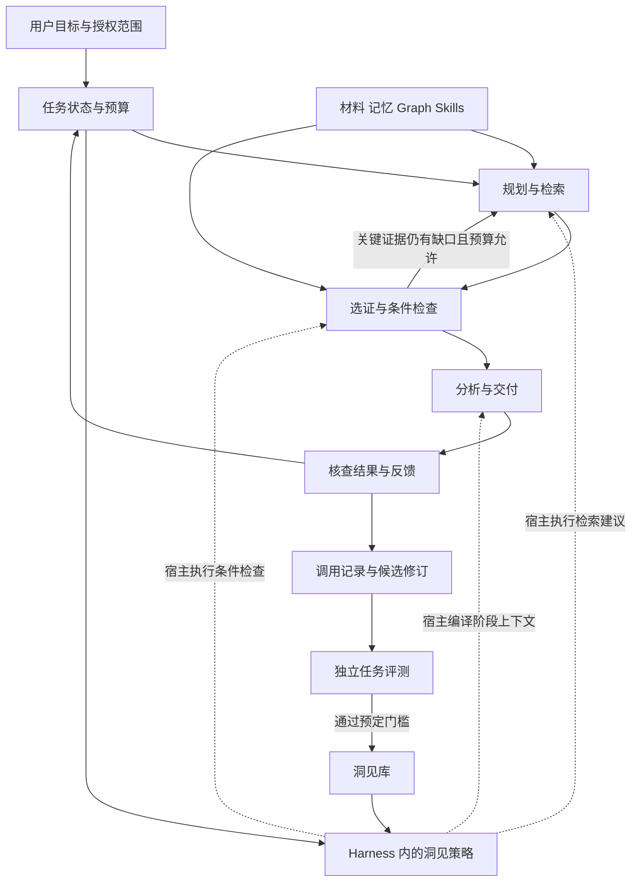

# Insight Schema 动态注入设计

DocThinker 的目标是让长期积累的经验参与当前任务的决策。系统根据目标、材料和执行结果，在适合的阶段调用少量洞见，影响计划、检索、分析、核查和交付，再根据结果修订这些经验。

本设计采用“洞见引导的智能体架构”，英文描述为 **Insight-guided Agent Architecture**。Agent 负责整体任务；**Insight Schema** 是可复用的洞见结构；**Insight Runtime** 是 Harness 内按阶段选择洞见、提出动作并记录效果的策略组件。Harness 统一负责执行、预算和生命周期。这些名称是本项目的设计用语。

本文包含已实现的第一版和后续研究方案。第一版已统一普通、流式、移动查询的运行所有者，并在研究/写作服务接入检索、分析、交付三个阶段；反馈晋升、持久任务恢复及实际回答质量收益仍需后续实现或评测。[方法卡实现](SUPER_SKILLS.md) 保留了知识资源的能力与边界。

Harness 的职责收敛、Codex 开源实现的具体借鉴点和公开接入边界见 [Codex Harness 源码参考与接入设计](CODEX_HARNESS_REFERENCE.md)。当前目标是在现有 Harness 上实现阶段策略，并为可选执行后端保留适配接口。

## 当前实现边界

`docthinker/harness_runtime.py` 提供唯一的请求内运行所有者。普通查询和流式查询共享准备、分发和完成步骤；移动端请求账本保留幂等及结果未知时不自动重试的行为。直接调用 ResearchService 也进入同一 Harness，嵌套调用复用既有运行，跨会话嵌套被拒绝。执行仍使用原有模型 callable，不依赖特定厂商或 Codex Responses 协议。

`server/insight_schema.py` 将现有、已按任务选择的方法卡冻结为带内容版本的 Schema；`server/insight_runtime.py` 只提出有界动作，不自行调用模型、读取私有资料或写入事实。

| 阶段 | 第一版实际行为 | 明确限制 |
|---|---|---|
| 检索 | 最多两个任务绑定维度，合并为一次本地补查；保留原证据，仅在剩余预算内追加至多两段原文 | 最多扫描256段；新增原文不超过2400 UTF-8字节，总来源预算不超过12000字节；词面匹配和相邻段不证明语义相关性 |
| 分析 | 按最终保留的来源及方法标签重新编译阶段核查建议 | 与完整方法卡共享3500字节，洞见块不超过1200字节；低排名方法整卡省略，不删其条件后继续使用；未知前提仍未知 |
| 交付 | 本地检查来源状态、引用标签、结构缺口；保存版本、动作、实际补查结果和输入状态 | 不增加评审模型调用，不宣称程序证明了结论或模型执行了建议 |

`insight_mode=off` 可单独停用多阶段机制，保留原写作前的方法卡，供受控 A/B 使用。`knowledge_skill_mode=off` 同时关闭知识卡和洞见。原文摘录模式不启用洞见。`context_assistance_enabled=False` 沿用旧语义，只关闭检索辅助，不等于关闭所有方法上下文。

调用记录随已有回答依据存储保存。依赖来源撤回后，回答、历史和状态回放都重新核对并隐藏失效的派生分析，不让旧内容进入后续上下文。记录区分已提案、实际补查、进入模型输入和结构检查；没有把这些状态写成“效果已证实”。

本轮事件为最多64条的进程内运行记录，`durable=False`。没有新增持久队列、HTTP取消/任务续跑接口、跨端事件游标、夜间经验自动晋升或 Codex 后端。移动安全研究路径的 SSE 适配完整答案，尚非逐 token 流。旧 Graph 查询已共用运行核心，但三阶段 Insight 的证据契约目前只在 ResearchService 中执行。

本版保持研究服务的一次回答模型调用，不涉及多次模型采样之间的增量注入或历史压缩重建；这些仍属于后续长任务机制。局部取消和超时会停止等待并记录真实状态，不保证撤销已经提交给厂商的请求或终止 Python 工作线程。

新增离线回归位于 `test_harness_runtime_unit.py`、`test_harness_transport_unit.py`、`test_insight_runtime_unit.py`、`test_insight_prompt_budget_unit.py` 和 `test_insight_service_unit.py`。测试验证运行、预算、真实本地检索及撤回行为；测试中的模型替身不能证明真实模型的答案质量增益。后文 A/B/C/D 质量实验仍作为独立验收任务。

2026-10-12 最终相关回归：后端 2642 passed、4 skipped；移动端/网页客户端 767 passed。后端范围为 research、knowledge skill、method planner、Insight、Harness、query、mobile、request journal、provider presets 及 Step 请求检查；并非整个仓库所有测试。字节预算不能替代厂商实测 token 或账单，本次没有付费模型调用。

## 核心目标与分工

10月13日增量：决策方法包 v2 的阶段门槛要求同口径基线/对照、样本期限、指标测法及通过/停止/数据不足条件；建议阈值保留待确认标识。动态检查与完整卡仍共享原预算，不增加模型或自动执行权限。移动端当前目录使用 v2，旧 v1 仅按历史快照回放；未知版本拒绝。最新软件回归与真实论文结果以[邀请测试验收](RELEASE_ACCEPTANCE_2026-10-12.md)为准，不用上方早期测试数量代表当前状态，也不把动态提示存在当作模型实际遵守。

设计假设是：将经验压缩为保留条件和出处的洞见，再主动选择何时使用，并通过结果修正，能提高长期任务的完成质量。压缩质量、主动选择和反馈校验需要分别验证；增加记忆条目或调用次数不能证明收益。

| 部件 | 保存或负责什么 | 在一次任务中的作用 |
|---|---|---|
| 材料与长期记忆 | 原文、用户确认的信息、偏好、事件及时间范围 | 提供事实依据和个人背景 |
| Graph | 实体、条件、来源依赖及关系索引 | 查找连接材料、条件和反例；维护派生项的失效依赖 |
| Skills | 方法说明、工具、参考知识和交付模板 | 完成具体操作 |
| Insight Schema | 有条件的解释或方法、来源、适用阶段与允许干预 | 帮助决定关注什么、查什么、怎样组织和核查 |
| Harness 与其 Insight 策略 | 宿主持有任务状态、预算、执行与回执；策略提供候选与动作建议 | 在同一生命周期内决定是否应用洞见、检查结果和停止 |

用户继续正常聊天、写作和安排任务。类比用于寻找可迁移结构，演绎用于在明确前提下推导，归纳用于提炼或修订候选经验；三者是后台方法。

## Harness 兼容契约

一次运行由一个服务端所有者管理。QueryHarness 保留策略准备职责，统一的 Harness Runtime 管理研究服务与各传输入口的生命周期，避免嵌套生成循环。

洞见接口采用 `on_stage(stage, readonly_snapshot) -> Proposal`：输入是本阶段任务、来源、模型和洞见版本的只读快照；输出是动作申请、上下文变化及检查要求。Harness 验证并执行申请，插件不自行启动模型或后台循环。这个接口是本项目的拟议契约，不是 Codex 的原生 API。

每一步冻结所用版本，下一步再接收用户纠正和新材料。活跃洞见按稳定标识比较内容变化，避免重复注入；历史压缩后重新装入当前有效信息。来源撤回需重建后续模型上下文，数据库里标记失效不能代替这一操作。

多端读取同一组运行事件，区分开始、步骤完成、失败、取消和结果未知。重连读取结果、恢复会话与恢复执行分别验证。现有请求账本提供结果回放，不代表已实现长期任务的持久续跑。

## 整体流程



主动性由任务状态的变化触发，例如新材料、用户纠正、关键条件未知、执行失败，或发现能改善交付的机会。它既可以补缺口，也可以提前选择更合适的比较方法、材料和交付结构。夜间整理复用同一套任务预算和调用记录，定时唤醒本身不构成持续工作的理由。

## 两个核心对象

### Insight Schema

一个 Schema 保存可重复使用的经验，以及使用这份经验的约定。方法类洞见可以提供核查方式；解释类洞见可以提出有条件的预测。解释的真假、方法的适用性和历史使用效果分别记录。

| 字段组 | 内容 |
|---|---|
| 身份与范围 | id、版本、用户或项目范围、共享权限、有效时间 |
| 洞见内容 | 方法或条件性解释、变量、适用对象和失效条件 |
| 证据依赖 | 支持材料、反例、竞争解释、原文或执行记录定位 |
| 应用约定 | 适用阶段、触发条件、需要绑定的事实、允许的动作及结果检查 |
| 生命周期 | 候选、试验、启用、暂停、撤销及修订历史 |
| 效果记录 | 在何种任务、模型和预算下观察到什么收益及失败 |

`启用` 表示允许用于规定的任务，不表示其中的解释已成为事实。用户偏好仍保存在个人记忆中，不能通过用户喜欢某种答案而提高事实判断的可信程度。

示例对象的逻辑内容：

```yaml
id: compare-study-conditions
version: 1
kind: method
insight: 比较研究结论时，先核对对象、实验条件和指标口径。
scope: 当前项目可访问材料
stages: [before_retrieval, after_evidence, before_delivery]
requires:
  - 当前任务涉及研究比较
  - 使用的材料可访问且来源有效
effects:
  - propose_search_dimensions: [对象, 实验条件, 指标口径]
  - add_check: 比较条件是否一致
  - qualify_claim: 条件未核对时保留可比性限制
stop_conditions:
  - 当前任务仅要求逐字摘录或翻译
validation:
  status: candidate
  semantic_applicability: pending_review
```

此例声明的是方法，不提供任何具体论文结论的事实证据。自然语言字段需要绑定和审查后才能影响对应决策；将字段保存为 JSON 或 YAML 不会自动产生推理能力。

### 本次调用记录 Activation

每次调用保存 Schema 的确切版本、任务阶段、绑定的来源、前提检查、申请的动作、实际执行的动作、成本和结果。调用记录区分“选中”“已放入输入”“已执行”“结果已检查”；只放入 prompt 不能证明模型采用了方法。

任务状态继续由现有的请求、检索 plan 和执行回执承载，增加阶段、待核对项与剩余预算的视图。初版无需引入另一个独立 Agent、规划服务或消息系统。

## 洞见如何进入工作流程

| 时机 | 输入 | 允许产生的改动 | 如何观察是否生效 |
|---|---|---|---|
| 规划和检索前 | 用户目标、已确认背景、任务约束 | 检索维度、比较轴、待核对项 | 实际查询或计划中是否出现相应项 |
| 选证后 | 本次真正保留的原文和来源状态 | 条件绑定、反例查找、一次定向补证申请 | 是否找到相关节选、关键条件是否得到核对 |
| 分析和写作前 | 证据、已检查条件、仍未知的前提 | 候选解释、分析顺序、结论边界和引用要求 | 交付物是否覆盖要求并保留必要条件 |
| 执行和交付后 | 结果、测试、明确用户纠正 | 失败记录、候选修订和再次核查建议 | 修订是否在独立任务上带来改进 |

Runtime 接收结构化的有限动作类型，如 `propose_query`、`add_check`、`propose_comparison`、`qualify_claim`、`propose_validation`。Harness 检查作用域和预算后执行；洞见内容不能自行修改用户目标、工具权限或已保存的事实。

程序检查精确条件，例如来源是否存在、指标单位是否明确一致、引用偏移是否合法。需要语义解释的条件保存证据和审查状态，无法判定时保留未知。未知条件允许触发核查；依赖该条件成立的结论性干预需等待核查结果。

传给模型的内容只包含本阶段需要的洞见部分及其条件、来源和限制。调用记录中保留完整版本；精简输入不能删除会改变结论含义的反例和边界。来自材料或模型提炼的内容保持数据身份，通过固定的系统策略解释。

## 选择与调度算法

初版使用可复现的有界算法，之后再用实测记录校准选择策略。

1. **过滤候选。** 先检查用户开关、用户和项目权限、有效版本、阶段以及明确的不适用条件。当前用户目标约束后续选择，历史话题不能独自激活无关洞见。
2. **检索经验。** 对目标、当前阶段和待核对项做低成本检索，复用词面或已有本地向量索引。只对少量候选读取详细条件、反例和效果记录。
3. **绑定前提。** 每个条件记录满足、不满足、未知三种结果及其依据；词语重合只用于候选筛选。普通因果描述不能直接变成逻辑蕴含规则。
4. **选择动作。** 把候选洞见转成具体的动作申请，按边际收益与成本排序，逐个加入当前预算，扣除重复覆盖，排除互相冲突的动作。保留不添加动作这一选项。
5. **执行并记录。** 合并同类查询和检查，调用现有工具；记录实际改动和新取得的证据。出现新的任务状态后，才重新评估相关候选。
6. **停止或继续。** 按动作对应的验收项判断进展：补证看是否找到新的相关材料，计划看是否补齐必要步骤，交付检查看是否发现或修正具体问题。无进展的动作不原样重复；目标已满足、相关检查完成、没有值得执行的剩余动作、达到预算或剩余前提无法核查时结束本轮。

可作为起点的排序式为：

`候选动作得分 = 预计任务改进 + 预计减少的关键不确定性 − 执行成本 − 重复信息 − 出错及打扰成本`

这些是需要统一尺度和校准权重的排序特征，不能把分数解释成真实成功概率或已知信息增益。冷启动按覆盖的明确检查项和保守成本排序，未知的历史收益不填成正值。有足够独立评测记录后，再估计不同任务下的边际效用。

Graph 用于查找连接关键事实的材料和出处。路径上的每一步仍须核对关系方向、条件和来源；缺失一跳形成待查项，不能靠新增推测边使路径看起来完整。多张洞见产生的动作在一个任务预算中竞争，避免每张洞见独自扩展图谱。

## 成本与主动工作的边界

初版实验参数可设为每阶段最多两项动作、每次请求最多三个不同 Schema、至多一轮定向补证。参数是待评测起点，须通过质量与成本曲线调整。查证动作同样消耗预算，不因其用途是检查就免费执行。

普通回答路径复用一次生成调用，洞见选择、结构检查和查询合并尽量在程序中完成。更长任务可以在任务总预算内分步生成；后台提炼的调用、token 和等待时间计入整体成本。现有字节上限继续作为输入保护，厂商返回的实际 token 使用量单独记录。

以任务、阶段、目标与约束版本、Schema 版本、输入证据版本、前提绑定状态及具体动作构成调用指纹，防止重复事件重复执行，同时允许用户纠正后重新判断。成功执行的动作不重复；明确失败的动作按失败原因和剩余重试预算处理；结果未知的外部操作先查询执行状态。来源删除或版本变化使相关缓存失效。前台任务优先；后台任务按需合并、可取消，并受每用户和总服务配额约束。初期探索策略在离线或明确的试验范围内比较。

## 反馈如何形成学习

每次调用先记录预期改进及其检查方式，执行后保存观察结果。单次成功只能形成观察记录；点赞主要表达主观满意度，引用次数主要表示可见性，二者均不能单独证明某个洞见带来因果收益。

原始材料、候选解释和方法效果分别保存。同一论文的不同节选、转述及派生洞见共享来源依赖，不能冒充多个独立支持。系统使用某洞见生成的回答，不能再作为该洞见的独立证据。

用户纠正、执行失败、发现反例或出现更好的验证材料时，可以生成修订候选。修订可缩小适用范围、增加条件、拆分混在一起的经验，或撤销解释。新版本经过未参与提炼的任务评测后才进入默认使用范围；来源撤回时，依赖它的版本暂停并重新检查。旧结果保留当时版本，防止用新知识改写历史依据。

偏好变化更新个人范围内的表达和交付方式；对事实的纠正需要对应来源或明确的信息性质。每个用户、项目和公共方法库的评测与数据范围分别记录。

这一步实现的是外部经验和运行策略的持续改进。若进一步研究 RSI，还需验证系统提出的改进方法能够改善后续改进过程，并在独立任务和固定总预算下持续获得收益。

## 用户能感受到的变化

用户提出“把这些论文整理成能用于选题的报告”后，系统可以先识别比较维度，查找条件和反例，组织候选解释，再交付带来源、边界和下一步验证建议的报告。

界面围绕任务进度和产物展示，例如“已比较实验设置”“正在核对一处冲突”“还缺一项关键指标”。解释面板可展开查看建议依据、适用条件，以及本次实际使用的经验。用户可以纠正理解或停用一条经验；无需在类比、演绎、归纳之间切换。

长期记忆的产品价值体现为后续任务少重复交代背景、少重复犯错，以及交付更符合用户明确的偏好。洞见数量和图谱规模不作为用户能力等级。

## 与现有代码的对应

| 现有位置 | 已实现 | 演进方式 |
|---|---|---|
| `research_service.py` 的 `answer` | 开头选择知识卡，随后检索，写作前编译上下文 | 在检索前、选证后、交付前后调用同一 Runtime |
| `knowledge_skills.py` | 当前任务路由、BM25 方法卡检索、有界打包 | 复用候选索引，用适配器生成初始 Schema |
| `research_knowledge.py` | 将卡片绑定到实际节选，保存方法回执 | 适配阶段调用与明确版本，保留旧记录兼容 |
| `method_planner.py` | 来源结构检查；语义前提保持待核对 | 复用检查器，逐项增加明确可执行的条件检查 |
| `research_prompt_budget.py` | 完整材料和方法块预算 | 编译本阶段已选干预，记录最终实际保留内容 |
| 检索、推理、Graph 和 scheduler 模块 | 有界候选、来源、关系分析与辅助调度 | 作为 Runtime 的现有执行工具，统一任务预算 |
| `research_store.py`、请求回执和反馈存储 | 来源、版本化记忆、回答依据和用户反馈 | 增加 Schema 版本与调用记录的存储及撤销依赖 |

洞见部分增加 `insight_schema.py` 和 `insight_runtime.py` 两个核心模块。前者冻结现有卡片，后者执行有界筛选、绑定、动作申请和上下文编译。共享运行控制放在轻量 `harness_runtime.py`，不引入旧 MemoryCore 的重依赖。调用记录复用现有回答依据存储，任务状态复用现有 plan。

现有自然语言方法卡以未经效果验证的种子经验迁入。旧 `QueryHarness` 与研究服务最终共享同一调用协议；初版先在来源完整的研究服务中实现并评测，再适配旧路径。当前离线 `evaluate_method_revision` 只返回是否可进入审查，不能承担完整统计验收或自动发布。

## 实施顺序与验收

| 阶段 | 具体产物 | 验收重点 |
|---|---|---|
| 0 Harness 收敛 | 统一运行所有者、阶段快照、多端事件适配 | 普通、流式与移动路径不重复执行，旧请求与模型接口仍可用 |
| 1 调用可追踪 | Schema 适配器、阶段接口、调用记录 | 版本、来源、实际执行与预算可回放；语义未知保持未知 |
| 2 检索受洞见引导 | 检索维度、条件核查、一次定向补证 | 关键证据召回和最终质量改善；保持完整条件与来源 |
| 3 全流程使用 | 计划、分析、交付检查共享任务状态 | 不重复干预、不扩大任务范围；异常与超时可退回已有流程 |
| 4 经验修订 | 反例、候选版本、独立评测与撤销 | 新版本在保留任务中有效；失败版本可回退，来源撤回可传播 |

真实模型评测使用四组：A 为相同基础检索和记忆但关闭方法卡，B 为当前写作前静态注入，C 为固定洞见库的多阶段注入，D 为经过训练任务反馈修订后的多阶段注入。B 对 A 测内容价值，C 对 B 测多阶段机制的整体收益，D 对 C 测反馈修订的增量收益。

若要单独归因于介入时机，另做消融实验：保持相同洞见、动作、内容和预算，仅在两个均满足前提的阶段改变执行时机。选择策略、补证、条件检查和反馈修订也应分别消融，避免把整套机制的收益归给其中一个环节。

每组使用相同原始材料、解析结果、索引快照和任务，检索结果允许随算法不同而变化。固定每对实验的模型、参数、权限和总预算，并通过多次运行估计随机波动。至少覆盖 Step 5 Preview 与另一模型家族；使用真实论文和长期个人任务，按论文来源家族、用户及时间划分提炼集与保留集，防止同源材料泄漏。

质量评测同时记录任务完成度、关键证据覆盖、主张有据程度、条件与反例保留、最终交付物可用性。报告总体及任务类别表现、每题退化、输入与输出 token、后台摊销成本、总延迟、首次可用结果时间和用户返工。自动评审需配合盲评抽查；模型生成的参考答案不能作为唯一标准。

质量和成本分别画出可比较的结果，在测试前固定允许的退化边界和实用收益门槛。按独立任务组估计配对差异的区间；样本不足时保持结果不确定。当前十二对样本的离线门槛仅适合初步筛查，不能代替这一验收。

## 相关工作与待验证贡献

[Agent Skills](https://agentskills.io/specification) 已支持指令、知识、脚本、资源和按需加载。因此携带知识及自动选择方法本身不能作为新颖性依据。

[ACE](https://arxiv.org/abs/2510.04618) 研究通过生成、反思和整理持续更新上下文策略；[ReasoningBank](https://arxiv.org/abs/2509.25140) 从成功及失败经历中提炼可检索的推理经验。二者为上下文学习和经验复用提供相关基础。

[Foundations of Proactive Agents](https://arxiv.org/abs/2609.37267) 将有用任务、时间与计算资源安排、用户信任共同纳入主动助手设计，提示调度收益需要连同打扰和审阅成本评估。

本项目需要验证的研究问题是：**对同一份经验，将其绑定到实际证据并按阶段转成可记录的工作干预，是否比仅在最终 prompt 中追加方法文本，更有效地改善证据召回、交付质量和长期适应，同时控制整体成本？** 名称、目录形式和字段数量均不能替代这一对照结果。
