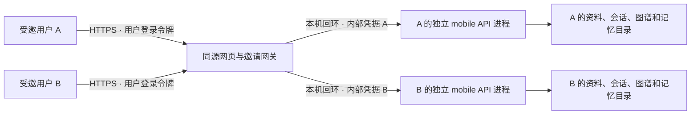

# 邀请制网页版内测

目标：几位受邀朋友在微信里打开 HTTPS 链接，用各自的账号试用。**这不是微信小程序，不会出现在小程序搜索结果里，也没有完成公网部署。** 用户于 2026-09-22 同意按这条路线推进；不据此注册企业、购买服务或默认公开电脑。

2026-10-08：已将本页的分终端启动流程封装为 [Docker Compose 部署包](../deploy/invite/README.md)，统一管理网关、固定用户后台、健康检查和密钥文件。默认仅本机入口，实际容器与公网验收边界见部署说明；没有自动开放此前禁用的功能。

2026-10-13：显式开启研究模式后新增“长任务”：用户保存有限问题/资料范围/依赖，再批准最多 1–6 次分析尝试；进度、请求身份、输入快照和引用式报告版本跨重启保留，未知结果不重发，资料变化按下游依赖使成果失效。网关按批准次数预扣问答额度，未用不退；这不是金额硬上限、自动规划或自主 RSI。当前问题负责检索，前步分析仅有界交接，不充当原文事实。详见 [持续研究任务](LONG_PROJECT_RUNTIME.md) 与 [本轮软件验收](RELEASE_ACCEPTANCE_2026-10-13.md)；默认聊天启动方式及公网未部署状态不变。

## 隔离方式



现有服务有进程级共享状态，所以内测采用固定小规模的进程隔离，不把给一个人设计的访问码直接分给所有人。最多预留五个未撤销账号；增加试用者后由运营者显式重启 worker 管理器，不允许外部请求无限创建进程。

这不是操作系统沙箱或端到端加密。服务运营者和实际处理请求的模型服务商可能接触内容；服务器账号受攻破也会影响所有实例。先使用非敏感测试资料，不能宣传“只有用户自己能看到”。

## 用户流程

1. 运营者本机创建一个预留用户名和一次性邀请码，私下交给指定试用者；链接、二维码里不放邀请码或密码。
2. 试用者打开 `https://你的域名/#/pages/invite/index`，填写预留用户名、邀请码和自己的密码。
3. 以后用用户名和密码登录，不需要输入服务器地址、模型 API key 或内部访问码。
4. 登录令牌只放当前页面内存，不写浏览器持久存储；刷新/重新打开需要登录。邀请码默认 48 小时失效，注册成功后不能复用。服务端会话最长 7 天，退出或撤销后不能继续使用。
5. 退出会清理当前身份并重新加载入口，防止把前一位用户的页面状态留给下一位。

登录和注册都不会调用模型。不提供公开自助注册、邮件找回或密码重置接口。丢失密码或邀请码时联系运营者处理，不要把口令发到聊天群。

## 当前功能边界

每个人连接安全 mobile API。**默认邀请启动器只开放聊天和历史**，不传递嵌入/重排/语音凭据。新增有界研究模式须部署者显式 `up --research`，并以 `add-user --research-uploads` 为指定新账号授权上传。它开放本地 PDF/TXT/MD 解析、原文词面检索、引用/缺口和用户确认的项目记忆，不启动旧全量 GraphCore。真实问答仍需正确配置并获准用于此用途的模型。自动补边、自学习、自动摘要写入记忆、语音和团队共享仍关闭；显式确认记忆不是自动偏好学习。开启步骤及删除边界见 [部署说明](../deploy/invite/README.md#开启研究核心)。

无后端、后端离线或模型未配置时应显示错误，不能自动用演示回答冒充真实结果。网关逐账号限制调用次数和并发；次数限额不是费用上限，单次问答的 token 消耗仍需观察。

当前限制为每人每 UTC 日最多 50 次提问、整实例每天最多 250 次提问、累计创建 100 个会话；每位邀请 worker 最多一个模型提问。网关带 ID 提问有最多四条在途转发，状态读取有独立连接和槽位；这不是供应商侧全部已发请求的全球并发证明。失败提交也可能保守计次。采用下述单机反向代理且禁用代理头信任时，登录入口的每 IP 每分钟 20 次限制按同一代理连接地址合计，不是每个真实公网用户独立计数。它适合几人的保守内测，不是大规模租户服务。

2026-10-10 上线基础补强：新邀请客户端强制使用 UUIDv4 回执；同会话/同问题/同开关的同编号仅执行一次、原子计次一次。提问等待最多 5 秒返回完成答案或 `202/running`，一次后台执行截止 110 秒；断线不会自动重发，进程丢失/异常返回 `unknown`，不能假称供应商未收费。`GET /api/v1/mobile/query/status` 只读取本人的回执；刷新历史返回当前会话近 24 小时最多五个未解决引用。状态查询使用独立连接池，四个长 POST 不能挤占它。只有 `not_found` 可用原编号/原问题显式继续；未知结果不自动续跑。旧无编号请求仍兼容，但无回执恢复保证。

邀请聊天有确定性硬请求边界：问题最多 8192 UTF-8 字节，最近最多六条历史、每条最多 2048 字节/合计最多 8192 字节，模型消息内容最多 24576 字节。普通聊天输出上限 2048 tokens；有原文入模的研究回答上限 8192，可能包含模型推理与正文；SDK 重试与失败换模型关闭。客户端保留超限完整草稿并阻止提交。模型截断、空正文和格式错误显示明确失败；网络结果不确定仍显示未知，两者都不会自动重发。字节/次数上限不是账单金额上限，供应商实际费用与 hard spend cap 仍需核对。

完成回执正文在独立 worker 的 `_system/request_journal.db`（0600）缓存最多七天，单条不超过 1 MiB，总缓存不超过 64 MiB；编号不再受终身 10,000 条门槛限制，数据库另受默认 256 MiB 活跃页准入配额。过期/回收只移除正文，不复用编号。会话历史另有原有保留方式。界面中的局部删除不等于全账号清理；新版账号可在撤销、停机后由管理员冷导出并清理 live worker 资料（含回执、反馈及独立记忆），仍保留身份墓碑，不删除备份、已下载副本或供应商记录。见[冷导出与资料清理](../deploy/invite/README.md#单账号私有导出与资料清理)。前端“带走这份回答”仅显式复制当前问题/回答/有限片段，不调用模型、不公开分享；剪贴板可能被设备中的其他应用访问。

部署前可运行 `python deploy/invite/manage.py preflight`；它验证本机配置与静态资源，不联网、不读 Key 内容、不调用 Docker/模型。真实 TLS、模型许可、手机访问、隔离、恢复与费用验收仍为待验或人工声明，详见 [部署门禁](../deploy/invite/README.md)。

2026-10-10 新增显式回答反馈：用户选择“有帮助 / 有问题”后，可填写最多 500 字符的说明并单独保存。后台只接受该用户当前会话中真实保存的助手回答 UUID，反馈保存在独立 worker 的 `_system/answer_feedback.db`（0600），不复制问答正文。反馈可覆盖修改，历史直接附带记录；不额外调用模型、不消耗提问额度、不自动训练或改变记忆。每 UTC 日最多 200 次反馈写入、每会话最多 500 条/每 worker 最多 2,000 条；旧后端无回答 ID 时不显示按钮。没有逐条反馈撤回或公开销户接口；管理员冷清理涵盖新版账号的 live 反馈数据库，不等于彻底擦除或自动保留政策。请勿在反馈中填写敏感信息。

## 本机管理与部署准备

以下是运行模板，不表示已经创建用户或对外开放。先安装项目 Python 依赖并完成 `clients/mobile` 的 `npm run build:h5`。

```sh
# 在仓库根目录。此目录必须独立于仓库、桌面工作区和任何旧资料目录。
export DOCTHINKER_INVITE_DATA_DIR="$HOME/.local/share/docthinker-invite"
export DOCTHINKER_INVITE_WEB_DIR="$PWD/clients/mobile/dist/build/h5"
# 替换为最终同源 HTTPS 地址，不含路径；仅本机测试可用 http://127.0.0.1:8088。
export DOCTHINKER_INVITE_ORIGIN='https://beta.example.com'
python -m docthinker.server.invite_admin init
python -m docthinker.server.invite_admin add-user --username alice --upstream-port 8101
```

最后一条命令只在终端输出一次邀请码，内部随机凭据留在本机 0600 数据库中，不输出给朋友。另一个用户必须用另一个固定端口。以上为默认聊天配置，不传 `--allow-uploads`；上传绑定仅在显式研究模式启动时允许，不能与旧 embedding RAG 混用。

网关与网页同源，无需 CORS 通配配置：

```sh
python -m uvicorn docthinker.server.invite_site:create_invite_site \
  --factory --host 127.0.0.1 --port 8088 --workers 1 \
  --no-access-log --no-proxy-headers
```

网关不自动启动模型 worker。另一个终端须使用同一私有数据目录，并显式提供以下环境变量；不会从仓库 `.env` 自动继承个人套餐：

- `DOCTHINKER_INVITE_DATA_DIR`：与网关一致的绝对目录。
- `LLM_VLM_HOST`：已获准使用的模型 API Base URL，公网地址必须为 HTTPS。
- `LLM_MODEL`：该 API 实际支持的模型标识。
- `LLM_BINDING_API_KEY`：通过本机受保护的环境配置注入，不放命令行参数、网页或 Git。
- `DOCTHINKER_INVITE_SHARED_MODEL_ACK`：核实服务许可后才设置为 `I_HAVE_PERMISSION_TO_SHARE`。此变量只是运营者确认，不会自动取得厂商授权。

```sh
# 先做配置检查，不调用模型；通过后再显式运行固定的用户后台。
python -m docthinker.server.invite_workers --check
python -m docthinker.server.invite_workers
```

不要为了让检查通过而虚假确认授权。上述默认聊天方式拒绝开启上传、嵌入、重排和语音配置；上传须按部署说明显式开启研究模式并逐账号授权。新增用户需显式重启；撤销用户后会停止相应后台。前台与每位用户的后台均只监听回环地址。

公网 HTTPS 代理模板见 [`deploy/invite/Caddyfile.example`](../deploy/invite/Caddyfile.example)。模板未绑定域名、申请证书或建立隧道。代理必须保留真实 Host，不能直接暴露每个用户的 worker 端口；若代理与 Mac 不在同机，中间链路也必须加密。Mac 关机后后端会不可用。正式选择托管地域、预算、备案与数据处理边界后再部署。[Caddy 自动 HTTPS](https://caddyserver.com/docs/automatic-https)、[代理说明](https://caddyserver.com/docs/caddyfile/directives/reverse_proxy)

## 撤销与剩余上线条件

```sh
python -m docthinker.server.invite_admin revoke-user --username alice
```

撤销阻止后续认证与业务请求；不等于彻底删除资料，也不保证已发送给模型的请求能撤回。需另外制定保留、备份、删除和运营联系方式，再邀请真实试用者。

上线前仍要完成：

- 确认允许多人应用使用的模型服务。当前 Step Plan 协议并未默认许可把个人订阅提供给第三方；网页版不会消除这项限制，也不能仅换 API 地址就当作已获授权。[服务协议第 3 节](https://platform.stepfun.com/docs/zh/step-plan/paid-service-agreement)
- 确认托管或加密隧道方案、实际费用、有效 HTTPS 地址及相应备案/运营要求；个人可以做网页内测不等于所有公开运营都免资质或备案。
- 两个独立账号真机验证同名会话编号不串对话、退出/撤销失效、离线/超时提示、上传/语音禁用状态；不能只凭模拟测试宣布真实链路可用。
- 配置与实际一致的隐私说明、试用规则及联系/删除途径；不要默认开启尚未验收的长期记忆和自进化功能。

本轮不代购、不自动部署，不把密钥、邀请码或真实资料提交 Git。

## 本轮验收记录（2026-09-22）

- Python 测试：831 通过、1 跳过、9 个子测试通过。存在测试依赖弃用警告。
- 移动端测试：248 通过；H5、微信小程序和 App 前端构建通过。构建成功不代表小程序已发布或原生安装包已签名。
- 双后台联调：两个真实独立 worker 均创建 `#00001`，历史和发送给模型的上下文不串；退出/撤销后请求被拒绝。使用本机模拟模型，没有调用真实厂商 API。复测命令：`python -m tests.manual_invite_isolation_check`。
- 浏览器移动视口：完成登录、聊天、功能禁用、退出、刷新重新登录检查，未见控制台错误。使用可销毁的本机模拟服务，不是手机微信真机验收。
- 尚未配置公网域名或 TLS 证书；Caddy 文件仅为模板，未用 Caddy 二进制验证，也未替代真实上线验收。
