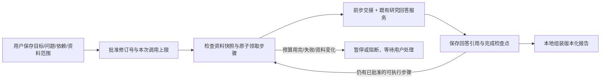
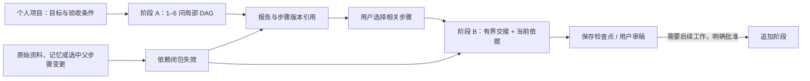

# 长期个人项目：分阶段续做、可追踪的工作

[工作台](WORKBENCH_PRODUCT_DESIGN.md) · [架构](ARCHITECTURE.md) · [产品化边界](PRODUCTIZATION.md)

实现边界核对：2026-10-20。现已接通**长期项目 → 可追加阶段 → 有界任务 DAG → 引用式成果 → 用户验收**。可用于工作、生活安排和资料研究；个人任务可以只使用明确选择的确认记忆，不必上传论文。任务可以跨服务重启保留进度，用户回来后继续剩余工作；不是进程启动便自行恢复付费执行，也不表示能无人值守地完成任意多天任务。

任务底座负责状态、依赖交接和成果版本；下文新增的事件证据控制器负责把关联结构、证据缺口与后续建议接进这条流程，不改变模型权重。此前真实论文回答的失败仍保留；本机模拟模型的软件测试不能把 V14 等真实质量 FAIL 改成通过。

## 1. 用户能做什么

在启用研究核心、能力接口返回 `workbench.tasks=true` 的工作台中，保存一个目标、约束和至多 6 个分析问题。问题可以互相依赖，也可以独立指定资料范围。创建、编辑、查看状态不会调用模型；用户批准本次最多执行 1–6 个分析尝试后才运行。离线界面演示或未启用该能力的部署不因此获得真实任务执行。

网页/移动聊天页的“长任务”面板提供计划、批准、读取状态与报告入口。打开页面不自动执行或轮询；关闭页面也不撤销已经批准的后台批次。要阻止后续步骤，请显式暂停；服务重启后的继续执行仍需用户批准。

每阶段仍有至多 6 个分析问题，另有资料检查和报告组装两个本地步骤。现版可增删问题、修改依赖拓扑：先预览哪些完成分支保留、哪些产物失效，再确认绑定修订号和 SHA-256 的变更。删除的步骤 ID 保留墓碑，不复用来伪装旧成果；变更计划不自动批准、刷新依据或重新调用模型。阶段之外的历史通过长期项目目录保留，不把 6 个问题直接膨胀成一个巨大提示词。



这个 DAG 描述调度依赖，不证明论证具有逻辑依赖、答案已经正确或所有关键材料都被找齐。

## 2. 哪些状态真正持久化

每个 worker 的 `project_tasks.db` 保存目标、约束、问题、依赖、资料指纹、修订/代数、批准记录、步骤尝试和引用式产物。任务绑定 `(session_id, instance_id)`；复用同一个可见会话编号不能读到已删除实例的任务。

| 边界 | 当前规则 |
|---|---|
| 计划 | 最多 6 个分析问题，依赖必须无环；另有 inventory/report 两步 |
| 并发写入 | 修改携带 `expected_revision`，陈旧修订返回冲突；领取步骤使用事务与 claim token |
| 运行批准 | UUIDv4 绑定任务、批准修订、资料快照与 `max_calls`；相同批准是回读，改变内容冲突，不增加额度 |
| 模型尝试 | 每一代分析步骤有稳定请求 UUID；走原 RequestJournal、ResearchService 和模型预算，无额外规划/总结模型 |
| 检查点 | 成功步骤持久保存，继续任务不重问已完成且仍有效的步骤 |
| 进程重启 | 未完成的本地步骤可重新准备；正在付费的步骤转为结果未知，停下来对账，不自动重发 |
| 已知失败 | 用户明确执行重置失败，再批准新一轮；不是读取状态或刷新页面便自动重试 |
| 暂停/取消 | 阻止领取后续步骤；暂停不承诺撤销在途调用或供应商费用，取消后迟到结果不能成为任务完成产物 |
| 容量 | 独立任务仍为每会话 20 个、worker 100 个；合法长期项目阶段不占这两个历史任务计数。共同受 64 MiB 任务库配额约束；单任务最多 128 次批准、单步骤最多 32 个产物版本，达到版本边界可显式追加新阶段 |

邀请网关在批准时**预扣 `max_calls` 个提问单位**。重复相同批准不重复扣；少执行、提前失败或本地报告完成时，未用单位不会自动退回。这是保守的次数配额，不是供应商已经实际收费的证明，也不是金额硬封顶。每个分析步骤仍受原输入、输出、超时和每日配额约束。

## 3. 资料变化后，重做受影响部分

资料问题可以显式选择文档；未指定时视为整个会话的资料。个人问题明确选择 0–8 条确认记忆；不默认读取全部私人记忆。批准时记录文档摘要哈希或所选记忆修订号，在执行前、完成后和读取成果时核对当前输入。

变化处理使用依赖图的下游闭包：资料 A 变化 → 使用 A 的问题失效 → 依赖这些问题的后续步骤及报告失效。只用资料 B、也不依赖前述问题的完成步骤保留。资料清单是调度依赖，不能因为全项目 inventory 更新就把全部独立分析重新生成。

- 改目标或约束：分析步骤全部失效。
- 改一个问题或其资料范围：该问题及下游失效。
- 仅改问题标题：旧报告失效；不能把旧版本标题静默换成新标题。
- 新增或删除资料：项目范围问题受影响；显式范围问题按实际文档和依赖判定。
- 来源撤回或依据无法确认：相关当前/历史产物保留版本元数据，但不返回旧正文或可复活的引用载荷。

用户需要显式刷新受影响输入，再批准剩余工作。刷新不会凭空找回已删除的文档，也不等于重新生成答案。读取时的源状态检查与失效处理不调用模型；它不是常驻监视所有磁盘变化的后台任务。

## 4. 前一步怎样交给下一步

交接 DAG 的直接依赖，以及用户从父阶段报告中明确选择的步骤版本，并先重新读取当前可访问回答和来源。两类依赖共用至多 6 项、2,000 字节的交接预算，不把全项目历史拼进提示词。前一步分析始终标为**分析线索，不是原文证据**；下一步事实引用仍来自本步声明范围内的原文。子阶段必须自己明确选择兼容的资料或确认记忆，不因选了父报告便扩大访问范围。

交接包 JSON 总上限为 **2,000 UTF-8 字节**。全部能放下时保留完整前步回答；否则先在单份回答 131,072 字节上限内切分完整文本单元，合计前 256 个单元参与词面相关性选择（按依赖分配候选额度），保留各自连续原位置，不增加模型调用、不剪断单元。全文切分仍有本地计算成本；256 是进入候选选择的单元上限，不是只解析 256 个单元。不支持据此声称已经读过前步全文。

检索和任务路由只使用本步骤的原问题，不把包装后的目标、约束或前步回答当成检索关键词。宿主构建的目标/约束/交接上下文在最终提示词中整块保留，受 **8,192 UTF-8 字节**任务上下文及 **24,576 字节**完整提示词上限约束；不能悄悄删掉已声明使用的交接材料。资料依然是不可信数据，字节边界不等于语义正确或精确计费 tokens。

每个直接依赖至少要有一个单元进入交接包。来源范围不兼容、当前依据不可用或预算连最小完整单元都容纳不了时，停止该步骤，报告交接不足，不继续生成并假装已经使用全部依赖。用户可缩小/拆分问题或调整合法资料范围后重新批准；系统不自动扩大访问范围。

宿主记录 `required / used / full / excerpted / omitted` 五项整数计数，校验数量关系及直接依赖数量，不另存前步骤正文。节选覆盖会明确提示。这些计数只说明送入模型的材料形态，**不验证语义相关、阅读理解、结论承接或全文覆盖**。

跨阶段另存 `phase_handoff` 回执及父阶段、任务、报告、步骤版本引用。新建阶段的状态只是“已选引用、尚未交付”；真正完成模型输入后才显示已交付。父步骤被修改、退休或其来源撤回时，依赖它的子报告、聊天历史和由回答确认出的记忆按引用链撤回；不能只在报告页藏掉旧正文，聊天里却继续使用它。

同一阶段内及普通独立任务的前后步骤也绑定确切的父任务、步骤和产物版本；不是只有跨阶段才检查。批量读取长聊天记录的共享检查缓存不计入单个记忆包的 128 项额度，避免“单读正常、批量读却把有效回答隐藏”的误判；记忆递归深度与循环检查仍单独保留。

生产邀请 worker 与直接数据目录适配器使用不同的任务库存放布局。生成依赖时绑定实际受信任布局，读取时只检查绑定位置；不因文件同属当前用户便扫描其他目录或回退到另一份任务库。

## 5. 报告是什么，不是什么

每个分析产物保存回答 ID、来源引用和版本；报告保存所引用的步骤版本，**不再复制一份永久有效的回答或资料正文**。打开报告时，按当前权限和来源状态重新读取各回答，确定性组装 Markdown，不再请模型改写、融合或“润色成成功”。

每节保留自己的来源标签、文件名、页码/块序号与字符范围。`S1` 只对本节有效，不把不同问题的同名标签混作一个来源。报告附带未语义验证说明；来源失效时，接口不把警告和完整旧报告一起返回。

这是有来源的分阶段研究记录，不是经过语义审核的统一论证。不同步骤之间仍可能矛盾、漏证据或重复；程序组装不能修复自由文本中的全称扩大、指标错绑、因果错误或实验方案缺陷。可核对定位不等于主张被证实，任务 `completed` 也不等于客户验收通过。

## 6. 用真实复杂项目验收，而不是固定答案演示

让试用者选择自己正在做的一项非敏感研究决策，例如：**为已有文献检索产品选择下一阶段的长期记忆方案，提交可复核的技术决策报告**。可替换为其他领域；不预设推荐结论。

导入 3–5 份不同性质的真实资料：候选方法论文 A/B、自己的接口与资源约束 C，以及独立评测/失败记录 D。先确认解析完成。建立以下三个依赖问题，并让试用者修改措辞和文档范围：

1. **机制与适用前提，范围 A/B：**“分别列出数据写入、变更处理、读取流程和实现前提。区分原文明确说明与未找到的条件；每项给出处，不按摘要宣传作推断。”
2. **匹配真实约束，范围 A/B/C/D，依赖 1：**“结合前一步与我们的接口、预算和评测记录，比较可复用部分、必须训练/开发的部分、冲突证据和未知项。不要把未报告结果解释为有效。”
3. **提交决策稿，范围 A/B/C/D，依赖 1/2：**“给出暂定选择、替代路径、阻断条件和需负责人确认的问题。将建议与材料事实分开，说明哪些缺口仍足以改变决定。”

分开检验软件可靠性和内容质量：

| 操作 | 客观验收 |
|---|---|
| 第一次只批准 1 个分析尝试 | 步骤 1 完成后暂停；剩余步骤不派发，没有额外总结调用 |
| 安全重启服务，再读取任务 | 完成回答 ID/版本保持；读取不生成；用户新批准后才继续 2/3 |
| 修改约束材料 C，保持任务总目标不变 | 1 的请求 ID 与完成版本不变；2/3 与报告失效；显式刷新后只重做受影响分支 |
| 打开报告 v1，再生成 v2 | 旧版本不静默换正文；失效的旧版不能当当前证据报告重新导出 |
| 撤回被报告引用的资料 | 当前及历史相关报告不能显示旧正文，元数据可保留；无关独立成果不被误删 |
| 模拟未知付费结果（仅在本机假模型验收） | 重启/状态查询/重复批准不会再调用模型；只读对账或人工处理，不以“没看到答案”推断未收费 |
| 由试用者审稿 | 核对关键方法、比较条件、反例、遗漏、引用和可直接使用程度；这些内容判断不能用状态测试通过替代 |

该流程可以隔天继续，但不承诺系统夜间自主研究、自动访问新网站或执行实验。资料经配置的模型服务处理；测试时不要上传尚未获准外发的客户数据、密钥或敏感文档。

## 7. 实现与离线复跑

- [存储](../docthinker/server/project_task_store.py)：实例隔离、DAG、修订、CAS、批准/尝试、引用版本与失效。
- [运行时](../docthinker/server/project_task_runtime.py)：有界顺序推进、检查点、只读对账和本地报告。
- [桥接](../docthinker/server/project_task_bridge.py)：现有研究服务、请求回执、资料范围与前步交接。
- [有界交接](../docthinker/server/project_task_handoff.py)：完整回答或原位置单元选择、字节预算与覆盖计数。
- [长期项目目录](../docthinker/server/long_project_store.py)：同一个任务库中的阶段、选中父版本、分页和用户验收。
- [跨阶段解析](../docthinker/server/long_project_context.py)：按需检查祖先、当前依据和阶段输入，不回放整个历史。
- [回答依赖链](../docthinker/server/research_answer_dependencies.py)：回答、任务步骤、来源与确认记忆的撤回传递。
- [API](../docthinker/server/routers/project_tasks.py)：创建/修改、批准、暂停/刷新/对账、版本读取。
- [长期项目 API](../docthinker/server/routers/long_projects.py)与[客户端入口](../clients/mobile/src/components/LongProjects.vue)。
- [独立边界测试](../tests/test_project_task_acceptance_unit.py)与[真实进程验收](../tests/manual_project_task_runtime_check.py)。

以下命令需要**完整开发工作区**、测试依赖和已构建 H5，使用临时账户、临时材料和本地假模型。可部署 ZIP 不包含 `tests/`，不能直接在解压后的部署包中运行这些开发验收命令：

```bash
PYTHON_DOTENV_DISABLED=1 PYTHONPATH=. DOCTHINKER_RESEARCH_SEMANTIC=off \
  python -m pytest -q tests/test_project_task_store_unit.py \
  tests/test_project_task_runtime_unit.py tests/test_project_task_acceptance_unit.py \
  tests/test_project_tasks_mobile_unit.py

PYTHON_DOTENV_DISABLED=1 PYTHONPATH=. python -m tests.manual_project_task_runtime_check
```

没有任意 shell/浏览器/外部工具执行，没有自主新增任务、定时唤醒、自动发表、自动实验或完整 RSI。持久化研究任务也没有替旧 GraphCore/SelfStudy 学习流程实现重启恢复。公共 HTTPS、真实模型质量、组织权限、实际账单、运维容量仍需独立验收；本功能不是已公开托管或商业可用的声明。

## 8. 已接通的长期项目层

“长期”首先是状态与依据的寿命，不是单个提示词的长度。阶段目录、任务执行、交接与验收共用原 Harness 和任务库，没有第二套重复执行器。



项目与阶段均保存验收条件并传入实际任务上下文；创建阶段仍不执行模型。阶段验收绑定报告版本，项目验收绑定明确列出的阶段报告版本，作者是用户，`goal_verified=false`、`semantic_verified=false`。新增阶段后，旧项目验收不能冒充新一轮已经通过。

### 算法与开销

- 计划修改同时遍历旧、新 DAG 的下游闭包；不相关的完成分支和请求 ID 保留。
- 阶段按 ordinal 游标分页；父任务有反向索引，读取时按需校验，不扫描并重生成全项目。
- 祖先检查用队列与 visited 集合；一个任务库读快照，再用一个资料库快照批量核对去重后的输入。只在本次请求内复用结果，不用文件时间戳缓存冒充来源仍有效。
- 回答依赖用迭代后序遍历，避免深链触发 Python 递归深度限制。来源、确认记忆及选中父任务步骤版本均是撤回依据。
- 不以固定 128 阶段限制项目寿命；检查仍受真实时间和元数据字节预算约束。预算不足明确阻断，不跳过祖先后假装通过。
- 单次祖先遍历仍为 `O(V+E)`；持续追加 N 阶段、逐次完整检查，累计仍可能 `O(N²)`。减少连接与重复校验，不等于已经消除所有历史增长成本。

[可复跑的本地遍历基准](../benchmarks/runtime_algorithms/long_project_context_benchmark.py)与[原始结果](../benchmarks/runtime_algorithms/long_project_context_benchmark_20261020.json)：30 阶段各 5 次，中位 18.57 → 2.79 ms，任务库连接 59 → 1。该基准使用真实任务 SQLite、模拟输入新鲜度检查，只衡量此段遍历开销，不是模型端到端提速或答案质量提升。150 阶段新版完整通过；旧版被 128 边界截断，不用两者耗时冒充等量对比。

### 软件验收与未完成边界

自动测试覆盖真实 ASGI → SessionManager → 任务运行时 → 回答服务 → SQLite 链路：30 阶段、3 次重启、分页、有界交接、选中与未选父分支修改、来源和记忆撤回、未知付费结果、跨账号／会话实例隔离。另测 150 阶段祖先校验与 160 步回答依赖，最早来源撤回后末端历史、成果及确认记忆失效。回答写作使用本地替身，不表示真实模型的语义质量已经验收。

2026-10-20 最终回归：后端 6,372 项通过（另有 13 个 subtest、7 项可选依赖／真实模型测试跳过），客户端 897 项通过。真实邀请网关与两个独立 worker 子进程的重启续做验收也通过；网页、小程序与 App 资源构建通过。具体命令、原始结果、性能口径、源文件哈希和未验证项见[本轮验收记录](../benchmarks/runtime_algorithms/long_project_personal_agent_result_20261020.json)。

资料目录仍有每会话 20／worker 100 文档边界；阶段扩展不等于无限文档容量。当前不自动生成并批准计划、不自主执行外部工具或跨周付费工作，也不证明复杂因果推理正确。真实客户任务的最终质量、Step 5 或其他模型的质量／token／速度对比、公开 HTTPS 与商业运维验收仍须分别进行；不把这些软件测试写成生产上线或完整 RSI 的证明。

## 9. 事件不是装饰图：证据义务与任务反馈

2026-10-20 新增接线。沿同一个 Harness 执行，不增加第二个 Agent 框架，也不增加用户的“推理模式”。


### 程序管什么，模型管什么

- **程序：**当前会话与输入白名单、实体 ID、事件与关系版本、依赖方向、已知时间冲突、不可丢弃的条件、调用与字节预算、原文坐标与哈希，以及补查建议的任务／产物版本。
- **模型：**解释原文、提出替代解释、判断具体材料怎样支撑某一环、组织正常回答。模型评估即使引用有效，也不升级成已验证因果。
- **未知：**漏报的义务、缺失的中间环节、尚无证据的条件与替代解释。多个具体缺口分别保留，不只留下第一个。

### 检索与数据结构

事件使用当前版本的 FTS 索引，不只扫描最近 100 条。优先拿最高相关事件的两跳关联包，再补零散节点；方向是显式数据，`depends_on` 的解释方向与存储方向分开，`before`、`related_to` 不变成原因。事件包至多 8 个事件、12 条关系、6KB；超限整项省略并报告，不剪断条件。

关系先按语义分流：`depends_on` 检查前置条件是否可满足，不冒充因果；`reported_cause`／`hypothesis` 才进入候选原因核对。每轮最多给模型两项重点检查（包括替代解释在内），按已知时间冲突、问题相关度、当前原文覆盖和路径中间缺口排序。这是确定性的检索优先级，不是语义正确性评分。正常交付优先，只有直接见证明确时才附加稀疏标注，空检查数组合法；不强迫同轮穷尽证明。完整义务由程序保留，未查项明确未知；模型多报几个 ID 也不能把未检查项变成支持，更不能宣称整条链已证明。

已在当前原文逐字出现的非重点事件可避免重复描述；个人记忆中的断言、全部条件、时间和已知冲突不能因此丢掉。被省略的完整动作及全部来源坐标／哈希成为最终输入的必留条件，压缩不能再把承载它们的原文移走。优先移除可选分析；必要内容确实放不下则在调用前拒绝，不付费后才发现丢失。重点数量有限不代表只保留两个事件，也不是关闭事件检索。

基础原文仍至多 8 段；优先把既有的两个补充位置留给关系机制、缺失环节和反证，再考虑泛背景。总硬上限不变：10 段、12KB 原文、24,576 UTF-8 字节总输入。一次本地补查至多添加两段，不替换基础证据，不发模型检索请求；容量不足明确保留缺口。重复条件在输入中只存一份、通过 ID 回指，不以删条件省字节。

原文逐字引文由程序定位；唯一匹配可自动计算位置，重复匹配必须给出明确坐标。核对的是最终实际进入模型的节选，不是预算压缩前的候选。完整联合见证必须一起保留，不能只存一个引用却维持整环“支持”；回执预算不足则降为未知。

**条件分两轴，不混用 support：**规则是否有依据（`rule_status`），以及条件目前是否满足（`satisfaction: met / unmet / unknown`）。“必须先得到许可”有原文，不表示已经得到许可；只提交规则依据，或缺少独立的满足状态／原文见证，仍是 `conditions_unresolved`。未满足则保留 `conditions_not_met`，不能提升整环或完整路径。两种见证仍共享原有联合证明预算，不增加模型调用。旧单一 support 回执不当作条件已满足；历史、任务缓存与报告统一降级无法辨别的旧正向评价，保留正常正文。

这两轴仍是模型评估，不是独立语义裁判。`met` 的模型判断、合法引文和原文哈希均不能绕过权限、触发执行，或使 `causality_verified` 变成 true。

### 撤回与反馈

回答绑定事件、边及端点的精确版本，后续回答和确认记忆复用同一撤回链。修改事件、撤回原始资料或补充证据，旧回答、核对状态与派生成果一并收起。任务完成／导出前，在同一资料库快照中再核对实际回答的依赖，避免文档没变却漏掉事件变化。

任务元数据也检查实际回答 ID，而不是只看文档时间戳：单任务、任务列表和选定的父阶段都经过依赖核验。列表在全部异步读取结束后再同步检查，防止读取后一条任务时撤回前一条依据，却仍返回旧支持标记。执行完成历史不抹掉；失效的评价与补查建议移除，显示 `needs_evidence / provenance_unavailable`，不会因此自动重试。

`completed` 仍只表示这次执行完成；报告另列 `content_review`、支持／反证／未知、定向补查问题和待确认的计划调整。建议绑定任务修订和产物版本，不能绕过既有预览、CAS 确认或批准额度。没有新增自动付费重试、外部执行、自动事实写入或后台自我授权。

没有事件图的任务也会检查内容：原始步骤问题固定为 Q1，阶段验收条件按原顺序固定为 C1…C12，程序不能丢掉难的条件。所有需求都必须有状态，漏报与不合法见证转为未知。初始本地补查至多使用前四条验收条件，与事件义务共享一次补查、两个补充位置；全部条件保留为原始约束。模型优先完成正常交付，至多附加两项已有直接见证的稀疏核对；其余是明确未核对，不是已完成，也不强迫模型在一轮里填满全部证明。

`task_review` 单独记录**交付覆盖**和**来源见证**：一句草稿确实出现在最终答案里，不等于它的事实已被证明。正文见证绑定最终交付的字符位置与哈希，来源见证绑定当前原文；最终试点表格渲染后再绑定正文，而不是绑定临时 JSON。至多 4KB 的任务回执不复制全文；必要联合见证放不下时，整项降为未知，不截去一部分证据却保留“已支持”。任务与事件回执分别绑定产物版本、分别展示，不混成一个虚假的完成分数。

这条链让事件真正参与回答和后续工作；它不证明任意复杂因果可正确识别，也不能代替跨任务的真实材料、真实模型质量验收。最新测试与实测边界见[工程验收](RELEASE_ACCEPTANCE_2026-10-20.md)。
