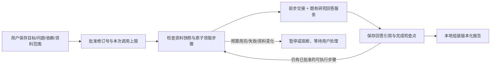

# 持续研究任务：可续做的工作，不是自主研究承诺

[工作台](WORKBENCH_PRODUCT_DESIGN.md) · [架构](ARCHITECTURE.md) · [产品化边界](PRODUCTIZATION.md)

实现边界核对：2026-10-13。新增的是**用户批准、范围有限、可保存检查点的研究任务 DAG**。任务可以跨服务重启保留进度，用户回来后继续剩余工作；不是进程启动便自行恢复付费执行，也不表示能无人值守地完成任意多天任务。

它补的是任务状态、依赖交接和成果版本，不是新的模型能力。此前真实论文回答的失败仍保留；本机模拟模型的软件测试不能把 V14 等真实质量 FAIL 改成通过。

## 1. 用户能做什么

在启用研究核心、能力接口返回 `workbench.tasks=true` 的工作台中，保存一个目标、约束和至多 6 个分析问题。问题可以互相依赖，也可以独立指定资料范围。创建、编辑、查看状态不会调用模型；用户批准本次最多执行 1–6 个分析尝试后才运行。离线界面演示或未启用该能力的部署不因此获得真实任务执行。

网页/移动聊天页的“长任务”面板提供计划、批准、读取状态与报告入口。打开页面不自动执行或轮询；关闭页面也不撤销已经批准的后台批次。要阻止后续步骤，请显式暂停；服务重启后的继续执行仍需用户批准。

任务还包含两个本地步骤：资料清单检查、最终报告组装。因此最多 8 个步骤；不是让模型无限分解计划或不断新增子任务。现版允许修改目标、约束和已有问题/资料范围，暂不在同一任务修订中增加、删除问题或改变依赖拓扑。



这个 DAG 描述调度依赖，不证明论证具有逻辑依赖、答案已经正确或所有关键材料都被找齐。

## 2. 哪些状态真正持久化

每个 worker 的 `project_tasks.db` 保存目标、约束、问题、依赖、资料指纹、修订/代数、批准记录、步骤尝试和引用式产物。任务绑定 `(session_id, instance_id)`；复用同一个可见会话编号不能读到已删除实例的任务。

| 边界 | 当前规则 |
|---|---|
| 计划 | 最多 6 个分析问题，依赖必须无环；另有 inventory/report 两步 |
| 并发写入 | 修改携带 `expected_revision`，陈旧修订返回冲突；领取步骤使用事务与 claim token |
| 运行批准 | UUIDv4 绑定任务、批准修订、资料快照与 `max_calls`；相同批准是回读，改变内容冲突，不增加额度 |
| 模型尝试 | 每一代分析步骤有稳定请求 UUID；走原 RequestJournal、ResearchService 和模型预算，无额外规划/总结模型 |
| 检查点 | 成功步骤持久保存，继续任务不重问已完成且仍有效的步骤 |
| 进程重启 | 未完成的本地步骤可重新准备；正在付费的步骤转为结果未知，停下来对账，不自动重发 |
| 已知失败 | 用户明确执行重置失败，再批准新一轮；不是读取状态或刷新页面便自动重试 |
| 暂停/取消 | 阻止领取后续步骤；暂停不承诺撤销在途调用或供应商费用，取消后迟到结果不能成为任务完成产物 |
| 容量 | 单项目最多 20 个任务，单 worker 100 个；单任务最多 128 次批准，单步骤最多 32 个产物版本；存储仍有字节上限 |

邀请网关在批准时**预扣 `max_calls` 个提问单位**。重复相同批准不重复扣；少执行、提前失败或本地报告完成时，未用单位不会自动退回。这是保守的次数配额，不是供应商已经实际收费的证明，也不是金额硬封顶。每个分析步骤仍受原输入、输出、超时和每日配额约束。

## 3. 资料变化后，重做受影响部分

每个问题可以显式选择文档；未指定时视为整个项目。批准时记录对应文档摘要哈希，在执行前、完成后和读取成果时核对当前输入。

变化处理使用依赖图的下游闭包：资料 A 变化 → 使用 A 的问题失效 → 依赖这些问题的后续步骤及报告失效。只用资料 B、也不依赖前述问题的完成步骤保留。资料清单是调度依赖，不能因为全项目 inventory 更新就把全部独立分析重新生成。

- 改目标或约束：分析步骤全部失效。
- 改一个问题或其资料范围：该问题及下游失效。
- 仅改问题标题：旧报告失效；不能把旧版本标题静默换成新标题。
- 新增或删除资料：项目范围问题受影响；显式范围问题按实际文档和依赖判定。
- 来源撤回或依据无法确认：相关当前/历史产物保留版本元数据，但不返回旧正文或可复活的引用载荷。

用户需要显式刷新受影响输入，再批准剩余工作。刷新不会凭空找回已删除的文档，也不等于重新生成答案。读取时的源状态检查与失效处理不调用模型；它不是常驻监视所有磁盘变化的后台任务。

## 4. 前一步怎样交给下一步

仅交接 DAG 的直接依赖，并先重新读取其当前可访问回答和来源。前一步分析始终标为**分析线索，不是原文证据**；下一步事实引用仍来自本步声明范围内的原文。

交接包 JSON 总上限为 **2,000 UTF-8 字节**。全部能放下时保留完整前步回答；否则先在单份回答 131,072 字节上限内切分完整文本单元，合计前 256 个单元参与词面相关性选择（按依赖分配候选额度），保留各自连续原位置，不增加模型调用、不剪断单元。全文切分仍有本地计算成本；256 是进入候选选择的单元上限，不是只解析 256 个单元。不支持据此声称已经读过前步全文。

检索和任务路由只使用本步骤的原问题，不把包装后的目标、约束或前步回答当成检索关键词。宿主构建的目标/约束/交接上下文在最终提示词中整块保留，受 **8,192 UTF-8 字节**任务上下文及 **24,576 字节**完整提示词上限约束；不能悄悄删掉已声明使用的交接材料。资料依然是不可信数据，字节边界不等于语义正确或精确计费 tokens。

每个直接依赖至少要有一个单元进入交接包。来源范围不兼容、当前依据不可用或预算连最小完整单元都容纳不了时，停止该步骤，报告交接不足，不继续生成并假装已经使用全部依赖。用户可缩小/拆分问题或调整合法资料范围后重新批准；系统不自动扩大访问范围。

宿主记录 `required / used / full / excerpted / omitted` 五项整数计数，校验数量关系及直接依赖数量，不另存前步骤正文。节选覆盖会明确提示。这些计数只说明送入模型的材料形态，**不验证语义相关、阅读理解、结论承接或全文覆盖**。

## 5. 报告是什么，不是什么

每个分析产物保存回答 ID、来源引用和版本；报告保存所引用的步骤版本，**不再复制一份永久有效的回答或资料正文**。打开报告时，按当前权限和来源状态重新读取各回答，确定性组装 Markdown，不再请模型改写、融合或“润色成成功”。

每节保留自己的来源标签、文件名、页码/块序号与字符范围。`S1` 只对本节有效，不把不同问题的同名标签混作一个来源。报告附带未语义验证说明；来源失效时，接口不把警告和完整旧报告一起返回。

这是有来源的分阶段研究记录，不是经过语义审核的统一论证。不同步骤之间仍可能矛盾、漏证据或重复；程序组装不能修复自由文本中的全称扩大、指标错绑、因果错误或实验方案缺陷。可核对定位不等于主张被证实，任务 `completed` 也不等于客户验收通过。

## 6. 用真实复杂项目验收，而不是固定答案演示

让试用者选择自己正在做的一项非敏感研究决策，例如：**为已有文献检索产品选择下一阶段的长期记忆方案，提交可复核的技术决策报告**。可替换为其他领域；不预设推荐结论。

导入 3–5 份不同性质的真实资料：候选方法论文 A/B、自己的接口与资源约束 C，以及独立评测/失败记录 D。先确认解析完成。建立以下三个依赖问题，并让试用者修改措辞和文档范围：

1. **机制与适用前提，范围 A/B：**“分别列出数据写入、变更处理、读取流程和实现前提。区分原文明确说明与未找到的条件；每项给出处，不按摘要宣传作推断。”
2. **匹配真实约束，范围 A/B/C/D，依赖 1：**“结合前一步与我们的接口、预算和评测记录，比较可复用部分、必须训练/开发的部分、冲突证据和未知项。不要把未报告结果解释为有效。”
3. **提交决策稿，范围 A/B/C/D，依赖 1/2：**“给出暂定选择、替代路径、阻断条件和需负责人确认的问题。将建议与材料事实分开，说明哪些缺口仍足以改变决定。”

分开检验软件可靠性和内容质量：

| 操作 | 客观验收 |
|---|---|
| 第一次只批准 1 个分析尝试 | 步骤 1 完成后暂停；剩余步骤不派发，没有额外总结调用 |
| 安全重启服务，再读取任务 | 完成回答 ID/版本保持；读取不生成；用户新批准后才继续 2/3 |
| 修改约束材料 C，保持任务总目标不变 | 1 的请求 ID 与完成版本不变；2/3 与报告失效；显式刷新后只重做受影响分支 |
| 打开报告 v1，再生成 v2 | 旧版本不静默换正文；失效的旧版不能当当前证据报告重新导出 |
| 撤回被报告引用的资料 | 当前及历史相关报告不能显示旧正文，元数据可保留；无关独立成果不被误删 |
| 模拟未知付费结果（仅在本机假模型验收） | 重启/状态查询/重复批准不会再调用模型；只读对账或人工处理，不以“没看到答案”推断未收费 |
| 由试用者审稿 | 核对关键方法、比较条件、反例、遗漏、引用和可直接使用程度；这些内容判断不能用状态测试通过替代 |

该流程可以隔天继续，但不承诺系统夜间自主研究、自动访问新网站或执行实验。资料经配置的模型服务处理；测试时不要上传尚未获准外发的客户数据、密钥或敏感文档。

## 7. 实现与离线复跑

- [存储](../docthinker/server/project_task_store.py)：实例隔离、DAG、修订、CAS、批准/尝试、引用版本与失效。
- [运行时](../docthinker/server/project_task_runtime.py)：有界顺序推进、检查点、只读对账和本地报告。
- [桥接](../docthinker/server/project_task_bridge.py)：现有研究服务、请求回执、资料范围与前步交接。
- [有界交接](../docthinker/server/project_task_handoff.py)：完整回答或原位置单元选择、字节预算与覆盖计数。
- [API](../docthinker/server/routers/project_tasks.py)：创建/修改、批准、暂停/刷新/对账、版本读取。
- [独立边界测试](../tests/test_project_task_acceptance_unit.py)与[真实进程验收](../tests/manual_project_task_runtime_check.py)。

以下命令需要**完整开发工作区**、测试依赖和已构建 H5，使用临时账户、临时材料和本地假模型。可部署 ZIP 不包含 `tests/`，不能直接在解压后的部署包中运行这些开发验收命令：

```bash
PYTHON_DOTENV_DISABLED=1 PYTHONPATH=. DOCTHINKER_RESEARCH_SEMANTIC=off \
  python -m pytest -q tests/test_project_task_store_unit.py \
  tests/test_project_task_runtime_unit.py tests/test_project_task_acceptance_unit.py \
  tests/test_project_tasks_mobile_unit.py

PYTHON_DOTENV_DISABLED=1 PYTHONPATH=. python -m tests.manual_project_task_runtime_check
```

没有任意 shell/浏览器/外部工具执行，没有自主新增任务、定时唤醒、自动发表、自动实验或完整 RSI。持久化研究任务也没有替旧 GraphCore/SelfStudy 学习流程实现重启恢复。公共 HTTPS、真实模型质量、组织权限、实际账单、运维容量仍需独立验收；本功能不是已公开托管或商业可用的声明。

## 8. 超长程项目需要再上一层：设计，不是已实现的能力

2026-10-13 的第二轮审计确认：**目前可恢复的短 DAG 不等于可不断扩展的长期项目。**不应把 `MAX_ANALYSIS_STEPS=6` 简单改成 60：依赖交接、报告节数、调用预算及客户端都耦合这条边界；更大的全文交接会放大费用、延迟和误读，而不是证明能力更强。

最小兼容演进应是：

```text
长期项目（目标、验收条件、预算及阶段目录）
  ├─ 阶段 1：已有 1–6 问局部 DAG → 检查点／成果版本引用
  ├─ 阶段 2：用户批准的新 DAG → 按需读取阶段 1 的相关依赖
  └─ 后续阶段：可追加、可暂停；不回放全部历史或自动重做旧工作
```

“长期”首先是工作状态的寿命，不是一个提示词的长度。阶段可以跨天存在，但每次执行仍有限；模型只收到当前步骤所需的目标、约束、直接依赖交接和当前有效原文。需要以下五块一起接通，而非只画目录：

| 层 | 应保存／执行什么 | 不得冒充什么 |
|---|---|---|
| 项目／阶段 manifest | 总目标、验收条件、里程碑、阶段 ID、状态、预算、当前修订；追加阶段携带 root CAS、父阶段成果版本和来源指纹 | 目录存在不等于阶段已执行；创建计划不自动批准模型调用 |
| 可恢复执行账本 | 每步稳定请求 ID、事务领取、真实完成检查点、剩余额度、暂停原因 | 断网/取消不等于调用没收费；未知付费结果必须对账，不能自动重发 |
| 工作记忆索引 | 决策、未决问题、反例／冲突，以及可撤回的 claim/answer/source ID、条件、页码／字符偏移和哈希 | 摘要、模型分析和假设不是原文事实；确认偏好仍须用户确认 |
| 跨阶段交接解析器 | 检查 session＋instance、父成果版本、当前权限／来源和下一阶段范围，再加载相关完整单元 | 外部旧报告正文不能直接提升为资料证据；不能跨租户或扩大资料范围 |
| 按需交付／验收 | 分页阶段目录、当前步骤进度、阻断原因、按需读取报告；验证来源和结构，内容质量另行审稿 | `completed` 不等于语义正确、建议有效或客户已验收 |

资料变化时，保持增量算法：`受影响步骤 = 直接使用变化来源的步骤 ∪ 这些步骤的依赖下游闭包`。不相关已完成分支保留；新的阶段不会凭空修复旧的未知结果、矛盾或漏证据。低成本调度、账本、权限、来源检查和依赖失效用确定性程序；模型只参与确需理解／写作的当前步骤，不额外为每个状态更新或全项目重新总结付费。

### 必须先移除的实际容量墙

当前同一任务不支持增删分析节点或改依赖拓扑；单项目历史任务计入 20 个上限、worker 100 个；单任务批准上限 128、产物版本上限 32。下一期应创建 successor phase，而不是覆盖旧版本。历史归档需受字节配额约束并分页，**不能删除请求账本或来源撤回记录来“省容量”**，也不能归档掩盖 unknown 结果。

来源侧实际 `accept_document` 仍执行每会话 20／worker 100 文档限制；`list_documents`、`document_snapshots` 仍最多读取 20 份。常量旁“非 lifetime capacity”的注释不能替代真实路径。若目标是几百篇论文持续研究，需一起改成分页／分片资料目录、完整的依赖指纹迭代和增量索引，不能只取前 20 份再声称全量处理。回答时可保持有界证据窗口，但被检查／选择的资料集合及未覆盖范围必须真实、可追踪。

任务列表目前逐任务刷新来源／对账，worker 同时只推进一个 DAG。长期阶段增多后，应先分页 manifest、按需刷新，以及建立来源→受影响阶段的反向索引，再考虑公平有界的并发；不靠无限排队或增加线程数解决。后台调度或重启后自动继续只应在明确、可撤销、有期限和额度的授权下设计；当前实现仍是用户重新批准，不声称无人值守跨周执行。

### 超长程的验收不是“多运行几步”

后续实现至少应以 30 个以上阶段的合成恢复／预算测试、分期来源改变／撤回、暂停取消／重复批准／未知结果、跨账号／编号复用、阶段分页与上下文有界为软件验收；再用真实复杂项目检验跨阶段矛盾、关键证据保留和最终可用成果。前者不新增模型调用也能验证，后者必须独立检验，不能用模拟任务通过替代。本轮只完成审计与这一设计，**Project/Phase、容量扩展及长期质量验收尚未实施**。
