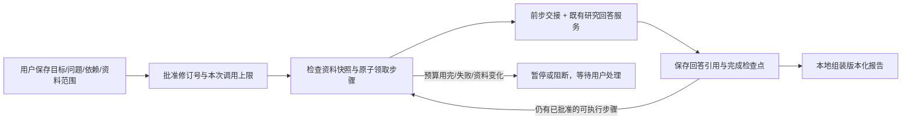
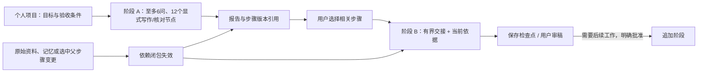
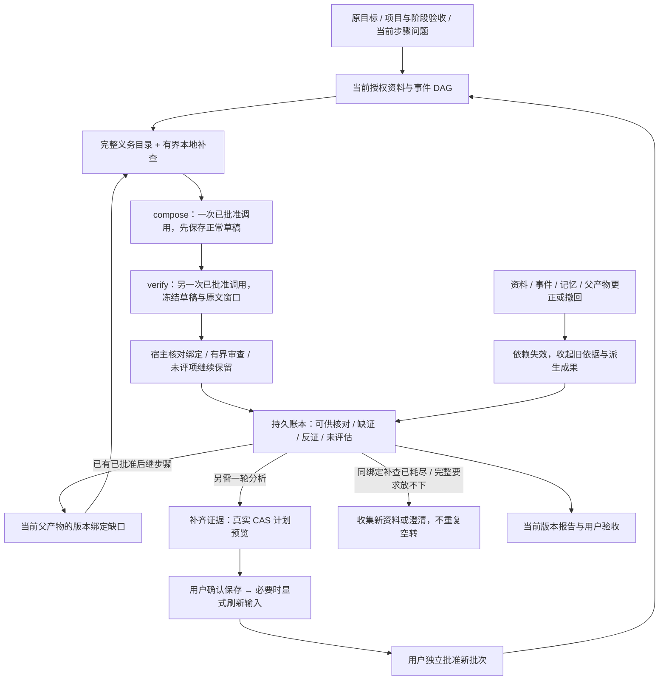

# 长期个人项目：分阶段续做、可追踪的工作

[工作台](WORKBENCH_PRODUCT_DESIGN.md) · [架构](ARCHITECTURE.md) · [产品化边界](PRODUCTIZATION.md)

实现边界核对：2026-10-20。现已接通**长期项目 → 可追加阶段 → 有界任务 DAG → 引用式成果 → 用户验收**。可用于工作、生活安排和资料研究；个人任务可以只使用明确选择的确认记忆，不必上传论文。任务可以跨服务重启保留进度，用户回来后继续剩余工作；不是进程启动便自行恢复付费执行，也不表示能无人值守地完成任意多天任务。

任务底座负责状态、依赖交接和成果版本；证据控制器把事件关系、原始验收要求和缺口账本接进检索、后续分析与交付。已授权后继步骤会消费当前父步骤的缺口，新增复查则先形成真实计划变更预览，由用户分别确认保存和执行；不是只在报告末尾附上建议，也不改变模型权重。此前真实材料回答的失败记录仍保留；本机受控模型的软件测试不能把真实质量失败改成通过。

## 1. 用户能做什么

在启用研究核心、能力接口返回 `workbench.tasks=true` 的工作台中，保存一个目标、约束和至多 6 个原始问题。新计划将每个问题显式拆成写作／整理 `compose` 和证据核对 `verify`，总计至多 12 个分析节点；旧计划不静默增加调用。问题可以互相依赖，也可以独立指定资料范围。创建、编辑、查看状态不会调用模型；用户批准本次最多执行 1–6 个分析尝试后才运行，超过六个节点需另批下一批。离线界面演示或未启用该能力的部署不因此获得真实任务执行。

网页/移动聊天页的“长任务”面板提供计划、批准、读取状态与报告入口。打开页面不自动执行或轮询；关闭页面也不撤销已经批准的后台批次。要阻止后续步骤，请显式暂停；服务重启后的继续执行仍需用户批准。

每阶段仍有至多 6 个分析问题，另有资料检查和报告组装两个本地步骤。现版可增删问题、修改依赖拓扑：先预览哪些完成分支保留、哪些产物失效，再确认绑定修订号和 SHA-256 的变更。删除的步骤 ID 保留墓碑，不复用来伪装旧成果；变更计划不自动批准、刷新依据或重新调用模型。阶段之外的历史通过长期项目目录保留，不把 6 个问题直接膨胀成一个巨大提示词。



这个 DAG 描述调度依赖，不证明论证具有逻辑依赖、答案已经正确或所有关键材料都被找齐。

## 2. 哪些状态真正持久化

每个 worker 的 `project_tasks.db` 保存目标、约束、问题、依赖、资料指纹、修订/代数、批准记录、步骤尝试和引用式产物。任务绑定 `(session_id, instance_id)`；复用同一个可见会话编号不能读到已删除实例的任务。

| 边界 | 当前规则 |
|---|---|
| 计划 | 最多 6 个分析问题，依赖必须无环；另有 inventory/report 两步 |
| 并发写入 | 修改携带 `expected_revision`，陈旧修订返回冲突；领取步骤使用事务与 claim token |
| 运行批准 | UUIDv4 绑定任务、批准修订、资料快照与 `max_calls`；相同批准是回读，改变内容冲突，不增加额度 |
| 模型尝试 | 每一代分析步骤有稳定请求 UUID；走原 RequestJournal、ResearchService 和模型预算，无额外规划/总结模型 |
| 检查点 | 成功步骤持久保存，继续任务不重问已完成且仍有效的步骤 |
| 进程重启 | 未完成的本地步骤可重新准备；正在付费的步骤转为结果未知，停下来对账，不自动重发 |
| 已知失败 | 用户明确执行重置失败，再批准新一轮；不是读取状态或刷新页面便自动重试 |
| 暂停/取消 | 阻止领取后续步骤；暂停不承诺撤销在途调用或供应商费用，取消后迟到结果不能成为任务完成产物 |
| 容量 | 独立任务仍为每会话 20 个、worker 100 个；合法长期项目阶段不占这两个历史任务计数。共同受 64 MiB 任务库配额约束；单任务最多 128 次批准、单步骤最多 32 个产物版本，达到版本边界可显式追加新阶段 |

邀请网关在批准时**预扣 `max_calls` 个提问单位**。重复相同批准不重复扣；少执行、提前失败或本地报告完成时，未用单位不会自动退回。这是保守的次数配额，不是供应商已经实际收费的证明，也不是金额硬封顶。每个分析步骤仍受原输入、输出、超时和每日配额约束。

## 3. 资料变化后，重做受影响部分

资料问题可以显式选择文档；未指定时视为整个会话的资料。个人问题明确选择 0–8 条确认记忆；不默认读取全部私人记忆。批准时记录文档摘要哈希或所选记忆修订号，在执行前、完成后和读取成果时核对当前输入。

变化处理使用依赖图的下游闭包：资料 A 变化 → 使用 A 的问题失效 → 依赖这些问题的后续步骤及报告失效。只用资料 B、也不依赖前述问题的完成步骤保留。资料清单是调度依赖，不能因为全项目 inventory 更新就把全部独立分析重新生成。

- 改目标或约束：分析步骤全部失效。
- 改一个问题或其资料范围：该问题及下游失效。
- 仅改问题标题：旧报告失效；不能把旧版本标题静默换成新标题。
- 新增或删除资料：项目范围问题受影响；显式范围问题按实际文档和依赖判定。
- 来源撤回或依据无法确认：相关当前/历史产物保留版本元数据，但不返回旧正文或可复活的引用载荷。

用户需要显式刷新受影响输入，再批准剩余工作。刷新不会凭空找回已删除的文档，也不等于重新生成答案。读取时的源状态检查与失效处理不调用模型；它不是常驻监视所有磁盘变化的后台任务。

## 4. 前一步怎样交给下一步

交接 DAG 的直接依赖，以及用户从父阶段报告中明确选择的步骤版本，并先重新读取当前可访问回答和来源。两类依赖共用至多 6 项、2,000 字节的交接预算，不把全项目历史拼进提示词。前一步分析始终标为**分析线索，不是原文证据**；下一步事实引用仍来自本步声明范围内的原文。子阶段必须自己明确选择兼容的资料或确认记忆，不因选了父报告便扩大访问范围。

交接包 JSON 总上限为 **2,000 UTF-8 字节**。全部能放下时保留完整前步回答；否则先在单份回答 131,072 字节上限内切分完整文本单元，合计前 256 个单元参与词面相关性选择（按依赖分配候选额度），保留各自连续原位置，不增加模型调用、不剪断单元。全文切分仍有本地计算成本；256 是进入候选选择的单元上限，不是只解析 256 个单元。不支持据此声称已经读过前步全文。

基础检索与任务路由使用本步骤的当前问题，不把整份包装提示词或前步自由文本当成新事实。另有一条明确的本地补查通道：从宿主固定的原目标、验收条件，以及当前父产物的缺口生成查询提示，与事件缺口公平竞争有限补查位置。查询只是找原文的线索，不替换原始要求，也不扩大本步骤的资料／记忆范围。

宿主构建的目标、约束、交接、完整项目／阶段要求和前步缺口上下文整块保留，受 **16,384 UTF-8 字节**任务上下文及 **24,576 字节**完整提示词上限约束；不能悄悄删掉已声明使用的交接材料。资料依然是不可信数据，字节边界不等于语义正确或精确计费 tokens。

每个直接依赖至少要有一个单元进入交接包。来源范围不兼容、当前依据不可用或预算连最小完整单元都容纳不了时，停止该步骤，报告交接不足，不继续生成并假装已经使用全部依赖。用户可缩小/拆分问题或调整合法资料范围后重新批准；系统不自动扩大访问范围。

宿主记录 `required / used / full / excerpted / omitted` 五项整数计数，校验数量关系及直接依赖数量，不另存前步骤正文。节选覆盖会明确提示。这些计数只说明送入模型的材料形态，**不验证语义相关、阅读理解、结论承接或全文覆盖**。

跨阶段另存 `phase_handoff` 回执及父阶段、任务、报告、步骤版本引用。新建阶段的状态只是“已选引用、尚未交付”；真正完成模型输入后才显示已交付。父步骤被修改、退休或其来源撤回时，依赖它的子报告、聊天历史和由回答确认出的记忆按引用链撤回；不能只在报告页藏掉旧正文，聊天里却继续使用它。

同一阶段内及普通独立任务的前后步骤也绑定确切的父任务、步骤和产物版本；不是只有跨阶段才检查。批量读取长聊天记录的共享检查缓存不计入单个记忆包的 128 项额度，避免“单读正常、批量读却把有效回答隐藏”的误判；记忆递归深度与循环检查仍单独保留。

生产邀请 worker 与直接数据目录适配器使用不同的任务库存放布局。生成依赖时绑定实际受信任布局，读取时只检查绑定位置；不因文件同属当前用户便扫描其他目录或回退到另一份任务库。

## 5. 报告是什么，不是什么

每个分析产物保存回答 ID、来源引用和版本；报告保存所引用的步骤版本，**不再复制一份永久有效的回答或资料正文**。打开报告时，按当前权限和来源状态重新读取各回答，确定性组装 Markdown，不再请模型改写、融合或“润色成成功”。

每节保留自己的来源标签、文件名、页码/块序号与字符范围。`S1` 只对本节有效，不把不同问题的同名标签混作一个来源。报告附带未语义验证说明；来源失效时，接口不把警告和完整旧报告一起返回。

这是有来源的分阶段研究记录，不是经过语义审核的统一论证。不同步骤之间仍可能矛盾、漏证据或重复；程序组装不能修复自由文本中的全称扩大、指标错绑、因果错误或实验方案缺陷。可核对定位不等于主张被证实，任务 `completed` 也不等于客户验收通过。

## 6. 用真实复杂项目验收，而不是固定答案演示

让试用者选择自己正在做的一项非敏感研究决策，例如：**为已有文献检索产品选择下一阶段的长期记忆方案，提交可复核的技术决策报告**。可替换为其他领域；不预设推荐结论。

导入 3–5 份不同性质的真实资料：候选方法论文 A/B、自己的接口与资源约束 C，以及独立评测/失败记录 D。先确认解析完成。建立以下三个依赖问题，并让试用者修改措辞和文档范围：

1. **机制与适用前提，范围 A/B：**“分别列出数据写入、变更处理、读取流程和实现前提。区分原文明确说明与未找到的条件；每项给出处，不按摘要宣传作推断。”
2. **匹配真实约束，范围 A/B/C/D，依赖 1：**“结合前一步与我们的接口、预算和评测记录，比较可复用部分、必须训练/开发的部分、冲突证据和未知项。不要把未报告结果解释为有效。”
3. **提交决策稿，范围 A/B/C/D，依赖 1/2：**“给出暂定选择、替代路径、阻断条件和需负责人确认的问题。将建议与材料事实分开，说明哪些缺口仍足以改变决定。”

分开检验软件可靠性和内容质量：

| 操作 | 客观验收 |
|---|---|
| 第一次只批准 1 个分析尝试 | 步骤 1 完成后暂停；剩余步骤不派发，没有额外总结调用 |
| 安全重启服务，再读取任务 | 完成回答 ID/版本保持；读取不生成；用户新批准后才继续 2/3 |
| 修改约束材料 C，保持任务总目标不变 | 1 的请求 ID 与完成版本不变；2/3 与报告失效；显式刷新后只重做受影响分支 |
| 打开报告 v1，再生成 v2 | 旧版本不静默换正文；失效的旧版不能当当前证据报告重新导出 |
| 撤回被报告引用的资料 | 当前及历史相关报告不能显示旧正文，元数据可保留；无关独立成果不被误删 |
| 模拟未知付费结果（仅在本机假模型验收） | 重启/状态查询/重复批准不会再调用模型；只读对账或人工处理，不以“没看到答案”推断未收费 |
| 由试用者审稿 | 核对关键方法、比较条件、反例、遗漏、引用和可直接使用程度；这些内容判断不能用状态测试通过替代 |

该流程可以隔天继续，但不承诺系统夜间自主研究、自动访问新网站或执行实验。资料经配置的模型服务处理；测试时不要上传尚未获准外发的客户数据、密钥或敏感文档。

## 7. 实现与离线复跑

- [存储](../docthinker/server/project_task_store.py)：实例隔离、DAG、修订、CAS、批准/尝试、引用版本与失效。
- [运行时](../docthinker/server/project_task_runtime.py)：有界顺序推进、检查点、只读对账和本地报告。
- [桥接](../docthinker/server/project_task_bridge.py)：现有研究服务、请求回执、资料范围与前步交接。
- [有界交接](../docthinker/server/project_task_handoff.py)：完整回答或原位置单元选择、字节预算与覆盖计数。
- [长期项目目录](../docthinker/server/long_project_store.py)：同一个任务库中的阶段、选中父版本、分页和用户验收。
- [跨阶段解析](../docthinker/server/long_project_context.py)：按需检查祖先、当前依据和阶段输入，不回放整个历史。
- [回答依赖链](../docthinker/server/research_answer_dependencies.py)：回答、任务步骤、来源与确认记忆的撤回传递。
- [证据控制器](../docthinker/server/project_evidence_controller.py)：有界检索工作集、父步骤补查回执消费、耗尽处理与真实计划修复预览输入。
- [义务账本](../docthinker/server/project_obligation_ledger.py)：原目标／验收要求、当前产物绑定、共同目标聚合和幂等查询尝试。
- [API](../docthinker/server/routers/project_tasks.py)：创建/修改、批准、暂停/刷新/对账、版本读取。
- [长期项目 API](../docthinker/server/routers/long_projects.py)与[客户端入口](../clients/mobile/src/components/LongProjects.vue)。
- [独立边界测试](../tests/test_project_task_acceptance_unit.py)与[真实进程验收](../tests/manual_project_task_runtime_check.py)。
- [跨场景证据闭环测试](../tests/test_evidence_goal_lifecycle_unit.py)：工作交付、家庭预约的缺证传递、用户确认补查、新材料重批，以及来源／确认记忆撤回；模型全部受控，仅验软件闭环。

以下命令需要**完整开发工作区**、测试依赖和已构建 H5，使用临时账户、临时材料和本地假模型。可部署 ZIP 不包含 `tests/`，不能直接在解压后的部署包中运行这些开发验收命令：

```bash
PYTHON_DOTENV_DISABLED=1 PYTHONPATH=. DOCTHINKER_RESEARCH_SEMANTIC=off \
  python -m pytest -q tests/test_project_task_store_unit.py \
  tests/test_project_task_runtime_unit.py tests/test_project_task_acceptance_unit.py \
  tests/test_project_tasks_mobile_unit.py

PYTHON_DOTENV_DISABLED=1 PYTHONPATH=. python -m tests.manual_project_task_runtime_check
```

没有任意 shell/浏览器/外部工具执行，没有自主新增任务、定时唤醒、自动发表、自动实验或完整 RSI。持久化研究任务也没有替旧 GraphCore/SelfStudy 学习流程实现重启恢复。公共 HTTPS、真实模型质量、组织权限、实际账单、运维容量仍需独立验收；本功能不是已公开托管或商业可用的声明。

## 8. 已接通的长期项目层

“长期”首先是状态与依据的寿命，不是单个提示词的长度。阶段目录、任务执行、交接与验收共用原 Harness 和任务库，没有第二套重复执行器。



项目与阶段均保存验收条件并传入实际任务上下文；创建阶段仍不执行模型。阶段验收绑定报告版本，项目验收绑定明确列出的阶段报告版本，作者是用户，`goal_verified=false`、`semantic_verified=false`。新增阶段后，旧项目验收不能冒充新一轮已经通过。

同一原问题的核对节点逐字保留草稿正文；补证重写则用显式 `refine_of` 绑定被替换草稿，原问题和批准范围不变，生成新的正文谱系。跨阶段未指定步骤时只交接当前重写／核对叶子，不重复塞入历史草稿及同文审核版，仍最多六个选中步骤。普通 `depends_on` 和相同问题文字都不当作替换关系；显式选中的历史步骤不会被自动换成别的版本。并行分支超出边界要求明确选择，不任意截断。

### 算法与开销

- 计划修改同时遍历旧、新 DAG 的下游闭包；不相关的完成分支和请求 ID 保留。
- 阶段按 ordinal 游标分页；父任务有反向索引，读取时按需校验，不扫描并重生成全项目。
- 祖先检查用队列与 visited 集合；一个任务库读快照，再用一个资料库快照批量核对去重后的输入。只在本次请求内复用结果，不用文件时间戳缓存冒充来源仍有效。
- 回答依赖用迭代后序遍历，避免深链触发 Python 递归深度限制。来源、确认记忆及选中父任务步骤版本均是撤回依据。
- 不以固定 128 阶段限制项目寿命；检查仍受真实时间和元数据字节预算约束。预算不足明确阻断，不跳过祖先后假装通过。
- 单次祖先遍历仍为 `O(V+E)`；持续追加 N 阶段、逐次完整检查，累计仍可能 `O(N²)`。减少连接与重复校验，不等于已经消除所有历史增长成本。

[可复跑的本地遍历基准](../benchmarks/runtime_algorithms/long_project_context_benchmark.py)与[原始结果](../benchmarks/runtime_algorithms/long_project_context_benchmark_20261020.json)：30 阶段各 5 次，中位 18.57 → 2.79 ms，任务库连接 59 → 1。该基准使用真实任务 SQLite、模拟输入新鲜度检查，只衡量此段遍历开销，不是模型端到端提速或答案质量提升。150 阶段新版完整通过；旧版被 128 边界截断，不用两者耗时冒充等量对比。

### 软件验收与未完成边界

自动测试覆盖真实 ASGI → SessionManager → 任务运行时 → 回答服务 → SQLite 链路：30 阶段、3 次重启、分页、有界交接、选中与未选父分支修改、来源和记忆撤回、未知付费结果、跨账号／会话实例隔离。另测 150 阶段祖先校验与 160 步回答依赖，最早来源撤回后末端历史、成果及确认记忆失效。回答写作使用本地替身，不表示真实模型的语义质量已经验收。

此前的阶段／重启底座验收保留在[历史验收记录](../benchmarks/runtime_algorithms/long_project_personal_agent_result_20261020.json)，不能据此宣布本次新增控制器已经完成最终回归。当前代码的验收命令、结果与未验证项统一以[工程验收记录](RELEASE_ACCEPTANCE_2026-10-20.md)为准；构建成功、软件闭环通过和真实模型回答质量是不同结论。

资料目录仍有每会话 20／worker 100 文档边界；阶段扩展不等于无限文档容量。当前不自动生成并批准计划、不自主执行外部工具或跨周付费工作，也不证明复杂因果推理正确。真实客户任务的最终质量、Step 5 或其他模型的质量／token／速度对比、公开 HTTPS 与商业运维验收仍须分别进行；不把这些软件测试写成生产上线或完整 RSI 的证明。

## 9. 目标与证据闭环：检索、分析、交付共用同一账本

2026-10-20 当前实现。沿同一个 Harness 和原任务 DAG 执行，不增加第二个 Agent 框架，也不增加用户的独立“推理模式”。早期“每轮固定只做两项检查、只取前四条验收条件、缺口仅作报告建议”的设计已被替换。真实测试进一步暴露同一调用写正文兼穷尽核对仍会空答，因此执行层把写作与核对拆为两个明确批准、各自可恢复的节点，不在写作函数里隐藏第二次调用。



### 程序管什么，模型管什么

- **程序：**会话／实例身份、输入范围、实体 ID、事件与关系版本、方向和时间冲突、不可丢弃的条件、完整验收目录、原文／最终正文坐标与哈希、任务修订、产物绑定、调用与容量预算。
- **模型：**理解材料、提出候选解释和替代解释、判断当前材料对各环节的支持／反证，以及组织正常聊天、草稿和报告。有效引文只证明位置可核对，不把模型判断升级成客观因果事实。
- **未解决：**缺失的事件、中间环节、条件、替代解释和验收要求继续留在账本；查到候选材料不代表相应义务已经解决。

### 事件 DAG 与完整审查

事件使用当前版本 FTS 索引，在会话和资料／记忆白名单内选种子，再做有界桥接路径搜索和邻接扩展，优先保留相连事件包，不只取最近记录或若干孤立节点。事件证据包上限为 **8 个事件、12 条关系、6,000 UTF-8 字节**；宿主侧精确版本与来源绑定另有 **8,192 字节**预算。绑定元数据不挤占同一份证据文本预算，也不因此扩大访问范围。搜索或包容量不足会留下明确限制，不能把未选中的长链当作已检查。

宿主为当前包建立完整的 `E / L / P / A` 目录：事件是否发生、逐条关系、候选完整路径、替代解释。`depends_on` 检查前置条件，`before` 只表示时序，`related_to` 只表示关联，`reported_cause / hypothesis` 才是待核对的候选原因；`contradicts` 的支持意味着存在冲突，不误当成正向因果证据。路径还检查路径节点、前置条件闭包和相关冲突，不能用一条概括性引文代替全部必要环节。

当前义务目录不再固定为两项：包内事件、关系、路径和替代解释都进入有界完整目录，最多 24 项。写作节点读取背景事实和缺口，但不要求输出整份事件核查。核对节点对冻结正文和完全相同的原文窗口审查，事件与任务要求公平交替，每次至多六个完整义务，优先此前未评项；整条义务的条件不可截断。完整目录和已访问项持久保留，后续核对继续轮转，不永久只核查前六个。联合路径只有在节点、环节、条件、时间与替代解释门槛齐备后才能进入前沿。动作已经完整存在于实际保留原文时可去重描述，但身份、时间、条件和来源守卫不丢；必要事实或条件不能完整保留则在调用前拒绝。

**条件分两轴：**`rule_status` 检查规则是否有依据，`satisfaction: met / unmet / unknown` 检查本次条件是否满足。“必须先取得许可”有原文，不表示许可已经取得；只给规则引文、缺满足见证或条件未满足，都不能提升整环和路径。多个联合见证须整体保留。路径状态来自当前各必要环节，不由模型单独宣布“完整链已证明”。旧条件或路径回执采用保守投影，不能凭旧正向标记恢复支持。

### 原目标、共同验收项与交付状态

没有事件图也检查原任务。宿主固定步骤问题 `Q1`、原始目标 `G1`、项目验收项 `P1…P12`、阶段验收项 `C1…C12`，按原文及其哈希建立目录；不能让模型少报或改成更容易的要求。完整项目与阶段条件保留在当前上下文中，不只读取前四条。

模型回执允许稀疏，也不能用“未写回执”表示已满足。写作产物先单独保存，核对失败不能抹掉已写草稿；审核器的简短总结不替换原正文。当前原文窗口、事件关系／条件、原要求和正文哈希全部一致时，才合并同一核对谱系的已有见证；未知不冲掉有效见证，新的显式反证仍阻断。更正、撤回或范围改变会使旧核对失效，不能用旧审核状态保住新正文。

受审调用使用统一任务档位，而不是为某个模型写特例：普通聊天 2,048、普通有来源回答 8,192；实际包含宿主事件或任务核对合同的调用为 `evidence_review`，completion 上限 16,384，可能包含供应商内部推理用量。fitter 记录档位与实际请求上限，已有更小的父预算不能被内层抬高。移动／邀请问答外层 Harness 与本轮真实模型 runner 配套为 240 秒 wall-clock 上限；已有更短生命周期仍保留，不自动延时或重试。该调整仅为正常正文与证据核对提供交付余量，不增加批准次数、不放松来源／条件，也不证明复杂因果可靠。

同一任务内的不同分析分支共享目标和验收项，按要求的宿主哈希聚合，不要求每个小步骤单独重做整个项目。每个步骤的 `Q1` 仍各自保留。当前合法产物中，对同一完整要求给出正向模型判断且见证有效的评价可形成待核对候选；这不是程序已证明语义覆盖完整。显式反证优先阻断，不能被另一个正向评价冲掉。聚合绑定全部成员的当前回执与输入；旧版本或失效成员不会提升新要求。这里是当前任务内聚合，不是跨所有阶段自动宣布整个项目成功，项目最终验收仍绑定明确的阶段报告版本。

`task_review` 分开记录**交付覆盖**和**来源见证**。文档任务的正向候选需要最终正文见证和当前来源见证；仅写出一段答案不表示事实有依据。个人任务的私人草稿可以仅靠合法正文见证进入“可供用户核对”，但不会因此增加事实支持计数、证明外部事实或声称真实事项已执行。试点等最终渲染之后再绑定实际交付正文，不绑定临时 JSON。

当前紧凑见证协议不要求模型反复誊抄正文或猜字符偏移：`evidence: [{"label":"S1"}]` 选择本轮实际保留的完整连续来源窗口，由宿主绑定来源 ID、字符范围及 UTF-8 哈希；`answer_witness: {"whole_answer":true}` 由宿主绑定经过前缀／试点表等最终组装后的整段可见答案。旧 `quote / start` 仍兼容，重复引文须明确位置。空正文、坏来源几何、撤回窗口或模型自带伪造坐标不会因此变得有效。标签与整段答案指针只证明“材料／交付存在”，**不证明该材料蕴含主张，也不证明整段答案满足某个验收项**；语义状态仍是模型评估或未知。

`project_obligation_ledger` 与任务共用 SQLite，保存元数据和引用，不复制原文或回答。原目标／要求、当前产物版本、回答 ID、输入指纹、回执哈希和共同要求组哈希共同限定状态。界面区分 `ready_for_review / unresolved / contradicted / not_assessed`；来源校验不可用则显示不可用态，不沿用旧正向徽标。`completed` 仍只表示执行流程完成，报告的 `draft_with_evidence_gaps / ready_for_user_review` 也不是事实或因果验证证书。

### 每项缺口保留，补查前沿有界

缺口的完整查询与对应义务绑定，保留逐项文本／哈希，不能把所有义务都替换成第一条查询。持久账本保留全部已识别工作；传给下一步的查询包和每次检索前沿受独立预算约束，延期数量明确记录，不冒充穷尽查询。宿主原目标和验收要求不随检索提示的长度而裁剪。

已有已批准的后继步骤会实际消费父产物缺口：桥接先核对父回答、任务／步骤／产物版本、原文和最终正文见证，再把缺证及反证查询送进本步骤的本地补查通道。父分析仍标为分析，不是新事实。父缺口、事件义务和原要求的检索提示公平竞争单次最多 8 条查询；不是把前步整份报告或全部后台推理塞进正文。基础原文至多 8 段，缺口补查与 Insight **共用**两个补充位置，用于必要机制、中间节点或反证；不是每个模块各加两段。最终总上限仍为 10 段、12,000 UTF-8 原文字节和 24,576 字节完整输入。补查只追加完整窗口，不替换或截短基础证据，不请求另一个检索模型。

原始父产物包仍留在宿主，用于请求指纹、范围／版本校验和本地查询，不复制到模型上下文。模型视图去掉重复 UUID、哈希和逐项缺口编码，只给出最多 8 条公平选出的完整提示、依赖／回执数量，以及仍待查和未交付数量，独立上限 4,096 UTF-8 字节；必要时舍弃整条提示并保留待查计数，不剪断中文或原始要求。该视图明确为非事实、非指令、非授权的数据；完整包和持久账本没有随视图缩小而丢失。

完成回答后，生产桥接消费实际本地补查回执：只有当前父产物／来源／事件／记忆仍有效，且查询哈希和回执完全对应，才为同一工作绑定记录 `partially_searched / candidates_found / exhausted`。有限扫描无候选也记录为已尝试，使尚未轮到的查询先行，避免前八条持续饿死后面的要求。状态单调合并，迟到的较弱观察不能覆盖已找到候选；同一绑定的回读不增加 attempts，候选存在不升级为要求完成。只扫已保留窗口、扫描截限、旧回执无完整覆盖标记或子任务范围小于原工作范围，都不得记为 `exhausted`。该状态要求当前批准语料覆盖完整且确实无候选，仍只是此启发式在同绑定材料上未找到；策略版本纳入绑定，旧策略不能重建新版本的耗尽状态。来源、输入或当前产物改变形成新绑定，记录不可用时不补发模型调用。

### 真正进入计划、仍由用户掌握执行权

“补齐证据”调用 `/workbench/tasks/evidence/preview`，把当前账本转成既有 CAS 重规划的真实草稿和影响预览。未评项追加显式 `verify / review_of`；已知缺证、反证或新候选需要改变正文时，追加同问题同范围的 `compose / refine_of`，实际消费前步定向查询重新取材料、重写，再追加 `verify`。不能用反复核查冻结旧窗口代替补召回，也不把整个审查合同塞回写作。原目标、约束、完整问题及批准范围不变，旧产物作为历史保存，当前目标只投影显式替换叶子；新叶子未完成或被撤回不能借旧正向回执达标。所有新节点计入同一批准和节点上限，容量不足明确要求另建阶段，不自动扩展或付费。

用户先查看完整草稿与影响范围，再确认绑定修订号和计划 SHA 的保存；保存不刷新依据、不执行、不增加额度。需要更新输入时另行显式刷新，执行仍须单独批准新批次。未纳入本轮的工作和完整问题容量不足会明确显示；不截掉原要求、不无限追加新步骤，也不以新请求编号重试结果不明的旧付费调用。

### 撤回与能力边界

回答绑定事件、边、端点、来源及所选确认记忆的精确版本；后续回答和由回答确认出的记忆复用撤回链。修改事件、修订记忆、撤回被引用的原文或补充证据，会使相关旧回答、评价和派生成果失效；仅新增一份无关资料不等于所有历史正文都必须撤回。完成／导出前的批量同步屏障核对实际回答依赖，不能只看文件时间戳或任务 `completed`。

这条闭环没有新增自动付费重试、外部执行、自动事实写入、模型权重更新或后台自我授权。`goal_verified / semantic_verified / causality_verified` 均不因引文合法、候选检索成功、流程完成或用户准备补查而变为 true。有界图和逐环见证能暴露缺口、约束交付并推动已授权工作；它们不保证任意复杂因果正确，也不取代跨场景真实材料、真实模型和长期使用质量验收。软件测试与实测结果以[工程验收记录](RELEASE_ACCEPTANCE_2026-10-20.md)分别列示。
