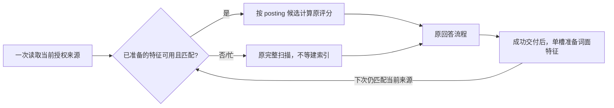

# 数据结构与执行路径提速：2026-10-13

本轮优化的是私有 mobile / invitation 研究服务的数据读取、基础词面检索与历史来源核验。不是所有旧 GraphCore 路径的性能验证，也不是模型推理变快、答案质量提升或生产吞吐验收。没有新增真实供应商请求，没有读取真实用户数据库做基准。

## 1. 已实施的改动

| 原路径 | 新路径 | 保持的边界 |
|---|---|---|
| `all_chunks` 最多 20 次连接、OFFSET 分页，每页重复 JOIN / ORDER BY | 一次 SELECT 读取当前 ready 来源；指定文档范围在 SQL 中筛选，而不是读完全部正文再丢弃 | 顺序、12,000 片段上限、会话隔离不变；分页 API 保留；只读不创建库 |
| 每问给全部片段重新分词、计算词频和文档频率 | 每服务拥有有界、不可变的语料特征；紧凑字节 posting buffer 保存 `term → (片段序号, 词频)`，复用全语料长度与统计 | 不缓存问题/答案；每次仍验证当前完整正文哈希、文件名、页码及成员集合，再用当前正文输出引用 |
| 对全部候选排序只取前 40 项，MMR 每轮又完整排序 | 有界 heap 选前 40 项；稳定排序键只算一次；MMR 用同一比较规则选择最优项 | BM25、RRF、MMR 公式、tie-break、全语料 DF/平均长度、去重、原句窗口和缺口保持原样 |
| 每条历史的每个引用分别查询可用性、开连接取正文；每条回答另读 proof | 当前请求内批读回答元数据、去重的引用正文及 proof；每批至多 384 ID，仍分别组装每条回答的实际来源包 | 不跨请求缓存，不把其他回答来源并入本条；保留撤回、偏移/哈希、缺失证明收起旧内容等检查 |

索引只保留派生词项/计数/指纹，不另存论文全文或生成答案；派生词项本身仍可能敏感，留在对应 worker 的内存中，不持久化、不外发。每服务最多保留 4 份特征快照，特征计量预算 32 MiB。**这不是整个进程 RSS 或冷构建峰值硬上限**：当前原文、旧特征、构建数组和不可变副本可以同时存在。超预算完整降级到原扫描，不缩减证据语料；同一超预算快照仅保留有界的哈希提示，避免反复失败构建。

## 2. 首问不能被“建缓存”拖慢

V2 尝试在首问等待链里建完整倒排索引，合成测量首问反而慢约 6%–21%。该策略没有作为最终默认实现，也没有删除这轮样本。

最终 V3 使用：



`lookup` 不建索引；后台锁忙时立即 miss，不让下一问反向等后台工作。成功回答完成来源记录后，至多创建一个实际后台准备任务，不排队、不请求模型。任务槽保留到实际线程退出；停机关闭缓存并等待真实完成，防止晚到构建重新发布。失败不自动重答。线程不能强杀，不承诺硬停机时长。

后台 CPU 成本没有消失。共享线程池/GIL 仍可能竞争；暖测在准备完成后进行，不证明重负载时下一问一定命中。Python `to_thread` 主要用于把工作移出事件循环，不等于让普通 Python CPU 工作自动按核心并行。见 [Python 3.11 的线程说明](https://docs.python.org/3.11/library/asyncio-task.html#asyncio.to_thread)。小固定 K 的选取参考 [heapq 官方文档](https://docs.python.org/3.11/library/heapq.html#heapq.nsmallest)；这里经过完整结果等价测试，而非改变召回预算。

## 3. 实测：同组比较，不跨轮挑数字

完整样本保留在开发工作区 `dist/research-structures-synthetic-first-20261013.json`、`dist/research-structures-serviceprep-second-20261013.json`、`dist/research-structures-serviceprep-third-20261013.json`。部署 ZIP 不含 dist 或 tests。V1 仅直接特征/排序；V2 包含 eager 首问退步；V3 为最终延后准备策略。三轮主机负载不同，不能跨轮原始毫秒数当因果结果。

V3：Python 3.11.15 / Darwin，本机合成 600/6,000/12,000 片段，最大正文 3,863,510 字节，4 个不同中英文/概述问题，每组 5 次。每个比较都检查旧冻结排序器的**完整 plan**一致（来源/分数/窗口/标签/缺口/digest），不是只比 top ID。没有模型、真实私有资料或受控冷磁盘测量。

| 片段数 | 旧首问 / 新首问，中位 ms | 旧暖四问 / 新暖四问，中位 ms | 后台准备，单独计 ms |
|---:|---:|---:|---:|
| 600 | 29.789 / 28.827 | 110.608 / 52.544 | 23.823 |
| 6,000 | 285.634 / 236.114 | 1,134.772 / 383.152 | 239.704 |
| 12,000 | 684.065 / 463.524 | 2,711.740 / 782.584 | 491.485 |

这些列包含同步基础读取、当前语料验证、缓存查询和排序；**不包含事件循环调度、辅助筛选、全部服务步骤或模型生成**。后台准备单列，不冒充免费或完全重叠。五个样本的 nearest-rank p95 只是观测最大值，不是生产尾延迟保证；12,000 片段新首问 p95 472.008 ms、新暖四问 p95 816.609 ms。原始所有样本保留，没有择快重跑。

另一个同 fixture 的历史核验实验：200 条回答，每条 10 个引用，重复使用 10 份原文，并带实际 audit/trial proof。旧/新完整输出一致；连接 **2,201 → 3**，SELECT **6,603 → 9**；3 次带 SQL trace 的本机中位 **1,370 → 37.7 ms**。这是重复引用的特定工作集，不应当宣称任意历史都快 36 倍；2,000 个不同引用另有分批边界测试。

## 4. 验收与可复跑入口

最终完整 `.github/workflows/product-contracts.yml` invitation pytest 清单：**4,283 passed、3 skipped、4 subtests passed，56.71 秒**，关闭 dotenv、可选语义资产及 BLAS 多线程。跳过不算通过。新增冻结 oracle / 完整排序等价 41 项、缓存 35 项、真实 service 后台准备 10 项、单快照/降级 9 项、历史批读 11 项均纳入清单。

真实进程的邀请、研究、持续任务三套联调通过；使用回环合成模型。分别检验账号隔离/回执、来源/记忆撤回、暂停重启/版本报告，未新增供应商调用。物理手机、真实外部模型速度和容器高并发仍未验收。前端本轮未改，资源沿用上一轮构建。

以下需要完整开发工作区和测试依赖，不在源码 ZIP 内运行：

```sh
PYTHON_DOTENV_DISABLED=1 DOCTHINKER_RESEARCH_SEMANTIC=off \
  OPENBLAS_NUM_THREADS=1 OMP_NUM_THREADS=1 MKL_NUM_THREADS=1 \
  python scripts/benchmark_research_structures.py --chunks 600 6000 12000 --repeats 5
```

脚本只打印内容无敏感信息的 JSON，自动核对四生产文件前后指纹和完整输出。计时前先停止其他重负载。测试参考冻结的是排序/统计流程；未修改的原句窗口等 helper 仍共享，因此不能推断所有语义逻辑已经独立验证。

## 5. 明确未改的瓶颈

1. **历史 JSON 写放大**：`SessionManager` 每条消息仍全量重写 `talk.json`，长期累计写入可能呈 O(N²)；还需兼容的追加日志/索引与迁移设计，本轮不冒险直接换用户数据格式。
2. **可选向量预热挡上传**：解析标 ready 后还等待预热；合成 Event 实验已验证下一文档停在 queued。应独立做有界、可合并的预热调度，不能把本轮词面准备当作已修这个问题。
3. **可选向量工作集**：2,048 项缓存面对 4,096 块时，假嵌入器三轮仍编码 4,096/2,048/2,048 项，需单独设计容量与增量更新。
4. **默认线程池竞争**：数据库、纯 Python CPU 和可选模型辅助共用池；有排队/执行计时，但没有真正的 OS CPU 优先级隔离。增加线程数不是已证实的方案。
5. **已索引仍取写锁**：`EvidenceIndex.ensure_project` 重复 DDL/写事务、原子关系查找可去重；先做只读快速路径与并发一致性验证，未顺手修改。
6. **当前验证仍 O(正文量 + N log N)**：缓存查找与排序各自重新验证授权来源，没有把总查询偷偷写成 O(posting hits)。未来可研究事务版本驱动的持久倒排索引，但不能跳过来源撤回检查。

保留解析子进程安全隔离、SQLite 持久性及当前 journal 模式；没有为了速度关闭同步写入、放宽会话权限或共享用户全文。索引要匹配过滤/排序条件，参见 [SQLite 官方查询规划说明](https://www.sqlite.org/queryplanner.html)。旧 GraphCore 实际负载、全路径 p50/p95、RSS 和外部模型首 token/完整响应还需分别测，不能由这些局部结果宣布“整个框架都快了”。

## 6. 第二轮：不能拿召回和证据换速度

本轮保持检索候选预算、BM25/RRF/MMR、提示词尝试顺序、最终来源检查、模型配置和输入/输出上限；不新增供应商调用。没有全项目重总结、缩短原句、少看资料或关辅助来冒充优化。以下是对第 5 节的后续处理，不回写 V1–V3 或真实质量 FAIL。

### 历史：查需要的字段，不把全图加载一遍

`SessionManager.get_session` 原先完整加载知识库及所有 entry 的关系，导致每次追加 `talk.json` 也先查整库。现在每次 live 读取会话 header；`get_history` 单 SELECT 只取 question/answer 的实际字段，不读无用文档正文和关系。全部消息、时间和并列插入顺序、旧字段／来源标记仍保留；无跨请求缓存、无历史截断。

`scripts/benchmark_session_reads.py` 用独立临时 SQLite、1,000 条消息＋1,000 条其他条目＋2,000 条关系，5 次交错测量、全部输出对照。正式记录 `dist/session-reads-round2-20261013.json` 保留全部样本；不是冷磁盘或整回答测量。

| 场景 | 原／新中位数 ms | 原／新 SELECT |
|---|---:|---:|
| 会话 header | 34.011 / 0.622 | 2,002 / 1 |
| 完整历史 | 32.346 / 6.478 | 2,002 / 1 |
| 200 条长消息时，完整 SQLite 写入＋实时 JSON 镜像追加 | 27.839 / 5.939 | 未作为读查询基准 |

JSON 镜像仍实时全量重写：新增 27 字节内容，五次前后各写 849,439 字节。未知扩展字段、完整消息和旧消费者兼容没有牺牲，**写放大尚未消除**。后续必须明确权威账本／导出快照边界并做迁移，不能让旧读取者无声读到过时 `talk.json`。读取加速不是无限历史容量证明。

### 证据索引：热路径不取写锁，闭包使用队列／集合

`ensure_project` 每次检查 live schema 对象及当前完成记录，只有缺对象／需初始化才走原写事务；不是会过期的进程布尔缓存。包括撤回触发器在内的 10 个对象、数据库替换、parser 版本及删除都测试。热路径从 2 连接／39 SQL／26 CREATE／2 次写锁预约变成 1 连接／4 SELECT／无 DDL 或写锁；有外部 reserved writer 时，可完成热读，旧路径必须等待。

演绎闭包的相同 scoped atom 在本次调用内复用 JOIN 结果；每次检查同一连接的 `data_version`，外部提交后失效，最终仍 JOIN 当前 ready 原文。100 条重复 atom fixture 的 JOIN 200 → 2，另有 200 次版本检查，不能误报成总共只发 2 SQL。FIFO 用 `deque`＋pending set 去掉队列搬移／线性去重；保持遍历顺序、循环处理和原预算。SQLite 版本比较只能在同一连接的不同时刻使用，不能跨连接比较数字；依据 [官方 data_version 文档](https://www.sqlite.org/pragma.html#pragma_data_version)。队列操作依据 [Python deque 文档](https://docs.python.org/3.11/library/collections.html#collections.deque)。

### 提示词：复用本次的格式，不缓存答案

同一 evidence packet 会因方法卡、Insight 等可选项多次尝试预算；现在只在本次 fit 内复用相同来源顺序／记忆／缺口／locator 开关的 base JSON，仍按原顺序追加每个可选／必选块和校验最终消息。换来源集合立即清理旧前缀文本；返回或失败后释放，不落盘、不跨请求复用。完整 messages、出处、缺口、预算和合同哈希与冻结 formatter 对照；失败语义也对照，不只验证字符数。

`scripts/benchmark_prompt_rendering.py` 五次所有样本保留在 `dist/prompt-rendering-round2-20261013.json`：

| 合成情形 | 原／新 base 渲染次数 | 原／新中位 ms |
|---|---:|---:|
| 普通一次成功 | 1 / 1 | 1.368 / 1.470 |
| 多次预算尝试，保留同样两条来源 | 47 / 14 | 86.562 / 28.142 |
| 故意超预算，仍返回原同类失败 | 60 / 18 | 393.938 / 117.739 |

普通情形没有提速，约 0.1 ms 差别；不能只挑后两行情形宣称每次都快 3 倍。纯 formatter 仍在事件循环调用，极端输入仍有本地 CPU 延迟，不能用线程池不受控堆工作来掩盖它。

### 向量：物理复用与候选准入分开

旧 2,048 项 LRU 的缓存命中不消耗 8,192 新编码窗口预算。**直接扩缓存，或仅预热新文档，会改变候选准入次序，无法当作效果不变的纯提速。**本轮放弃 delta／无条件后台化，保留 full prepare 和前台原阈值／超时／gate。

新设计保留旧 2,048 逻辑 identity LRU 决定旧窗口预算，物理向量 store 最多 4,224 项只复用完整内容哈希、模型指纹和租户 namespace 一致的派生向量／offset。物理命中也要先通过原逻辑准入；物理丢失的逻辑命中补算，不抛弃候选。两层联合采用有界保留特征计量，**不是整个 RSS、模型或在途 matrix 的峰值保证**。不同显式小容量实例的逻辑 trim 沿用旧插入时机；诊断里的 logical limit 是 trim 目标，不能说是每次条数保证。极小内部 byte 预算会使逻辑命中补算，实际编码窗口可超过旧 miss 的 8,192；实际计数和旧预算计数分开展示。

最终保留计量采用 **100 MiB**、每窗口 128 字节 metadata allowance。合法最长 namespace／24 窗口的旧 2,048 条实际 records 联合计量 101,216,256 字节，测试可全保留；来源仍至多 4,096×24 个窗口，未变成无限工作。私有字节上限的故障注入不是公开配置支持；不能把预算小于 logical metadata 本身的情况说成整个进程硬内存上限。

冻结旧实现有独立 LRU／gate；合成 encoder 检查完整 scores／spans／旧候选诊断，包括长文预算、混合实例、重复正文、删除／改文、租户、指纹和随机调用序列。它不证明真实 ONNX 的跨硬件数值复现，更不证明真实 LLM 质量提升。本轮没有真实 ONNX 资产性能或供应商质量复测；缺资产的用例按 skip 记录。

`scripts/benchmark_semantic_vector_reuse.py` 三版记录分别保留在 `dist/semantic-vector-reuse-first-20261013.json`、`dist/semantic-vector-reuse-final-20261013.json`、`dist/semantic-vector-reuse-third-20261013.json`；最终代码匹配 third，不覆盖早期失败／开销记录。4,096 条合成来源，五阶段（首次准备、两次查询、重复全文准备、加入扫描窗口外资料后查询）各五次：旧 passage 编码 12,290＋query 3 次，新 4,096＋query 1 次，完整 score/span/候选诊断相同。第三版假 encoder CPU 中位数：冷准备 30.998 → 38.361 ms（慢约 7 ms）、第一次查询 27.804 → 19.934 ms、重复全文准备 18.744 → 11.267 ms。不能把省编码次数直接说成真实 ONNX 或完整回答快 3 倍；脚本先 old 后 new，仍有顺序／主机负载偏差，不是受控生产 A/B。

准备任务另增加实际线程生命周期单槽：等待者取消不释放真实槽，重复调用不排队，关闭后不新读库或新提交，`stop` 等真实准备结束、事件循环仍能响应。上传依旧可能等 full prepare，不宣称已完全解耦；后台化必须先解决争用导致前台退回词面的风险。`shield` 的取消语义依据 [Python 官方文档](https://docs.python.org/3.11/library/asyncio-task.html#asyncio.shield)，并有真实 Event gate 测试，不承诺强杀线程或硬停机截止时间。

### 超长程仍需要新的阶段层，而不是放大一次调用

这一轮没有改变固定 6 问 DAG、20 文档目录或任务历史容量。审计与最小兼容 Project/Phase 方案见 [超长程项目设计与未实现项](LONG_PROJECT_RUNTIME.md#8-超长程项目需要再上一层设计不是已实现的能力)。数据层加速是这层的基础，不能代替跨阶段接力、长期来源目录、验收和真实复杂任务质量。

### 第二轮最终验收

最终 `.github/workflows/product-contracts.yml` 116 文件后端清单，**4,460 passed、5 skipped、4 subtests passed，71.66 秒**；五个 skip 不算通过。新历史 19、证据 fastpath 32、完整 formatter 差分 67、语义缓存差分 33、真实 prepare 生命周期 7 项纳入清单。最终向量代码 SHA `2b0c6e5d7cfb573f3f8cbb8d09e9db8790b5dc28ef93fe9bd0512898dc317845` 与第三版基准匹配；先前 96 MiB 配置运行过的 4,458 项结果不冒充最终版本。

三套真实子进程／HTTP 联调均通过：`manual_invite_runtime_check`、`manual_research_runtime_check`、`manual_project_task_runtime_check`，覆盖登录／回执／反馈／隔离、资料与记忆撤回、预算一条后暂停／重启剩余两条、旧完成步骤不重问和报告版本；使用回环假模型，本轮零供应商调用。源码 ZIP、开发测试、真实模型质量、公开部署与超长程是不同验收层；未做新的 ONNX 资产实测、生产负载／RSS、目标容器、物理手机或跨周真实项目验收。前端本轮未变更，沿用上一版资源。
