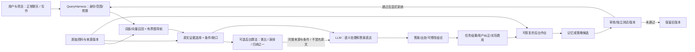

# DocThinker 产品化：先成为可靠助手，再成为团队产品

[中文首页](../README.zh-CN.md) · [架构现状](ARCHITECTURE.md) · [研究设计](RESEARCH_GROUNDED_DESIGN.md) · [邀请内测边界](INVITE_WEB_BETA.md)

代码审计日期：2026-10-10。本文区分**现有实现**和**下一阶段设计**；不表示公网已上线，也不表示科研记忆或 RSI 已经得到验证。

2026-10-13 补充：有界、用户批准的持久研究任务已接入工作台；不再把所有跨重启任务能力列为缺失，也不把它扩大成自主长期 Agent。详见 [持续研究任务与验收](LONG_PROJECT_RUNTIME.md)。历史真实模型质量失败保留。

## 1. 先做好一个产品，不同时做两套

建议先面向 **ToC 的研究者、学生和独立知识工作者**：围绕一个长期项目，帮助用户整理资料、回答有出处的问题、保留经用户确认的偏好和阶段结论。选这个入口是因为它最贴近当前文档、会话、图谱和记忆代码，而不是已经验证了市场需求。

本轮任务链是：**建立项目 → 导入资料 → 等待处理 → 正常聊天/写作 → 核对出处/缺口 → 留下可修改的结论 → 下次继续。** 由部署者显式开启研究核心，不要求用户选择“类比/演绎/归纳模式”。三种算法退到后台，按任务辅助找材料和组织论证，模型负责最终自然表达；先让少量用户做真实任务验收，再扩展团队共享。本地合成数据联调不等于真实模型质量或公开上线。

ToB 复用相同任务链，增加组织、成员权限、共享资料、审计和运维能力；不能只在个人界面上添加“企业版”字样。暂不优先做任意自主执行、插件商店、全自动改代码或多 Agent 编排。

产品对外承诺应是“帮你持续推进项目，重要结论有依据，记忆由你控制”，不是“图谱会越长越聪明”或“已实现 RSI”。

### 工作台：借鉴成熟流程，保留自己的证据特色

本轮将 WorkBuddy 的任务与成果入口、Manus 的项目上下文和可控工作流程作为设计参考，落点是独立的 DocThinker 工作台：**围绕长期项目，把资料变成能核对、能修改、能接着做的成果。** 官方来源与实现范围集中记录在[工作台设计](WORKBENCH_PRODUCT_DESIGN.md)，不根据公开产品页面推断其私有算法，不移植厂商效率数字。

工作台接入带版本冲突检查的项目要求、四个可编辑任务草稿、真实请求回执和引用式成果收藏；另有最多 6 个分析问题的用户批准研究 DAG。准备草稿不调用模型；普通问题由用户显式加入项目要求，持久任务按已批准目标/约束与资料范围执行。成果目录只返回元数据，点开单条才重新装配答案与来源。任一来源撤回或元数据无法确认时，详情不返回原答案全文；收藏不等于核验，也不自动转成记忆。工作台记录绑定稳定项目实例，并在删除会话时清理，避免编号复用后读出旧项目内容。原有显式确认记忆继续独立管理。浏览器控制、任意工具/连接器、自主规划与无人值守续跑、团队权限仍属后续范围。

这部分完善的是用户如何使用和继续项目，不是研究辅助的质量放行。真实 V6 仍存在新论文退步，结论与实验开关不因工作台上线而改变；见[研究设计与结果](RESEARCH_GROUNDED_DESIGN.md)。

## 2. 当前到底有什么

| 能力 | 代码现状 | 当前交付边界 |
|---|---|---|
| 真实聊天、会话历史 | mobile API、邀请网关与固定用户 worker 已有 | 邀请运行时最多五个预留/活跃账号；仍需实际托管、模型许可及公网验收 |
| 文档导入与证据检索 | 有界研究模式本地 PDF/TXT/MD、持久队列、BM25/MMR、页码/偏移；默认邀请聊天关闭 | 可显式开启到独立邀请 worker；无需 embedding，不自动建图；扫描 PDF 无 OCR |
| 记忆开关和上下文预算 | `QueryHarness` 有四个开关；邀请聊天另有确定性字节/历史/输出预算、关闭 SDK 重试与模型池回退 | 字节不是供应商 token；次数/输出限制不是账单金额封顶，仍无全费用账本 |
| 证据路径与探索 | 有界路径搜索、探索 PPR/MMR、推导关系门禁已有 | 图连接不证明因果；问题路由主要是关键词启发式，需真实数据评测 |
| 长期记忆及版本 | FTS5 检索全保留期，事件有效期与记录时间分开；明确确认、修订、归档、分页历史、删除；来源撤回使依赖项失效 | 容量由可扩展数据库字节配额约束，不再有 100/500 条终身上限；每次只取有限候选，版本冲突不覆盖；删除不擦除旧聊天/备份 |
| 用户偏好 | 新路径仅用户确认的偏好/决定/结论；按范围与问题排序，普通问题不加入无关发现 | **不是自动偏好学习**；重复使用不增加事实可信度，助手回答不自动入库 |
| 后台整理 | 新文档队列可重启恢复本地解析；旧自学仍为进程内调度 | 没有可自主续跑的夜间学习/长期研究 Agent，两个路径不可混称 |
| 后台论证材料 | 正常聊天/写作中，至多选一种明确规则演绎、结构类比或样本归纳；连回原文，最多 3 项/4,000 字节，算法不调用模型；不单独作为模式让用户操作 | 原文与线索分开，先保留检索证据；短关系/规则解析不完整，缺前提或超预算整项省略；类比不是事实、归纳不是普遍定律；原 studio 演示不是实际任务结果 |
| 前台优先调度 | 每服务一个已提交/运行的辅助任务、零排队，最多等 1 秒，忙/超时/失败回退原文问答；超时线程真实结束前仍占槽 | 等待超时不等于强杀 CPU；解析另有部署级单槽、120 秒等待预算和局部最多 4 等待者，不承诺跨进程严格 FIFO |
| 逐主张溯源 | 绑定原文字符区间，连续原句、未验证改写和数值/否定/条件核对提示分别呈现；读取时重查来源 | 没有一般语义蕴含验证，也不能证明原文本身真实；检查有窗口并报告省略量 |
| 回答反馈 | 已保存回答有稳定 ID；显式反馈独立持久化，历史内返回 | 不额外调用模型、不消耗提问额度；不是事实核验、训练或自动采纳，暂不提供撤销/彻底删除 |
| 单次提问可靠性 | 回执绑定问题、开关、兼容请求字段与记忆时点，完成回放、只读状态和刷新引用；网关原子计次去重；扩展字节配额替代 10,000 请求终身上限 | 淘汰回放内容不丢请求 ID；进程丢失/结果未知不重发；仍不是可自主续跑的长期作业 |
| 持续研究任务 | 用户批准的有限 DAG、按步骤持久检查点、作用域哈希与下游失效、未知付费停止对账、引用式报告版本 | 6 个分析问题＋清单/报告；每次批准 1–6 个尝试并预扣次数，未用不自动退；不是金额硬限额、自动规划或事实核验 |
| 可带走的成果 | 单次答案/有界来源可预览复制；研究项目导出资料清单与有效确认记忆；任务报告按回答引用本地组装并列各节来源定位 | 保留截短/引用失效及节选交接提示；不是语义一致性核验、完整论文/聊天导出或公开分享 |
| 上线预检 | `manage.py preflight` 检查配置元数据、HTTPS 格式、H5 实际字节与同源资源 | 不联网、不调用模型/Docker；运营者声明不冒充真实验收，不自动宣布可上线 |
| 自改进 | 候选、审计和独立标签的离线门禁已有 | 缺统一候选版本、隔离 A/B 运行器、采纳与完整回滚；尚不是 RSI |

核对入口：[`harness.py`](../docthinker/harness.py)、[`reasoning_policy.py`](../docthinker/reasoning_policy.py)、[`retrieval_policy.py`](../docthinker/retrieval_policy.py)、[`sqlite_backend.py`](../docthinker/memory_core/sqlite_backend.py)、[`mobile.py`](../docthinker/server/routers/mobile.py)、[`invite_workers.py`](../docthinker/server/invite_workers.py)。

## 3. 收敛框架：一条在线主线、一条后台主线

以下是整体目标设计；新有界研究核心的实际调用链、算法与预算见 [架构](ARCHITECTURE.md#有界研究核心2026-10-10)。后台候选晋升与受控 RSI 循环仍是设计，不新增一套平行的 Agent 系统：

资料是证据底座，图是找资料的索引，记忆是有来源的用户/项目状态，推测是待检查候选。它们不应互相覆盖，更不能用系统刚生成的文字证明系统自己的猜想。

三种推理的产品价值是**给写作和结论提供更好的参考材料**，不是让用户操作三种独立功能。比如写研究综述时，后台整理共同发现和反例；写解释段落时，检查论证缺哪一环；借鉴其他领域时，给出结构相似性和不适用之处。提示词把这些当作有条件的辅助材料，模型仍须引用实际原文，而不能引用“算法认为”冒充原文证据。没有可靠线索时就不加，辅助忙时也不让正常聊天排队。

已有 Flask/FastAPI、GraphCore、MemoryCore 与研究模块先保留兼容入口；新增产品能力接到明确契约上。只有测出重复初始化、额外 I/O 或运维成本后才拆除旧路径，不能因层数多就贸然重写。

## 4. 算法优先解决什么

### 4.1 上下文：覆盖关键材料，而不是堆数量

目标设计：同一授权范围/证据版本内，词面与向量召回融合；只在需要关联时有界扩展图。以完整片段或带全部支撑片段的路径为选择单位，按**新增问题覆盖、相关性、冗余、来源血缘与 token 成本**选择集合。

可以先实现并比较一个确定性贪心基线：`增益 = 新增覆盖 + 相关性 + 多样性 − 重复惩罚`，再除以新增 token 成本。各项权重在开发集选择；排序分数不是事实概率。不能只裁掉路径的关键桥接片段以达到预算，也不能把同一原文的摘要/复制件算作多份独立支持。

严格回答使用原文；解释任务保留方向、条件、否定、分支和缺口；探索任务允许新联系但保持“假设”标签。实际收益分别评测，探索改善不能掩盖忠实回答退步。

### 4.2 记忆：先学会“不乱记”，再追求自扩展

新增研究产品路径已落实显式确认、项目隔离、版本冲突检测、有效期、归档、删除和来源撤回；FTS5 搜索完整保留期，候选再经有界重排。`as_of` 按现在已知修订回答某个事件时点，不是复原当时系统的全部知识。归档仍可相关召回；撤回与删除不因查询过去时间而复活。10,050 条合成记录测试验证旧相关项召回与避免整库扫描，尚未完成大规模真实任务与并发容量评测。

旧完整图谱路径的 SQLite 记忆主要从问答摘要创建。此前重复摘要会同时增加 `use_count/confidence`；已改为只增加重复次数、保留原置信度，避免一条未核验的总结被重复二十次后自动升到高分。**活跃度**和**已确认程度**必须分开：多次被模型说到，只说明重复出现，不增加事实支持。既有历史高分没有被自动降低，仍需审查；不能把这一旧路径与新增显式确认记忆混称。

目标记忆记录至少有：`owner_id, project_id, source_role, source_ids, kind, status, valid_from, supersedes, version`。优先保存用户明确表达/确认的偏好、项目决定和任务状态；助手总结默认是候选。用户说“只这次简短”不能成为长期风格；用户后来改偏好要能失效旧项而不删除历史。

初期采用规则/schema 判定、范围过滤、词面/向量候选匹配与显式确认；仅对歧义项有限调用 LLM。偏好召回应能解释“来自哪次确认”，纠正时先预览差异。敏感内容默认不长期记录；现有秘密正则只是防护之一，不能保证识别所有隐私。

### 4.3 增长：增量更新与候选晋升，不是永久补边

解析结果可按内容哈希复用，但每个项目的文档拥有关系必须独立存在。删除/撤回资料要影响所有依赖它的检索、图边、记忆和候选；旧快照也不能绕过撤权。

后台只处理新增/变化的证据，用稳定任务键避免重复作业。候选有来源版本、费用预算、审核状态和过期条件；事实晋升需要真实独立支持，策略晋升需要留出任务收益。相似、共现、频繁使用均不等于支持，判断不够就保持候选或拒绝。

### 4.4 自改进：先优化受限策略，不自动扩大权限

先只搜索召回数量、路径预算、去冗余系数和证据顺序；确定性网格/局部搜索即可生成第一批候选，不默认每轮先调用一个“反思 Agent”。冻结父版本、数据快照、模型设置和预算，分忠实/路径/探索对照；失败、重试和评审成本全部计入。

候选生成不得读取最终留出答案，也不能修改评审标准、权限或成本上限。第一阶段人审采纳、可恢复父版本；这有助于形成系统级自改进研究基础，**不是递归自我改进已经实现的证据**。

## 5. ToB 之前不能跳过的隔离与运维

当前按固定用户拆进程适合少量内测，不是可扩容的租户架构。`session_id` 只区分会话，不证明权限；MemoryPolicy 中的 `user/project` scope 名称也不是 tenant ACL。现有 `default` 范围键不能直接被当成企业共享范围。

团队版至少需要：服务端解析身份和组织；每次查询/写入/缓存/任务校验 owner 与 ACL；明确的个人与组织资料共享；撤权立即生效；管理员最小权限；可恢复作业；备份恢复演练；删除与保留政策；实际费用账本与硬限额。共享索引可以复用计算，但不能让排序结果、摘要或报错泄露无权限资料。

当前不承诺端到端加密、运营者不可见、合规认证、SLA 或生产容量。收费/企业采购之前须单独验证这些条件，不能以“私有目录”“HTTPS”“测试通过”替代。

## 6. 分阶段验收，不用界面完成度代替产品完成度

下面是**产品阶段验收条件**。本轮已用单元测试与两个真实 worker/本机假模型验证研究链的状态、隔离、重启、记忆修订和引用撤销；尚未用真实模型/用户完成整阶段验收。性能/成本阈值仍须由真实试用基线冻结。

| 阶段 | 最小交付 | 必须通过 |
|---|---|---|
| P0：诚实的内测入口 | 同一入口区分真实后端、离线演示、未开放能力；给用户明确下一步 | 无后端不伪造回答；禁用上传/记忆时不展示成功；超时说明查看历史；退出后不保留前用户内容 |
| P1：科研任务链 | 每人独立项目、受控资料导入、证据回答、用户确认的记忆 | 同文档在两个项目均可见且不串；两用户相同 `#00001` 不串；删除/撤权后不可召回；引用能定位原文；关键桥接材料缺失时保留缺口 |
| P2：长期使用 | 可恢复上传/整理、记忆确认/纠正/导出/删除、实际费用与任务状态 | 重启保留作业与结果状态；结果未知的付费调用不自动重发；临时偏好不固化；冲突偏好可纠正；来源过期不继续当真；备份可恢复并仍尊重已删除/撤权标记 |
| P3：团队试点 | 组织/成员/角色、显式共享、审计、配额和运维 | 跨租户 API/缓存/检索/后台任务全部负例；移除成员立即失权；恢复演练；冷/热负载的 p50/p95、失败率与真实 usage 达到事先约定目标 |
| P4：受控改进 | 策略版本、留出评测、人工采纳、完整回滚 | 注入退步会拒绝；采用后可恢复父版本；新文档上改善成立；计入候选/评审/重试后的总成本仍有净收益 |

第一轮真实试用应覆盖“找原话、解释路径、找反例、跨论文比较、继续上周项目、纠正偏好”六类任务。记录完成/放弃原因、查证动作、无依据主张、证据覆盖、真实 token 和时延；不能只问用户“喜不喜欢”，也不能只看关键词覆盖率。

更具体的算法及消融设计沿用 [研究设计](RESEARCH_GROUNDED_DESIGN.md)，自改进完成条件沿用 [RSI 路线](RSI_ROADMAP.md)。产品化的优先顺序是：**任务可信 → 状态可控 → 长期可靠 → 团队权限 → 经验证的改进**。

## 7. 本轮落地与参考

- 三种交付模式的使用指南与未开放能力面板已接入移动界面，不会自动检查模型或把演示数据当真实数据。
- 回答反馈需要用户选类型并点击保存，说明最多 500 字符。后台核对真实回答 ID 与会话，在隔离 worker 中保留一条可更新的反馈；不复制问答正文，不把备注发给模型、不自动训练或改写记忆。运营者仍可能访问后台数据，并非端到端加密。
- 历史读取附带已有反馈，不新增页面自动反馈请求；旧后端没有回答 ID 时不展示不可用的按钮。保存失败保留说明，超限保留全文但禁止提交；切会话/离开后的迟到响应不污染新视图。
- 新增 `product-contracts.yml` 本地对应检查：移动状态测试、三端资源构建、精简邀请依赖、鉴权/反馈/隔离/记忆回归及两用户真实进程联调。需提交到 GitHub 后才会触发 Actions；本轮未推送、未公网部署。

评测设计参考 [Anthropic：Demystifying evals for AI agents](https://www.anthropic.com/engineering/demystifying-evals-for-ai-agents)：把真实结果、运行轨迹和回归检查分开，用户点赞不能替代能力评测。企业隔离参考 [OWASP 多租户安全指南](https://cheatsheetseries.owasp.org/cheatsheets/Multi_Tenant_Security_Cheat_Sheet.html)：身份/租户范围需要覆盖后端访问与存储，不是前端选择一个工作空间就完成。上述来源支持设计原则，不是 DocThinker 已满足企业要求的认证。

## 8. 对标 Manus：对标可交付任务，不以外观代替能力

Manus 官方团队介绍将工作成果、共享项目、使用量管理、访问控制列为产品能力；任务管理帮助包含部署、任务分享和结果访问；调度说明强调继续使用同一任务/项目的上下文。它们支持我们应优先建设任务交付和可靠性，而不是仅增加一个聊天皮肤。这是产品设计借鉴，**不是对其内部算法的逆向结论，也不证明 DocThinker 有同等能力或会获得同等市场表现**。[团队产品](https://manus.im/team)、[任务与环境管理](https://help.manus.im/en/collections/15921567-task-environment-management)、[Scheduled Tasks 2.0](https://manus.im/blog/manus-schedules)

本轮落地的骨架：

1. **一件事只执行一次。** 邀请网页生成 UUIDv4，后台绑定会话、完整问题、四个控制项、兼容请求字段与记忆时点的指纹。相同编号/内容读取回执；不同内容冲突；配额仅原子扣一次。进行中返回 `202/running`，前端不伪造完成、不清空草稿、不自动重发；用户主动读取状态只做 GET。刷新后的历史返回最近未解决引用，不在浏览器保存身份或正文。
2. **失败不盲目续跑。** 同一进程可在客户端断线后完成这一次提问；执行有 110 秒截止。已收到的截断/空正文/格式错误持久化为明确失败；进程丢失、网络超时等不能确认的结果仍标记未知。两者均不能推断供应商没有收费，也不会自动重发。只有明确查到无回执，用户才可用原编号/原问题显式继续；放弃追踪后再提问要确认可能重复使用额度。已接受编号不会静默复用，完成正文缓存最多七天，每 worker 的回执/结果都有容量上限。
3. **有限上下文、一次模型调用。** 当前输入最多 8192 UTF-8 字节，最近最多 6 条历史且累计最多 8192 字节，模型消息内容最多 24576 UTF-8 字节。普通聊天输出上限 2048 tokens；有原文研究回答 8192，可能包含推理与正文，是上限而非必须消耗量。检索排序一次，之后整块删减历史、记忆和可选线索，不为试不同提示词预算重复扫描资料。三种后台算法零模型调用，正常回答最多一次生成；旧原文摘录 API 保留零模型兼容。只使用明确配置的模型，不做 SDK 自动重试或失败切模型；每天每人 50 次、整实例 250 次，失败可能保守计次。字节不等于计费 token；未宣称实测节省比例，供应商分词、推理和未知结果仍需实际账单核对。
4. **成果可核对、可带走。** 复制只包含本次可见问题、回答和有限片段（研究模式最多八条，旧聊天五条），截短、失效与未核验标记保留。不会自动发布、创建共享链接或导出其他会话；剪贴板不是受保护的后端，用户分享前仍需检查。
5. **验收不自证。** 部署预检的机器验证、运营者声明和待验项分别呈现。真实 TLS、厂商授权、手机访问、容器、隔离、恢复和费用硬限额未验证时不能声称上线。打包/资源构建不等于这些条件已满足。
6. **可选算法不拖垮前台。** 辅助调度每服务一个任务、零队列、1 秒等待；超时或取消后仍保留真实运行槽直到结束，后续请求直接跳过辅助，避免 `wait_for(to_thread(...))` 超时后不断叠加线程。关闭只停接新任务，不无限等待。解析另走全局单子进程槽、本地 FIFO/有限等待，模型调用不占解析槽。算法仍需有界，不能把等待超时描述成强制中断计算。

### 下一版真正的产品卖点与门槛

首发卖点应是**“围绕一个研究项目，持续产出有来源、能纠正、能接着做的研究成果”**。本轮已补资料、证据和明确确认记忆的功能骨架；本机假模型不证明真实科研成果质量，仍不可宣传为完整自主科研助手。

持续任务现在具备可复跑的执行骨架：多材料依赖问题、预算暂停、服务重启后继续有效检查点、只重算受影响分支、报告版本及撤回隐藏。真实交付验收应让用户拿自己的材料完成一项研究决策，而不是只看固定样例回答；[长期项目验收步骤](LONG_PROJECT_RUNTIME.md#6-用真实复杂项目验收而不是固定答案演示)将软件状态与原文支持、反例、建议可用性分开。长任务保存成功不弥补单步答案的质量失败。

下一版的明确任务验收：两位用户各导入同一套非敏感论文；完成跨论文观点/分歧比较；每个关键结论能回到原文；人为移除桥接证据时保留缺口；确认/纠正一条项目记忆后下一次能正确使用；一次任务中断后不重复付费；最终输出能保留来源与修订。未完成这条链，不能宣传为完整科研助手；尚未完成组织权限、审计和数据删除恢复，就不能宣传为企业版。

市场验证先做五位独立研究者的实际任务试用，记录首次有用成果、任务完成/放弃、查证、纠错、下周继续使用及真实成本；这些是待收集的数据，不能用前端测试数量替代。RSI 的入口是把明确纠错转成可审计样本，离线评估一个受限检索策略候选，人工采纳且可回滚；不能把点赞、重复记忆或补边数量作为“越来越聪明”的证据。
