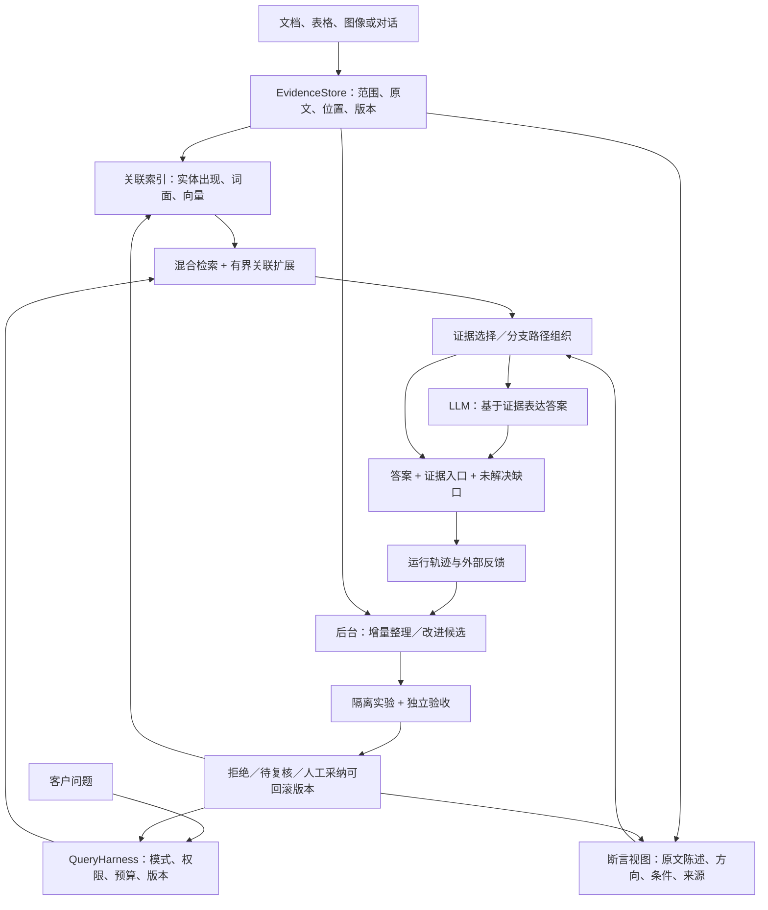

# DocThinker：基于相关工作的图谱、增长与自改进设计

分发范围：本文包含完整仓库的研究与历史开发参考。邀请源码 ZIP 不分发全部历史 JSON、私有语料或测试，不能直接执行所有开发命令；包内可运行入口以 [邀请部署说明](../deploy/invite/README.md) 为准。

[现有架构](ARCHITECTURE.md) · [RSI 路线](RSI_ROADMAP.md) · [现有评测工具](SELF_EVOLUTION_EVALUATION.md)

调研日期：2026-09-19。代码基线：`797af518c49ee394bf0ca9b6e85385c2bc35f4ce`。

**9 月稿状态：研究与工程设计，尚未实现，也未在客户数据上验证收益。** 本文区分论文证据、源码事实与本项目的设计假设；不把引用论文等同于复现论文，不把无生成式 LLM 调用等同于无计算成本。9 月该轮工作不修改生产逻辑、不运行付费模型实验、不部署；后续实现与实验另行注明。

**2026-10-10 实现进展：** 上述状态描述的是 9 月设计稿，不代表当前所有能力均未实现。私人/邀请研究路径现已接通时间化索引记忆、逐主张溯源、显式规则演绎、结构类比及去重样本归纳；当前实现、预算和局限以[有界研究核心](ARCHITECTURE.md#有界研究核心2026-10-10)为准。本文其余高级图算法、自动策略晋升和 RSI 闭环仍是研究设计，不能因局部落地而视为全部完成。

**2026-10-12 默认无本地模型路径：** 未配置完整本地语义检索／精排组合时，已增加有界词面与原文结构选证，见 §0.12。它与 §0.1 的本地模型精排是不同路径；不是把旧实验结果当成新路径的成绩，也不是语义核验或 RSI 已完成的声明。

## 0. 2026-10-10 已实现的证据重选路径

本节描述 `faceted_evidence_selection_v4`（选择策略 `bounded_source_set_v4`）及随后明确标注的修复，不是后文所有图算法的完成声明，也不是质量提升声明。目标是同时处理**关键原文漏召回**和**同主题背景过多**；不是把辅助关掉，也不是让 LLM 再生成一批关系后塞进上下文。V7 已进行真实 Step 5 Preview 对照，**未通过验收，且有两组未完成配对**，见 §0.7。随后开发不能用旧题回放代替新的真实回答质量验证。

历史窗口扩写 / legacy 路径保护至少 6 条基础来源，主要在已有窗口上扩充原文；基础候选若已经被摘要、相关工作或参考文献占据，保护旧集合就可能保护了噪声。证据重选路径把辅助改成“重新找和选原文”，可替换任意低价值基础来源，不以来源数量或扩写量作为成功条件。实验轮次 V4/V5 与算法版本 v1/v2 对应，不要与算法 v3 混淆：历史两轮真实 Step 5 Preview A/B **未通过质量放行**，结果原样保留于 §0.4。v3 冻结版的 V6 现已完成，开发题证据覆盖改善，但新论文退步且两个分组均未全面达标，见 §0.6；运行结束后的资产准备改动不属于这轮付费质量数据。

### 0.1 已落地的计算流程

1. **区分内容需求与查询视图。** 保留原问，并提取原有子句、技术短语、点名资料，最多 8 个 facet、32 个显式锚点；不调用 LLM 拆问题，不读标准答案，不把源文档内容变成查询事实。独立内容需求来自原问 literal 子句；“写 related work / literature review”等体裁、引用格式及输出语言不算新需求，条件和否定链不为缩短查询而拆开。可选本地翻译最多提供 4 个 `derived_translation/query_only` 视图，总 facet 仍不超过 8：优先保留 literal 子句，不保证全部需求进入预算。派生视图是同一问题的检索与评分辅助，不计作额外独立需求或缺证据项，也不成为证据。完整原问、原始锚点和指定文档范围保留，答案模型始终接收原问。
2. **分支补召回与相邻上下文。** 每个 facet 分别做本地语义与词面候选检索，指定资料有独立候选提名。命中位置用于定位，候选向前、向后扩展同一章节内的连续原文，目标约 1000 字符、硬上限 1600 字符，记录准确字符偏移；不是只保留命中句或固定最多 3 个单元，也不是拼接不相邻语句。遇到章节、被过滤单元或上限就停止，不能将窗口较完整等同于关键事实完整。参考文献与致谢按通用规则过滤，背景章节和表格碎片有软惩罚；非表格问题中符合通用模式的孤立英文标签在排序前剔除，包括单行标签及仅由相邻多行型号/变体名构成的单元，不把两种模型名称当作方法解释。扫描、窗口池和最终候选均有上限，未扫描不等于不存在证据。候选池最多为 2 个合格基础来源预留提名，仍占精排预算，不强制进入最终答案。
3. **在固定评分预算内选择查询视图。** 本地 cross-encoder 以完整问题或完整译文做 full 精排。明确点名多篇资料且名称映射齐全时，只从该文档的查询中删除其他指定文档的完整字面名称，不删除自身名称、内容需求或条件；映射不足则保持完整查询。单文档或未显式点名多文档的问题，至少有 2 个独立 literal 内容需求才启用 focused：2 个需求最多选 1 个，更多需求最多选 2 个，**共同分配最多 24 对**，不是每个需求各 24 对；不足 4 个合格提名的需求不启用。满配为 **24 full + 24 focused，合计最多 48 对**，同一窗口评两次占两对，候选不足不凑数。验证、限制、实验和比较需求可按唯一类别关联一个翻译别名，但原文和译文同类歧义、数字或术语丢失、否定增删等检查失败时不关联；这只是 query-only 路由启发式，不证明语义等价。先分配 pair 预算，再为每个 focused 组选择一个实际评分视图：只有唯一合格别名存在、且本组实际拟评分窗口全部通过保守英语文字检查时才用英语别名；混合或未知材料保持 literal，不同时给两种视图额外配额。记录真实 `query`、`rerank_facet_id`、`rerank_view_of`，不冒称原文子句也已评分。原始 logit 只在相同实际查询组的合格候选中转为序位效用，不跨查询共用名次；第一名也不是事实支持证明。单查询最多 192 模型 token、单对最多 512，截断边界见 §0.2。
4. **按相关性、互补性与文档公平选择。** 初选使用 ordinal rank + MMR 式重复惩罚；字节只作硬预算及确定性同分条件，没有固定 facet 深度封顶。一个实际评分查询视图至多关联一个需求，不广播给其他子问题；翻译视图的需求关联只形成相关性代理，不宣称 literal 本身已评分。多文档问题检查资格、组内序位效用下限 0.20 和预算后，优先覆盖缺失文档，再按每篇 `ceil(来源上限 / 指定文档数)` 的软配额促进公平；这不保证具体事实齐全。focused 效用乘 0.75，最多贡献 2 个新来源、共 1 个优先槽，不能给每个别名保底，也不能脱离合格 full 分支运行。同源候选会比较原窗口、安全完整并集及按完整证据单元形成的连续扩展；完整并集超过 1600 字符时，只保留仍满足边界和上限的完整单元，不截半句冒充完整窗口。focused 增量扩展最多 2 次。初选后最多做 **2 轮来源集合复查，每轮至多替换 1 个来源**，重算集合收益并保护已覆盖需求、文档配额及预算，避免先入选窗口永久占槽。只有最终引用完整保留某个 submitted window，才继承该送评 pair 的记账；局部扩展不能继承未完整保留窗口的分数。总上限仍为 **8 个来源、12000 UTF-8 字节**，不强行凑满；无法安全连接就保留缺口。这里的完整性是字符窗口几何，不是模型完整看过所有 token 或语义充分性的证明。
5. **只把选中的原文交给答案模型。** 这条路径不附加生成结论、关系或组织索引，不写入长期记忆。后台辅助新增生成式 LLM 请求和供应商 token 均为 0；正常答案仍只有一次生成请求，完整提示上限为 24576 字节。最终总 token 是否下降由原文长度、模型推理和输出共同决定，不能预先宣称节约。

初选规则可以概括为：

```text
rank_utility(e) = 9 / (8 + 同一实际查询组合格候选中的排名)；focused 分支再乘 0.75
utility(e | S) = rank_utility + 有界锚点增益 + 指定文档奖励 − 0.30 × 最大词面重复率
先通过资格、排名下限及硬预算，再按缺失指定文档 / focused 保留槽 / 文档软配额的优先级选取。
同一优先级按 utility 选择；没有固定 facet 深度上限，也没有字节软惩罚，无需填满预算。
```

这是工程启发式，不是后文路径优化公式的理论实现；独立文档配额、有限候选、条件约束和合并规则均影响结果，**不声称子模近似最优保证**。锚点“操作细节”检测同样只是文字线索，不能验证机制或完整因果链。

v2/v3 的历史实验与结论保留在 §0.4–§0.6。v4 修复需求与派生视图混算、跨语言提名丢失、窗口合并及集合占槽等计算问题；合成反例与已曝光开发题回放只能检查这些路径，不能证明未见资料上的收益。排名模型仍可能把他人工作或概述排在本文的限制条件前，译文也可能遗漏语义。**V7 实测已补回部分旧题证据，但未通过联合质量与效率条件**，不据此修改历史 V6 结果或宣布问题全部解决。

### 0.2 调度、成本和不足的表达

前台最多等待辅助 8 秒，**每个 service** 的辅助工作线程单槽；重排器与翻译器各有进程级模型 gate，忙时立即降级，不排队、不自动再次请求付费回答。这不是全进程唯一 CPU 作业的保证，不同组件和不同服务仍有各自工作。超时不终止实际线程，工作位一直保留到线程结束，迟到结果不得覆盖已返回答案。模型缺失或执行故障回退基础来源；完成筛选后没有证据则保留空集合与不足说明，**不会为了看起来有资料而恢复被筛掉的噪声**。

V6 付费运行结束后增加的 `prepare_assets` 仅校验并加载本地资产，不分词/推理、不翻译问题、不填充查询缓存、不下载、不增加 API 调用；服务通过已有辅助工作位顺序准备组件，并共用各模型的进程级 gate。资产初始化仍消耗实际时间、CPU 和内存，准备耗时必须与回答耗时分列。准备回执的 `completed` 仅表示调度工作完成，须另看每个组件的 `ready` / `busy` / `unavailable`，不能解释为所有组件均可用，也不能由此宣称已经消除超时。8 秒前台等待限制未提高；该后续改动尚无新的 Step 5 答案质量数据。

重排器使用固定 revision/hash 的本地模型，约 136 MB 文件，另需冷加载、CPU、运行内存和有界缓存；嵌入、重排与答案模型分别计成本，启用翻译还会新增真实的模型加载与 CPU 解码开销。安装、环境开关和具体哈希见[模型配置](MODEL_CONFIGURATION.md#新实验路径分要点召回本地重排预算内重选证据)。不能把无外部生成调用解释成零成本，也不能把 8 秒等待上限当成固定低延迟承诺。

翻译支路使用固定 revision、校验本地资产的 `Helsinki-NLP/opus-mt-zh-en`，遵循上游 CC-BY-4.0 署名要求，以 CTranslate2 int8 在本地运行；不在查询时下载模型，不增加供应商请求。输入及译文各限 8192 UTF-8 字节，源序列含结束符最多 256 pieces，单次确定性解码上限 256 tokens，触及输出上限即回退；不多轮翻译或生成扩展问题。原问中最多 24 个拉丁字母短语／数字片段先替为占位符，译后须逐个恰好出现一次且顺序不变，才能恢复原字符串；恢复后仍执行数字、英文词项和明显否定的原有词法检查。非中文查询跳过；用户占位符碰撞、超限、占位符丢失／重复／乱序、词法检查失败、模型缺失或校验／执行异常均保留原问，进程级翻译单槽忙时也立即回退。安装命令、开关与固定版本详见[可选本地中文查询翻译](MODEL_CONFIGURATION.md#可选本地中文查询翻译不翻译证据)。

这些保护不是语义保真证明。本地虚构问题 smoke 中，中文“不能预测风暴”曾译成 `results are not predictable`，遗漏“风暴”含义；原问并无英文 `storm`，因此不是受保护术语丢失，也说明占位符完整、否定仍在并不足以确认译文正确。目前未证明这一支路带来真实检索或回答质量提升，不能由 smoke 可运行或保护检查通过推导收益；仍需独立冻结评测分别核对证据覆盖、回答质量和新增耗时。

**送评窗口、模型输入与事实充分性分开记。** 选择器的 credit geometry 只检查最终引用是否完整保留提交给重排接口的字符窗口。重排器仍受 192/512 token 上限约束，不能把 submitted window 等同于模型实际看全的 token 输入。逐 pair 的提交／实际查询哈希、字符边界与 token 完整性回执只进入显式启用的私有诊断，公开 trace 不暴露这些查询指纹；回执缺失时不推断完整。即使回执显示未截断，也仅说明输入边界，不证明原文支持结论、限定条件齐全或答案正确。

输出的 `evidence_coverage_proxy` 明确指出相关性不等于充分性；`evidence_facets_uncovered` 只报告未覆盖的 literal 需求，不把翻译别名当新需求，`evidence_anchors_uncovered` 另记锚点缺口。这些仍是代理信号，不是自动充分性判定。客户端与复制记录使用固定的通俗提示，不显示“已证明”“完整推理”徽章，不要求用户选择独立推理模式。来源保存、历史恢复和撤回检查共用真实原文 ID 与字符范围；缓存不能恢复已撤权资料。

这仍是**有界研究内核**：有限扫描可能漏证据，跨页或复杂表格可能缺限定条件，小型重排模型可能误判科研语言，用户没有明确写出的隐含需求也未必拆出。来源引用正确、证据完整、回答正确需分别评估。它不是无限记忆、完整语义验证或 RSI；至多是后续可测量策略改进的一块基础。

### 0.3 借鉴与本项目改造

| 原始工作 | 借鉴与区别 |
|---|---|
| [Question Decomposition for Retrieval-Augmented Generation](https://aclanthology.org/2025.acl-srw.32/) | 论文用 LLM 拆子问题，分别召回后合并重排。本项目借“互补召回后去噪”的结构，但以原问 literal facets 为主，可选本地翻译只提供查询辅助；不是复现论文的 LLM 拆解方法，不能继承其提升数字 |
| [Sentence Transformers：Retrieve & Re-Rank](https://sbert.net/examples/sentence_transformer/applications/retrieve_rerank/README.html) | 借低成本召回后用 cross-encoder 精排；本项目额外限制总 pair 数并按需求/文档覆盖选集合，不把精排分数当事实置信度 |
| [Sufficient Context](https://arxiv.org/abs/2411.06037) | 借“没有取到足够资料”和“模型没有用好资料”应分开诊断的观点；本项目当前覆盖分数不是该论文的充分性判定器，也没有宣称实现可靠的自动拒答判断 |

评测分别审计实际送入模型的原文是否覆盖关键事实、无关来源比例、答案质量、真实 token 与耗时；不能只看最终答对多少。已用于修改算法的题目属于开发回归，新的同论文问题也不等于未见论文泛化；小样本 AI 盲评不能替代客户验收或统计显著性证据。

<a id="04-真实论文结果工程修复不等于质量修复"></a>

### 0.4 历史 V4/V5 真实论文结果：工程修复不等于质量修复

以下保留当时算法 v1/v2 的结果与结论；其中“当前 trace”“下一步”描述的是 V5 完成时的诊断状态，不是算法 v3 的 V6 成绩。后续离线定位见 §0.5，V6 结果见 §0.6。

2026-10-10 使用真实 `step-5-preview`、RAG / Lost in the Middle / GraphRAG / MemGPT 四篇论文，冻结 8 道主问题（4 道开发回归、4 道同论文新问题）及 1 道中文诊断。v1 与 v2 各运行一轮，每轮 18 次请求；没有自动重试，全部完成。本轮合计 **36 次真实调用、175,412 个供应商上报 tokens**，不含旧窗口实验、评审代理自身消耗或本地模型计算。完整回执索引、模型版本、代码快照哈希、分组及逐题结果见[证据重选实验报告](../benchmarks/research_real/result_faceted_20261010.json)。

最终 v2 的 8 组主问题结果如下。OFF 是基础检索，ON 是实际运行的新辅助，并非关闭辅助后的结果。

| 指标 | OFF | ON |
|---|---:|---:|
| AI 盲评答案均分 / 100 | 74.06 | 71.41 |
| 找齐完整关键事实 / 23 个（部分覆盖不计完整） | 9 | 6 |
| 每题完整关键事实覆盖率的平均值 | 37.5% | 25.0% |
| 完整覆盖全部关键事实的题数 / 8 | 1 | 0 |
| 全无关来源标签 / 全部标签 | 7 / 64 | 9 / 37 |
| 平均输入 tokens | 2881.5 | 1468.75 |
| 平均总 tokens（输入 + 输出） | 6545.875 | 3627.625 |
| 平均完整回答耗时（秒） | 44.93 | 30.80 |

ON 的 8 次辅助全部完成、没有超时，最终每题选 2–8 段原文，未新增供应商请求。总 tokens 平均减少约 44.6%，但质量 3 胜、4 负、1 平，不能以节流换来的更短上下文作为成功。全无关标签比例按总标签计为 10.94% → 24.32%，按每题比例平均为 10.94% → 22.08%；这不是逐句或逐字的噪声率。剩余缺陷是**相关性排序和覆盖代理尚不能保证具体机制、训练步骤及限定条件都被保留**。

开发回归均分 77.81 → 70.94；4 道新问题 70.31 → 71.88（2 胜 2 负），后者不能掩盖总体和证据覆盖下降。v1 曾得到答案均分 76.41 → 81.41，但完整事实反而 8/23 → 5/23；两轮均未达到召回验收。两轮 OFF 提示词和来源内容的哈希 9/9 完全相同，然而独立 AI 评审对相同来源也有注释差异，因此不能用跨轮的 5 → 6 个完整事实宣称 v2 有可靠提升。两轮是重复同一套问题，不是 16 道独立题，也不是未见论文泛化或人工专家验收。

耗时是整次回答，不是首 token 延迟；包含查询检索、辅助、生成与保存，不含单列的入库及文档向量预热。本地模型前处理均值约 0.074 → 3.299 秒；缓存 tokens 均值 256 → 288，输出长度、供应商缓存及网络均不同，故观察到的总耗时下降不能单独归因于算法提速。实验输出上限为 8192，产品默认 2048 未修改。中文诊断单列、不参与主评分；q06 的查询翻译触发占位符保护而回退原问，保留在结果中，没有剔除。

只读失败检查确认：q13 所需 RAG 训练段已经入库，约 460 字符就包含边缘化 NLL、固定文档编码器/索引及成本理由，但 ON 未选入，最终只使用 1702/12000 字节原文。q08 的 MemGPT 同一块有函数与事件控制细节，最终窗口却仅保留效果句；RAG 还选入了未来预训练方向而漏掉实际联合微调。两题最终装配均没有再次裁切来源，不能归咎于最终字节预算耗尽。当前 trace 只持久化阶段数量和最终来源，没有逐候选身份、分数及淘汰理由，因此**尚不能唯一定位为候选截流、精排还是最终选择的错误**，更不能仅凭现象断言某个模型失效。

结论：代码与回归测试完成，不等于关键证据问题已解决。普通服务现有实验开关默认值未改变，未将此结果作为客户版质量提升发布。下一步应先逐层测量“原文存在 → 候选包含 → 排名保留 → 最终来源包含”，记录窗口偏移、实际评分查询、边际收益及停止原因，再修复丢失层，并用新资料验收；不继续围绕这 8 道题调参后冒充独立测试。

### 0.5 后续离线定位与当前 v3 的验收边界

私有诊断的 pre 回放已在 q06、q08、q13 三道已曝光开发题上准确复现 V5：OFF 基础来源及 ON 最终来源的 ID、原文和偏移均一致，启用或关闭诊断 callback 不改变来源。回放使用冻结语料、禁用网络，不调用答案供应商；它是本地函数级诊断，不能冒充新的真实生成评测，预热回放耗时也不是服务延迟。

逐候选记录将“原文存在 → 窗口包含 → 内部池保留 → 48 对提名 → 实际查询精排 → 最终选择/合并”分开，已把旧题中的具体丢失定位到相应层：短窗口可能截断机制后半段，内部池及最终提名可能挤掉原文，候选已精排后仍可能因指数分差、固定 facet 深度或最终集合选择被丢弃；完整问题的高分也可能掩盖子需求或偏向单篇资料。第一版 post 回放仍存在遗漏，促成当前 v3 的上下文、序位效用、文档公平和有界 focused 支路修改。**定位了计算上的丢失路径，不等于已证明当前版本找齐全部事实，也不是各修改独立贡献的反事实证明。**

诊断通过私有 `diagnostic_callback` 显式启用，默认 `None`；生产服务不传入 callback，不默认持久化逐候选信息，也不把真实查询、候选原文、logit 或淘汰回执追加到客户 trace。callback 接收隔离副本，普通 callback 异常不影响选择；主动提供 callback 的调用方仍须负责其保存与导出边界。客户侧继续只使用有界摘要、实际引用和证据不足提示，不能靠排序高分或覆盖代理宣称证据已经充分。

上述迭代仅使用已曝光开发题，不能充当独立验收。之后先冻结 v3 代码，再开放独立保留的新文档题并运行 V6：全部 8 道旧题归为开发回归，另设 2 篇新论文的 4 道保留题，中文诊断单列。原问题、gold、split 及预算没有按保留题结果修改。验收必须同时核对严格完整事实、部分/缺失事实、噪声、答案质量和实际成本；代理盲评不是专家或人工验收，不能仅凭 token 缩短、离线回放或测试通过宣称质量提升。

### 0.6 V6 冻结实测：开发证据改善，新文档与整体门槛未达标

V6 在代码指纹 `704fd1a65ffe198925c68a181bdcd3e5e00da905f629c9bff35d65100d35aac6` 下完成 26/26 次真实 `step-5-preview` 请求，均正常结束，无重试或未知 usage。12 组主问题的每个开关只生成一次，另有 1 组中文诊断；每题两位独立代理先分别盲评，再按题取均值，形成 **12 个题级比较，不是 24 道独立题**。完整配置、代码快照、逐题分数、原始评审分歧和成本见 [V6 实验报告](../benchmarks/research_real/result_evidence_trace_20261010.json)。

下表均为 OFF → ON。完整事实严格要求保留全部关键成分与限定，部分不算完整；两位原评审的事实状态完全一致。无关来源采用独立证据盲仲裁后的标签，分母是整段来源标签，不是句子或字节。

| 分组 | 答案均分 / 100 | 完整事实 / 所需事实 | 全无关来源 / 全部来源 | 平均总 tokens | 平均完整回答秒数 |
|---|---:|---:|---:|---:|---:|
| 开发回归，8 题 | 78.91 → 81.95 | 9/23 → 20/23 | 8/64 → 10/64 | 6003.5 → 5703 | 38.435 → 41.962 |
| 新文档保留，4 题 | 81.72 → 75.47 | 7/13 → 6/13 | 8/32 → 6/32 | 5222 → 6119.25 | 25.080 → 42.946 |
| 全部主问题，12 题 | 79.84 → 79.79 | 16/36 → 26/36 | 16/96 → 16/96 | 5743 → 5841.75 | 33.983 → 42.290 |

题级质量为总体 6 胜、5 负、1 平；开发组 4 胜、3 负、1 平，新文档组 2 胜、2 负。严格完整事实宏平均，开发组 37.5% → 83.33%，新文档组 52.08% → 43.75%；找齐全部事实的题数分别 1 → 6、1 → 1。开发题 q08、q13 的确补回了此前遗漏的机制/训练证据，不能抹去这项改善；但它们已经用于调试，不能代表未见论文收益。

**两个分组都未通过冻结验收。** 开发组虽然平均质量及召回提高，q14 的 ON 回答却把总 context-token 用量差异误当成“没有控制单次回答窗口”，反转关键实验控制结论；两位评审均标记中心错误，不能用正均分冲抵。仲裁后开发组无关标签宏比例也从 12.5% 增至 15.625%。新文档组的质量与严格召回下降，平均输入 tokens 3236.25 → 3280.5、平均总 tokens 5222 → 6119.25，质量、证据和 token 条件同时失败。默认实验开关继续关闭，并非本轮新改成关闭；不发布“全面解决漏召回”或“无额外 token 的可靠质量提升”。

主问题中 10 次 ON 辅助完成并改变来源，q02、q15 在 8 秒等待上限超时回退；两题 OFF/ON 的提示词及原文内容哈希相同，仍纳入以上 intention-to-treat 主结果。相同来源下的生成/评分差异不是检索改善，不能删掉回退后只报 active 子集。所有主回答都使用 8 个来源，但相同条数不代表同样完整或相关。

26 次请求总计 **150,906 tokens**（输入 77,738、输出 73,168；其中缓存 11,264 已包含在输入中），主问题占 139,017，诊断占 11,889。第 26 次请求前为 144,582，最后一次在途请求增加 6,324，依照冻结的“调用间检查”规则越过 150,000 软线；没有提高上限或补跑。实验输出上限 8192、产品默认 2048 不变，辅助不新增供应商请求不等于总 tokens 不增加。

总体主问题输入均值略降（2999.75 → 2965.5），输出均值却增至 2743.25 → 2876.25，缓存均值 256 → 661.33，不能把缓存差异算成算法节流。前处理均值约 0.068 → 5.831 秒；10 次完成辅助的本地耗时均值 5.305 秒，两个超时 worker 的最终完成时长未保存在回答回执中，不补成零。完整回答时间含检索、辅助、非流式 HTTP 生成及保存，不是首 token 延迟；供应商、输出长度和网络差异也不能单独解释为算法快慢。

6 个旧语料模板直接复用，21 个复制文件逐项哈希一致，保存的 51.998 秒旧入库耗时没有再次发生；2 个新模板实际入库约 8.879 秒。26 个 fresh arm 的复制约 0.120 秒、文档向量准备约 196.255 秒另列；不能把每题的冷启动等价入库摊销再求和为本轮支出。初始模板拷贝耗时未独立测量，记为未知而非零；未取得金额账单，也不把代理评审和本地计算称为免费。

协议偏差同样保留：评审 B 的 6 个包使用了与 A 相同的候选顺序，随后 6 个未读包才反转，不能声称呈现顺序完全平衡。原始评审共 4 组无关标签冲突，由第三位代理在不见 arm、答案评分和成本的情况下，对 3 个包 / 4 份原文进行证据盲仲裁；原 weighted 答案分数没有重写。两篇同领域公开新论文、四道保留题及小样本 AI 判断仍不构成跨领域泛化、统计显著性或人工专家验收。

冻结后离线启动归因也不构成新质量数据：初始归因组的 q02 每条件 3 次，process-cold 回答耗时中位约 6142 ms、asset-warm 约 4739 ms，后者另需约 1521 ms 资产准备，6 次来源摘要相同；q15 每条件仅 1 次，cold 5938 ms、warm 6533 ms，另需 1629 ms 准备。初始组均完成，但后续公共 `prepare_assets` / 实际回答路径烟测的 4 次运行并非全部完成辅助：q02 cold / warm 回答约 6000 / 4615 ms，warm 另需 1602 ms 准备；q15 cold 在不变的 8 秒上限超时，回答约 8670 ms，辅助 worker 总耗时约 9606 ms，回答返回后仍观察到约 1583 ms 尾部工作；q15 warm 回答约 5286 ms，另需 1968 ms 准备。上述耗时起点不同，不能把回答与尾部之和当作辅助耗时。q15 cold 返回的是回退来源，后台最终来源才与 warm 一致，不能混为同一个来源包。公共烟测每条件各 1 次，保留初始 q15 cold 比 warm 快的反例；所有诊断均无网络、无供应商调用，使用常量答案标记且不保证操作系统文件缓存冷态。故不能将两次付费超时都归因于初始化，更不能据此宣传已消除超时或端到端提速。

新增 `prepare_assets()` 公共接口后又分别做了 q02/q15 各一组新进程离线烟测，不能替换前一组或付费结果：q02 cold 6000 ms、warm 4615 ms，另需 1602 ms 准备；q15 cold 实际发生超时，前台约 8670 ms 返回回退，helper 共运行 9606 ms，答复之后仍有约 1583 ms 后台尾部；warm 5286 ms 完成，另需 1968 ms 准备。q02 两臂最终来源相同；q15 冷臂前台用了不同的回退来源，迟到 helper 的来源虽与 warm 相同，也不能算作前台使用过。四次均使用常量生成标记、零联网、零付费调用，保留在 `startup-attribution-{q02,q15}-public-v1/`；先前 q15 预加载反而更慢的记录同样保留。实现只把可测的资产加载移出首问，不保证消除超时，也没有用这些离线时间改写 V6 的真实响应速度。

剩余失败的冻结代码回放已准确复现 q14、q19 的付费来源，且 callback 不改结果；私有诊断位于 `dist/real-paper-ab-20261010/trace-v6-remaining-v1/`，无需新增付费请求即可复查。它定位的是丢失层，不是修复或新的质量实验：

- **q14 并非低分或未召回。** GraphRAG 第 7 页关键窗口 `[755,1806)` 已进入提名并获 full-query 第 2 名（logit 5.724）。同源前缀 `[15,1164)` 先被选中后，该窗口转为待合并；连接本身安全，但并集 `[15,1806)` 为 1791 字符，超过单窗口 1600 的硬上限，被整体拒绝。最终只用 8725/12000 字节，故不是总字节用尽。可连接的较短窗口又分别受 24 full + 24 focused 分配或 48 个提名上限排除。缺失控制段能解释证据遗漏，却不能证明它是模型错误推断的唯一原因，更不能把“修召回”当成保证答案正确。
- **q19 并非参考文献过滤或精排预算不足。** FiD 第 5 页 `[0,218)` 的未来工作段在 34 个候选中，且全部候选均已精排；该段 full-query 第 14 名、按独立来源为第 9，效用约 0.381，低于占据最后一槽的 Related work 段约 0.478，因此止于 8 个来源上限。停止时仅用 7951/12000 字节，合并后 8859，220 字节关键段仍未进入。冻结的内容需求规则未包含“哪里”，使 focused 支路没有触发；这只是已证实的路由现象，尚未验证补一个词就能改善最终来源。
- **q20 还有答案阶段问题。** 已提供的 ON 原文包含训练/测试 passage 数量条件、恢复训练及计算成本，但生成答案仍错读了实验条件；同包也存在真实的无关碎片。只读检查没有重跑 q20 精排，不能编造其逐候选排名或断言噪声导致了这次退步。完整证据召回与正确读懂条件仍需分别验收。

冻结时研究单测为 1019 passed / 3 skipped；付费运行结束后的资产准备与仲裁工具合入后，研究单测为 1039 passed / 3 skipped。两次不能相加，也不是全仓库或手机测试，更不能代替上述真实质量失败结论。

### 0.7 V7 真实对照：旧题改善，不等于新论文达标

[V7 完整报告](../benchmarks/research_real/result_evidence_trace_v7_20261010.md)保留配置、逐题得分、来源事实审计、失败、协议偏差和原始文件哈希。计划 4 道开发题加 8 道新论文题；实际 23 次 Step 5 Preview 调用，22 个答案、1 个输出达到上限的空回答，另 1 次因软预算未派发。10 组完成配对接受双人独立 AI 盲评；不完整的 h05/h08 保留在计划清单，不补零、不删掉后判通过。

开发组 OFF → ON：答案均分 **81.72 → 86.25**，完整事实 **7/12 → 11/12**，全无关来源 **8/32 → 6/32**；但总 tokens 均值 **5898 → 6537.25**、完整回答时间 **31.50 → 47.22 秒**。q14、q19 的控制条件／未来工作补回了，q20 在原文齐全时仍混淆实验条件。输入更少不代表总输出成本更少。

新论文只完成 6/8 组，不能估计全组验收成绩。完成子集仅作失败分析：答案均分 **81.46 → 75.10**，完整事实 **7/18 → 9/18**，全无关来源 **14/48 → 9/48**。h03 丢掉重要比较段，h04 超时后两臂来源完全相同，仍大量召回题录；不能把同提示下的生成差异归因于来源重选。总共消耗 **155,831 tokens**，包含失败和未配对调用，没有自动重试。

结论仍是**未通过**，不是“少几题就能宣布成功”。封存协议与 fixture 的语料范围另有矛盾，本轮实际按题指定论文，不是全七篇混合库检索。后续句级需求拆分、超时回退清洗和引用位置修复是另一次开发，不计入上述成绩。详见报告的失败定位；这也不是 RSI、客户上线或人工专家验收。

### 0.8 V7 之后的 v5 修复：先追踪证据，再验回答

2026-10-11 开发中的 `faceted_evidence_selection_v5` / `bounded_source_set_v5` 不改变上面的 V7 成绩。主要修复的是原文在各阶段被错误丢弃，而不是增加 LLM 生成关系：

- **切分阶段**：英文句号后的独立请求可形成新需求，但同句否定、条件和依赖必须保留。标题需要真实行边界与结构证据，不能把正文的 “24 hours in advance” 当新章节。图注单独成边界；只有紧邻图注且满足严格模式的纯坐标刻度可剔除，混合单位、表格、未知内容保留，用户询问图表数据时不执行此过滤。
- **候选阶段**：原始检索的每个合格来源最多提名一个仍可用的窗口，至多 8 个，占用既有评分预算。只是让它们有机会参评，不保送最后的来源集合，也不恢复已撤回、已过滤或不存在的资料。
- **纠错请求的补位阶段**：对于严格限定的英文“核对这段引述”请求，完整原问仍正常评分；另用原问中可精确定位的材料前缀与核对要求作为查询视图，去掉待纠正引述的牵引。它不是新需求，不算证据。两分支必须确实完整评过同一原文窗口，至少有 4 个独立来源可比；只考虑核对名次进入共同候选前半、且相对原问名次提高的候选，优先补入改善更大的一个来源。分数只在各自查询下排位，不跨查询比较 logit。没有合格项就不启用该保留槽。这个规则仍是相关性启发式，排名提高不证明内容正确或条件齐全。
- **退化与溯源阶段**：辅助超时或失败时，仅保守清理基础集合中的完整题录／联系信息，不追加检索或付费重试；引用位置查找覆盖尾部证据，并在恢复时核对原文哈希与权限。答案公共规则明确“本次节选没覆盖”不能写成“整篇论文没报告”。这些保护不等于语义蕴含校验。

预算仍是总计最多 **48 对评分、8 个来源、12000 字节原文**，普通 focused 与引述核对不叠加预算；引述核对最多 12 对，最多一个来源并共用现有补位槽。后台仍不新增生成式 API 请求，但本地嵌入、重排、可选翻译及回执验证都有计算成本。

该修复使用已曝光失败题开发。冻结后的 h02/h03 真实 Step 5 Preview 试验 **仍未通过**：4 次请求共 27,198 tokens，答案均分 86.875 → 74.375。h02 辅助超时，实际没有用到新来源；h03 证据补齐但答案仍改错因果量并漏掉实验限定。详见 [V8 完整报告](../benchmarks/research_real/result_evidence_repair_v8_20261011.md)。因此不能把旧题回放、合成测试或“来源找齐”报告为答案质量达标。

后续修复另外记录：中文查询的不变条件增加保守词面检查，失败返回原问；这不是语义等价验证，且拒绝译文后跨语言召回仍可能退化。回答规则强调结果与条件、因果方向绑定，仍需真实生成验证。本地分桶实验虽省 padding，却因动态量化改变分数并丢掉 h02 关键来源，**未合入**；增加线程的少量速度收益伴随明显 CPU 增长，也未合入。尚未解封下一轮新论文。实验失败、输出截断、超时与 token 增长均保留；本节不是上线、无限记忆或 RSI 完成声明。

### 0.9 模型无关的输入契约：把规则、证据和传输分开

2026-10-11 后续实现把规则集中到 `research_answer_contract.py`。系统规则不读取模型名称，也不含特定论文答案；覆盖证据边界、数值与条件绑定、因果方向、未知／冲突、记忆用途和自然聊天写作。`grounded_prompt` 只序列化任务数据，不再复制另一份长规则。

实际链路是 **检索与筛选 → 原文/记忆/历史的整体预算 → 两条已校验消息 → 模型适配器 → 引用与来源状态审计**。`ResearchService` 从预算校验后的同一消息取 system/user 内容，继续使用原来的模型调用接口；不会因模型不同改写证据、试探多个 prompt，或因接口异常再补一次付费调用。供应商参数兼容仍由适配器负责。一般服务器模型池的 failover 与邀请测试路径的单次请求限制是不同配置，不能混称全项目永不重试。

输入回执保存规则版本和 SHA、实际消息 SHA、原文包 SHA、预算前后来源数。它能定位“被检索到但没送入模型”，不能证明模型真正使用了材料或句义正确。新增调度回执分开记录共享线程池等待、实际工作耗时和超时快照，迟到完成不回写旧回执；上限仍为 8 秒，不能把尚未测完的时间记为零。

这轮不采用简单的等基础检索字节上限：六道开发题的离线检查显示它会删除关键条件。也不合入改变动态量化排序的分桶、收益不足的加线程、未补回缺口的双 focus 或仅让词面 guard 通过的翻译预替换。固定规则去重节省的是输入字节，并非已经验证的模型 tokens/质量收益。按同一规则分别报告不同模型的真实配对结果，不用一个模型的提升代替其他模型验收。

### 0.10 双模型试跑：输入契约统一，质量与效率尚未联合达标

使用上述同一套运行时，在两道已参与开发的真实论文题上完成 Step 5 Preview／Step 3.7 Flash 各四次调用。4/4 对应输入的 system policy、完整消息、证据包哈希与生成参数完全一致；没有按模型切换提示词或筛选规则。相关测试在分析器显式模型参数修正后为 **1737 passed / 2 skipped / 3 deselected**，不代表全仓库或产品发布测试通过。

两模型实际原文完整事实均从 4/6 提升至 6/6，但不能把材料齐全等同于答案正确：两位独立 AI 盲评分，Step 5 均分 78.44 → 97.81；Flash 73.44 → 74.38，且其中一题退步。Flash 仍把“输入延迟＋额外生成时间”混成错误总耗时，并在另一题引用了不支持相应机制的标签。

争议包独立证据仲裁后，全无关来源数均为 1/16 → 6/16，输入 tokens 增加；Step 5 总 tokens 略降，Flash 总 tokens 与耗时均增加。因此这轮验证的是可替换生成模型的输入链路，以及开发样本上的证据改善，**不是联合达标、跨厂商泛化、2048 产品输出上限验收或 RSI**。下一步仍须解决候选窗口与实验条件的成组保留、无关来源淘汰和引用语义支持，不能以提示词替代这些算法工作。详见[完整试跑报告](../benchmarks/research_real/result_portable_contract_v1_20261011.md)。

### 0.11 2026-10-11 有界图补召回与后台假设辅助

本节记录本轮新增实现，不覆盖或重写 §0.4–0.10 的历史评测结论。目标是让图帮助**定位真实原文的连接处**，再在用户要求研究 idea 时组织可检验的候选；不是用生成的关系代替原文，也不是新增一个独立“推理模式”。

**借鉴边界。** Microsoft GraphRAG 的 Local Search 将相关实体作为入口，结合图中关系与关联原文，再按上下文预算筛选；本项目借鉴“图导航最终回到原文”的原则。[官方 Local Search 文档](https://microsoft.github.io/graphrag/query/local_search/) PropRAG 强调保留上下文的命题表示，并通过不依赖在线 LLM 的路径搜索组织多跳材料；本项目借鉴“路径搜索不必逐跳调用模型、关系不应丢失条件”的原则。[PropRAG 原论文](https://arxiv.org/abs/2504.18070) 本轮没有复现两者完整的实体提取、图构建、搜索或评测流程，不能继承其论文成绩。

**实际流程。** 在已有词面／本地语义召回及可选重排之后，`research_graph_retrieval.py` 用当前项目已授权原文的保守关系索引补查连接：共享实体端点才形成邻接，仅有相同关系词不连边。以已选原文为起点，最多扩展两条新边，最多加入三个原文窗口；高连接度节点、候选状态数、索引窗口均有限制。关系保留方向、否定和条件，但搜索连通仍只是检索线索，不是蕴含或因果证明。命中的路径必须回到当前原文字符窗口；旧缓存只提供指针，不能绕过来源变更和撤回。

本轮图补召回只追加完整窗口，不更改已经选中的原文、顺序或标签。来源总量仍限制为八条、12000 UTF-8 字节；预算满就报告无法补入，不为插入桥接材料而删掉已有答案或必要前提。这是保守的增量策略，不意味着八个槽位已经用满时还能保证找齐完整推理链；前面的证据重选仍负责改进原集合。

**提出 idea 的后台辅助。** 用户在普通聊天中明确要求新假设、研究方向或 idea，且已有原文时，`research_hypotheses.py` 才生效；翻译、只摘录、否定要求、询问作者已有假设等有保守守卫。现有后台辅助启用开关与 `evidence` 禁用行为不变。模块仅检查当前选中摘录，最多读取 48 条可解析陈述，再分别运行一次现有结构类比、条件演绎和去重样本归纳。完整前提必须对应当前 `[Sx]` 摘录内的准确字符范围；超限结果整体省略，不给半条证明。三个算子不要求都成功，也不强行凑满候选。

一次正常答案生成把这些材料组织为至多三个候选，每个包括：想法、原文依据、迁移边界或缺失前提、反例或竞争解释、最低成本的证伪测试及失败信号。system policy 与辅助约定分清三类信息：

- **原文观察：** 只引用当前真正提供的摘录；文件名、记忆、排序和相似度都不是事实证据，来源陈述本身也未被认证为真实。
- **模型背景知识：** 可以用于启发，但明确标注 `model_background_unverified`，不能挂上传资料的标签冒充出处。
- **待验证假设：** 与观察分开，保留条件、可能失败的原因和验证办法，不宣称新颖性已被验证，不自动写入长期记忆或事实图谱。

本轮图搜索和假设辅助均是本地有界计算，**新增生成式模型请求为零**；正常回答仍由一次 writer 调用完成，不为每条路径、每种推理另开模型请求。假设辅助块上限为 4000 UTF-8 字节，完整提示适配优先整体移除辅助块，再考虑削减原文。字节不等于供应商 token，也不等于无 CPU、内存或延迟成本；一次 writer 调用的实际 tokens 仍可能增加。来源撤回时，辅助依赖和相关回答一起重新校验，不能保留“已验证”的旧展示。

**普通论文的实际局限。** 当前严格解析器只覆盖短关系与明确条件规则，不等于理解任意论文散文、图表、公式或跨句指代。新增测试使用 GraphRAG 文档及 PropRAG 摘要的短原文：这类普通技术散文可能一条严格陈述都解析不出，此时算法结果为空，只提供上述候选组织约定，由正常 writer 阅读实际摘录后提出明确未验证的想法。空结果不代表论文没有相关结论；三个算子运行过也不代表理解完整或语义证明成功。长距离同义实体、复杂实验条件和跨模态关联仍需后续检索与表示改进。

本轮验证的是路由、完整来源绑定、否定与撤回、硬预算和零新增模型调用等工程不变量，**未新增真实模型 A/B 质量、供应商 token 或响应速度评测**。尚不能据此声称新论文回答更准、更快、idea 更好或已经实现 RSI；须另做真实资料的配对消融，分别评价关键证据召回、无关材料比例、条件／反例保留、假设可检验性和全部资源成本。

长源块不再一律跳过：仅追加覆盖当前路径所需陈述及紧邻显式条件／否定的完整连续窗口（最多 1000 字符），保存原 chunk 字符范围与窗口哈希；跨度过大则整条路径省略。PDF 关系句内部的软换行仅在解析视图中作同长度空白归一化，引用保留原文。这里的完整是语句和所需路径陈述完整，不是保证远处实验条件、图表或全文语义已经覆盖。

可复跑的离线检索诊断：

```bash
PYTHON_DOTENV_DISABLED=1 python -m scripts.benchmark_graph_discovery
```

2026-10-11 本机默认参数运行 **8/8 合成场景通过**。五个桥证据召回场景中，指定原文覆盖从基础词面检索的 0/6 到追加图检索的 6/6；累计追加 183 UTF-8 字节。另两个预算满场景保留原证据且拒绝追加，单独报告，未计入召回成功率；一个无连接负对照没有追加。固定 seed 的 1800 块／1800 边、五组冷／热缓存纯图阶段中位数分别为 **91.95 ms／7.57 ms**。计时包含图输入校验、建索引或校验缓存、锚点和路径搜索，不包含基础检索、模型、网络、重排与文档解析；“冷”指新图实例，不是新系统进程。此结果不是新论文回答质量、真实 token 或端到端提速成绩，不能覆盖前述真实评测失败。

### 0.12 2026-10-12 无本地语义模型时的默认选证路径

**解决的是“原文存在，但找错或选丢”，不是让模型多写几条关系。** 在已曝光的真实论文开发回放中，明确出现了两类问题：参考文献和泛背景进入答案来源；核心方法已经在候选池中，却被包含更多问题用词的附录、效果描述或相关工作挤掉。此前的单个 `文档×角色` 最大值会被一段混合文字占满，“有几个动作词”也会被误当成较完整的方法。只增加关键词权重、扩大上下文或者关闭辅助都不能针对这些丢失环节。

本节对应 [`research_lexical_coverage.py`](../docthinker/server/research_lexical_coverage.py) 的 `literal_window_coverage_v1` 及 [`research_fallback_sources.py`](../docthinker/server/research_fallback_sources.py)。后台辅助启用、请求不是 `evidence` 且服务没有完整本地语义检索／精排组合时，运行这条路径；已有本地模型组合仍走 §0.1 的独立调度路径。关闭后台辅助不运行新选证；明确的逐字、编辑、参考列表问题不触发本轮全库窗口竞争。两条路径共享部分原文窗口代码，但不能混报模型调用、候选评分或收益。

**实际计算步骤：**

1. **保守清理整段噪声。** 去掉可明确识别的纯参考文献、联系信息和纯泛背景；支持无编号的作者—年份参考列表。混有实质陈述、否定、条件或测量值的来源保留，未知形式也保留。用户明确查询参考列表、背景或联系信息时有相应豁免。清理不改写、拼接或裁掉原文中的条件。
2. **用字面需求提名，而不是生成检索结论。** 从原问提取有限子句、技术锚点和明确点名的文档；`architecture/data flow/架构/数据流` 等明确机制需求可以路由方法提名。规则词形匹配只用于查找，引用文本不变；它不能翻译、理解任意同义词或建立因果关系。基础来源里的文档不再成为硬性搜索范围，其他当前授权资料有真实查询匹配时仍可竞争。
3. **互补候选入口。** 一条按问题与原文的词面命中提名；另一条在明确点名或已有召回依据的文档内，为符合机制需求的组成／数据流文字提供有限候选机会。明确的结构解释请求还按文档、子节和不同功能定义轮询：从原文有限语法定位“某组件保存／返回什么”，最多四个标记／窗口、八个组件／文档；图注、相关工作和只提到名字不获得定义奖励。未点名的文档还须有用户问题中的组件词面锚点。这些都只获得进入同一 48 候选池的机会，不保送来源，不注入新事实。
4. **在硬预算内选互补原文。** 结合词面效用、`文档×角色` 前两条的折扣边际收益、实际问题词项的覆盖增益和最大词面重复惩罚。第二条角色贡献乘 `0.4`；结构任务另对不同组件的明确功能定义和原文明示 `first…then…` 的过程提供有上限的边际机会，后者最多两个词面动作对／文档。“提过名称”不能消耗定义维度，末段操作定义也不能自动覆盖前段过程。它不是完整语义义务或因果链检测。数值／指标限定任务不自动扩为架构比较，结果与实验条件仍有各自机会；显式功能解释优先于 `recall` 等歧义指标词，未知意图不强加组件要求。附录只作条件性的软降权，唯一方法在附录仍可选。排序使用文件名、原文顺序、偏移和内容，不按论文名、标准答案、预期结论或随机 UUID 设规则。
5. **保留片段边界和不足。** 每条来源仍是一个 chunk 内的连续原文，保留来源 ID、页码和字符偏移，不将不相邻句子接成“完整证据”。末尾没有可识别句界时保留原片段，同时置 `sentence_boundary_preserved=false` 并提示 `source_boundary_unverified`；小包直接保留、无候选等提前返回也检查。标点存在本身仍不证明语义完整，不能据此确认跨页条件已找齐。达到扫描上限时，无候选也必须保留 `literal_coverage_scan_limited`，不能把没搜到当作不存在。

选择器的目标是**有界词面／原文结构相关性代理**，不是蕴含检测或因果证明。`文档×角色` 与问题词项覆盖不是独立事实覆盖，`top-2` 和去重也是启发式；重复惩罚、扫描截流和预算约束存在，不声称最优或子模近似保证。第三方研究、复杂表格、跨页说明、隐含前提以及低词面重合的实质内容仍可能误排或漏排。

同日组件修复分别定位到候选池与最终选择两层：真实正文的功能定义已有窗口，却未进入 48 候选；仅把它放入池内，仍会被粗粒度“机制已覆盖”及词面重复惩罚淘汰。新增维度因此同时作用于候选机会与边际选择，不能只提高召回数量。独立回归还发现并修正数值任务误入定义、定义挤掉建图前段两种副作用。最终六臂真实 PDF 准备恢复了记忆组件正文与图构建入口，并保留原有假设题来源；准备阶段零供应商调用，**不是新回答质量结论**。新实现见 [`research_component_coverage.py`](../docthinker/server/research_component_coverage.py)，通用验收见 [`test_component_coverage_acceptance_unit.py`](../tests/test_component_coverage_acceptance_unit.py)，真实复验范围提前记录于源码仓库的 `benchmarks/research_real/plan_insight_component_regression_20261012.md`。

10月13日进一步统一后台补来源的窗口安全。V6 真实复核发现补查原先绕过基础选证的章节规则，将上一任务的续文与下一任务标题交给同一个标签，诱发错归属。现在通用 `_excerpt` 即使短于预算，也不能跨已观察到的真实章节行边界；只在原片段内选择一个完整连续窗口，图注、数量和未完句换行不自动变成新章节。最终拟合的每一种来源组合重新检查可见开头的回指，不猜跨片段对象，撤掉节选后也撤掉其过时缺口。来源/提示预算、普通一次生成和零额外供应商请求不变。这是**结构范围安全**，不是每条主张语义已核验；隐式换题和未识别标题仍有局限。见 [`test_research_source_scope_acceptance_unit.py`](../tests/test_research_source_scope_acceptance_unit.py) 和预登记的 `benchmarks/research_real/plan_insight_source_scope_regression_20261012.md`。

**同日后续修复：来源身份与回指对象不能被压缩掉。** 明确点名比较不同文档时，两个文档中的相同表述仍分别具有出处；选择器给尚未覆盖的点名文档保留来源机会，缺文档则提示 `documents_not_selected`，不因文字相同而静默抹掉第二篇。保留两份出处不意味着两次独立实验，也不增加事实真实性。

真实开发回答还暴露了另一类错误：节选从 “To overcome this” 开始，前一个任务的标签困难被切掉，模型将后续操作误归给紧接着出现的另一个任务。本轮用通用回指规则把 `To overcome/address/resolve/handle/avoid/mitigate this` 及“为此”等表达与可见前句绑定；保留当前条件，不以特定论文或任务名称设规则。绑定后的单元若超过窗口上限则整体不选，不能裁掉前句或条件再保留操作。若原始 chunk 开头已经没有先行对象，保留原文并报告 `source_antecedent_unverified`，不能借后续标题或模型常识补造对象。该提示与 `source_boundary_unverified` 分开：句末有句号不代表回指已解决，缺回指也不等于没有句界。合成边界回归覆盖这几种情况；它不是任意代词、跨页语义或实验对象消歧的完整实现。

10月13日真实回答还发现了与召回分开的两类交付故障，随后作了确定性修复：组合引用由统一的有界语法解析，未知标签和截流不能在保存、重启后消失；逐主张核对仍限12段，但仅跳明确的格式元素，并按原语句位置分层，避免开头表头耗尽全部额度。未知粗体、引用、数值和否定仍可进入核对；未选的实质语句明确计入遗漏。它们新增供应商调用为零，回放保留历史答案哈希和未验证状态，**不修正回答正文、不证明语义支持或已通过质量门禁**。见 [`test_research_citation_syntax_unit.py`](../tests/test_research_citation_syntax_unit.py)、[`test_research_audit_allocation_acceptance_unit.py`](../tests/test_research_audit_allocation_acceptance_unit.py) 和[最终软件验收](RELEASE_ACCEPTANCE_2026-10-12.md)。

随后进一步修复“入选了定义，写作却只列名字”的交接：最终拟合的 `source_quotes` 可附最多4项、1200字节的组件功能原句定位，仅结构/功能任务启用；名称和完整原句坐标直接取自该节选，不重复 quote、不生成定义。未知意图、仅提名字、数值任务及明确排除架构时不添义务。最终预算不足先整体撤掉定位提示，不能为提示挤掉资料；实际消息和证据哈希使用同一投影。回答合同 v6 为3742 UTF-8字节，并未增加供应商请求。该机制是注意力提示，不保证模型已解释全部组件。

效果、优越性及“已证实”的中英文词面同样只作为有限核对的优先信号，在各位置段内先于有引用和篇幅排序；非逐字表述提示核对任务、指标、对照和条件。否定或条件句也可能命中，不表示判错；某个混引来源含结果不让整句通过。未命中的未知措辞仍有核对机会，逐字对应仍只表示原文字面一致，未选部分照常披露。通用独立验收见 [`test_research_performance_review_acceptance_unit.py`](../tests/test_research_performance_review_acceptance_unit.py)，组件交接与预算见 [`test_research_component_handoff_unit.py`](../tests/test_research_component_handoff_unit.py) / [`test_research_component_prompt_budget_unit.py`](../tests/test_research_component_prompt_budget_unit.py)。新修复不回写为 V7 的真实质量成功。

**预算与调度边界：**

| 层次 | 本条路径的实际边界 |
|---|---|
| 原文扫描与候选 | 最多扫描 4096 个 chunk；单块扫描上限 8000 字符，过大块跳过；共享窗口池最多提交 48 个候选 |
| 单候选与基础来源集合 | 单窗口上限 1600 字符；选证最多 8 条、合计 12000 UTF-8 字节；收益不足或预算不够就停止，不凑满 |
| Insight 后续补查 | 独立的有界阶段，最多再补 2 条，最终协议至多 10 条；仍共用 12000 字节来源总预算，不将 8 条基础来源上限误写成整条流水线最终上限 |
| 完整答案输入 | 完整提示上限仍为 24576 UTF-8 字节；字节不是模型 token，辅助块与来源仍须经过最终预算装配 |
| 本地工作与供应商调用 | 本次词面选证新增模型／供应商调用为 0；正常 writer 生成仍有模型成本，不承诺总 token 或总时延下降 |

词面选证与原有材料组织合在同一次 [`BackgroundContextScheduler`](../docthinker/server/research_scheduler.py) 作业中，默认前台等待 **1 秒**。这是每个 service 的单个活动作业入口，不是整个服务器只有一个 CPU 线程，也不是强制中断线程或整次回答 1 秒完成。已有共享线程池可能引入等待；`queue_ms`、`worker_ms` 等回执分开记录。超时、忙或失败不重试选证，只检查已有基础包的明确整段噪声；迟到结果不能替换已返回答案，活动槽保留到线程真正结束。图补召回和 Insight 后续阶段还可能各自使用同一入口，不能把单次等待预算当成整条流程耗时上限。

**本轮验证及尚未证明的事：**

- 新增反例覆盖：基础召回漏掉整个相关文档；同文档两个机制；清理后基础包为空仍应找方法；`flow/flower` 伪词形匹配；高词频附录挤掉低词频正文方法；唯一方法在附录；明确查询附录；第三方相关工作不能替代本研究结果。
- 另外检查 48 候选边界下替换 document/source UUID 后内容选择不漂移、两种提前返回的半句警告、超过 4096 块但无候选时的扫描提示；逐条核对原文切片、页码、偏移及 8 条／12000 字节限制。这是指定反例的稳定性检查，不是所有资料顺序或任意规模都不变的证明。
- 本节更新时，词面选证、调度和存储回归合计 **138 passed**，无供应商调用。扫描提示可持久化并在重新建立存储对象后恢复，只保存固定缺口代码，不保存调用方附带的私有解释文本。测试见 [`test_research_lexical_coverage_unit.py`](../tests/test_research_lexical_coverage_unit.py)、[`test_research_scheduler_unit.py`](../tests/test_research_scheduler_unit.py) 和 [`test_research_store_unit.py`](../tests/test_research_store_unit.py)。
- 同日跨文档出处与回指修复后，连同 [`test_research_heading_boundaries_unit.py`](../tests/test_research_heading_boundaries_unit.py) 独立重跑四组，共 **216 passed**，仍无供应商调用；这是新增工程边界验证，不是新回答质量结果。
- 上述合成反例、真实论文原文回放和提示准备不是新的模型回答质量试验，不覆盖历史付费实验失败，也不能证明已找齐核心方法或减少了供应商 token。下一步需冻结代码后分别测候选召回、最终关键原文覆盖、无关背景字节、条件保留、回答质量和端到端实际资源；已用于调试的题仍属开发集。

复跑本节工程回归：

```bash
PYTHON_DOTENV_DISABLED=1 PYTHONPATH=. python -m pytest -q \
  tests/test_research_lexical_coverage_unit.py \
  tests/test_research_heading_boundaries_unit.py \
  tests/test_research_scheduler_unit.py \
  tests/test_research_store_unit.py
```

### 0.13 2026-10-13 固定预算内的目标覆盖与增量补查

问题不是“再召回多少条”，而是**有限上下文里缺哪种材料，下一段能否真实增加可见的信息**。默认词面算法不请求 LLM 分解或打分；它使用保守的原文结构代理，仍可能漏召回和误判。

基础选证将同文档的机制族与实验族分别归一到最多1.3软收益，避免把一个目标拆成更多章节、定义或子格就抢到更多位置。实验族区分设置、测法和已报告结果，机制族保留功能定义、至多两个有效操作对及一个有存储约束的状态维护维度；未知形态仍可按有限粗角色回退。原文完整度按单个锚句及合法紧邻限定分别计算再取最大值，不能从另一任务借“失败处理”或“仅在某条件下”凑分。通用请求短语不能靠更短的分母压过完整子问，明确引用和未知技术词仍保留。

测量定义既识别显式程序，也识别同句的“评判对象＋标签/值/含义”映射，纯数字、库存/业务代码、另一句的标签、未来计划不能填格。只有用户明确指定文档、泛问实际评测时，同一实验子格可共享已提名窗口的相关性；正文完整度仍独立竞争。具体指标、不同文档分句、否定和逐字任务不借用这种相关性，不把同名指标当语义等价。

先贪心选证，再对同一归一目标做一遍有界局部改进；最多48个候选×8个位置、384次替换或补入尝试，仍只有8条基础来源和12000原文字节。一条来源保持同一原文块内的连续切片，不把互补窗口拼成引文。这个目标是原文形态与词面覆盖减重复损失，**不是语义事实覆盖、最优解或继承文献的近似保证**。

随后 Insight 补查由独立的 [`research_insight_supplement.py`](../docthinker/server/research_insight_supplement.py) 执行。方法维度只提供查询机会，邻近基础段落也不自动得到奖励：先从实际保留的来源建立文档内的目标账本，再按新增设置、测法、结果、功能/过程、明确条件或用户主题的有限增量竞争。选择一条后更新覆盖，再决定第二条；没有可见增量可以不追加，而不是关闭整个后台辅助。明确要求的背景或拟议研究可以走受限、未验证的回退，但不能当作本论文已发生的实验结果。

补查 v2 先补用户确实要求、当前来源尚缺的粗格，再比较粗格完整度改善，最后比较已覆盖类别内的细分增益，避免“更多机制＋更多条件”吞掉完全缺失的测法。窄指标只用同句的明确主题形态，不借同文另一任务的量表。回执分别说明追加槽已满、字节不足与确实无剩余增益；它只描述拟合前保留补查包，最终实际入模来源另有 `kept_source_ids`，不能把前者当作拟合后的完整语义覆盖。

同一次补查的来源画像、切句和词面解析可复用，每类缓存最多512项，原文、章节和作用域进入键；请求结束不供后续用户/请求复用，也不是LLM响应缓存。缓存测试要求来源及回执等价，调度仍只前台等一秒，不以加长等待或更多线程掩盖重复计算。

补查保持最多256块扫描、48个候选、2条/2400追加字节；全部仍不超过10条/12000原文字节，不驱逐或改写基础来源，不增加生成、翻译或核验模型。未完结果句不能单独填满结果格，计数回执只描述实际加入的来源，不保存候选正文或把排名叫可信度。未知语法、低词面重合、复杂图表及跨页条件仍须披露不足。

本轮协议先于新的付费调用记录于 [`plan_insight_evaluation_delivery_v11_20261013.md`](../benchmarks/research_real/plan_insight_evaluation_delivery_v11_20261013.md)。陌生材料反例和零调用来源审查只验证这些工程边界；真实答案、token与完整时延须另行冻结复验，不能用离线通过改写V9/V10失败。最新实测与放行状态以[软件与质量验收](RELEASE_ACCEPTANCE_2026-10-12.md)为准。

### 0.14 2026-10-13 从“有操作词”改成“有局部操作证据”

V12/V13 的实际输入暴露了两种不同错误：资料已经进入候选池，但粗略的机制分数让泛泛更新压过具体失效条件；以及把“写报告／研究检索”误解成用户要解释记忆写入／读取。修复这些错误不增加候选、上下文、模型调用或论文特定权重。

- **请求边界**：完整材料标题只提供检索定位软线索，不成为权限或事实。报告的有限形容修饰仍是交付要求；retrieval 作为主题不等于读取操作。用户明确解释操作及测法的并列子问可以同时保留，不能用全句出现一个指标就删除机制；只问指标、引用内容及明确排除机制仍保持原限制。未知语法保守返回，不承诺完整意图理解。
- **同块窗口竞争**：同一个原文块可提名不同连续区间，但实际选证按原文块去重；不把区间拼起来或追加成多个独立支持。标题从材料元数据及有界开头提取，正文偶然出现论文名不算目标文档。
- **操作完整度**：共享 `research_operation_stages.py` 只识别有作用对象的原文局部写入、变化、读取行为。基础形态为 0.5；同一完整动作句的条件、状态／版本处理各最多增加 0.25，封顶 1。另一句、另一动作、未来设想或明确提示模板不能借来凑分；观察到的否定行为保留，不当成成功。赋值规则可作状态定位，但不验证赋值语义或完整因果链。
- **仍然是同一个目标族**：只有用户明确要求的阶段按文档分工参与基础机制覆盖；共享原有机制族总收益，阶段形态占该族 3/4、组件与顺序细节占 1/4，不新建奖励族。未要求阶段时不强加写入／变化／读取三件套。已报告结果识别与完整度复用同一判定，避免正文比较在两层被不同处理。
- **补查 v3**：基础来源不可改写或驱逐。后台按各文档的明确阶段补缺格，再比较局部完整度与细节；通用 operation 粗格与这些阶段只共享一份机制族收益。没有显式阶段的普通结构问题只比较细节，不制造新的必填格。操作解析加入本请求最多 512 项的有限画像缓存；不跨请求，也不是答案缓存。

原有 48 基础候选／8 基础来源、384 次局部尝试、256 补查扫描／48 候选／2 条追加／2400 字节、最终 10 条／12000 原文字节／24576 消息字节、前台一秒和单非排队任务槽均不变。评分和收据是**原文结构代理**，不是语义支持、完整生命周期或全局最优保证；低词面重合、隐式条件、跨页和复杂表格仍可漏选。

模型无关回答合同 v8 进一步区分总体与逐指标优势、外部索引与模型内层访问；拟议试点要求固定对照、缺失／失败分母及互斥且全覆盖的通过／停止／数据不足规则。系统指令仍与不可信原文和后台数据分开，不执行资料模板。合同本身不证明模型服从。V13 来源验收失败记录保留，V14 先冻结输入再决定是否付费；最新结果见[验收记录](RELEASE_ACCEPTANCE_2026-10-12.md)。

### 0.15 2026-10-13 把明确要求的试点交付变成有限对象

V14b 已把关键原文送进模型，答案仍漏掉时间重叠条件，试点的基线、分母和灰区也未闭合。这说明继续堆选证特征或提示词不能替代交付约束。新增 `research_trial_delivery.py`、`research_trial_contract.py` 与 `research_trial_renderer.py`，只在**当前用户明确要求试点／验证方案**时启用；普通聊天、论文实验转述、引用指令和否定请求不应触发。有界中英文触发器覆盖已测例，不承诺任意自然语言分类。它不是独立推理模式，也不受 Insight 开关绕过。

同一次生成输出 `{answer, trial_spec}`，用普通 JSON 兼容多模型，不要求厂商专用结构化接口。合同完整计入既有 24,576 消息字节预算，不能静默丢弃后声称启用；拟合仍先舍弃可选提示。没有额外模型评审、自动修 JSON、续写、重试或换模型。正文是普通证据分析；试点表仅由程序从对象确定性渲染，不核验自由正文与表格的语义一致性。

- 两臂固定模型、带 JSON 类型的配置、题集和历史，只有声明的待测值不同；未知值保留草稿，程序不代填。
- V1 只支持最多两个计数率指标，分母固定为全部计划问题，失败和缺失不得被剔除。费用、平均 token 和延迟可以在正文讨论，但不属于此结构校验。
- 明确最低配对样本门槛；达到门槛后按候选率减基线率的差值判定。通过、停止以及声明的灰区取证规则必须覆盖整个 `[-1,1]^d` 域（指标数 `d≤2`）且互不重叠。灰区不能被伪称为样本不足，各结论保留下一步。阈值由用户声明或模型提出待确认建议，程序不创造阈值。
- 最多八条轴对齐区间规则。用精确有理数检查每个端点及相邻端点中点，最多 256 个笛卡尔代表点；这是有限区间覆盖检查，不是搜索所有可能实验。超限、空档、重叠、非有限值、额外权限字段、重复 JSON 键或类型不符均不能取得 `valid`。
- `valid` 只表示内部结构一致，不表示执行许可、阈值合理、指标有效、来源支持或自由正文语义正确。无法解析或校验失败的已付费输出留为有界草稿，不冒充可执行方案。解析最多保留 65,536 UTF-8 字节，含确定性表格的渲染上限为 81,920 字节；超限明确标记截断，不能当作无损归档。

独立回执存入既有证据记录，不新建试点数据库；实际拟合来源由宿主写入依赖，不能相信模型自报来源。来源删除、生成期间撤回、保存故障和历史核验不可用都不得保留旧的通过状态。这是 V14b 实测之后的软件补丁，**尚未取得新的真实模型质量通过结果**；不将旧失败改分，也不把模拟 JSON 合同测试当成论文效果。

## 1. 先明确要解决的问题

目标不是让图谱变大，而是：**在相同原文、模型和资源约束下，持续提高客户完成任务的成功率，并让改善可解释、可复现、可撤销。**

暂按中文为主的私有文档问答、固定模型 API、需要持续上传资料的客户场景设计。客户规模、硬件、领域术语覆盖和时延目标尚未确定，因此不承诺容量、固定最优 top-k 或百分比加速。

三类任务不能混成一个指标：

| 任务 | 真正需求 | 不应奖励什么 |
|---|---|---|
| 忠实问答 | 准确找到并表述资料中的主张，包括否定、条件、日期 | 写得更长、补出更多常识 |
| 多跳解释 | 找齐必要证据与分支，说明它们如何支持结论和哪里仍有缺口 | 无依据地把所有概念串成一条链 |
| 开放探索 | 在明确区分证据与假设的前提下，发现有用的新联系 | 把多样性分数当成事实正确率 |

### 调研后修正的三个判断

1. **不是所有图都必须改成“因果图”。** 关联图适合找资料；保存陈述语义、方向、条件的断言适合核对解释。把两种职责分开，比要求全库先建成完美语义图更符合低成本目标。
2. **不是上下文越少越好。** 增加材料可以补回关键证据，也可能引入噪声。应优化单位成本的有效证据覆盖，而不是统一降低 top-k。
3. **完整解释不一定是一条线。** 条件、并列原因、流程义务和物理影响可能形成分支结构；“存在长路径”不是因果证明。

以上是结合下述文献与当前代码做出的设计取舍，不是某一论文直接证明了本方案。

## 2. 相关工作：借什么，不借什么

这是围绕本项目问题的针对性调研，不是穷尽全部研究的系统综述。检索后阅读方法、实验或附录，并对关键实现检查作者仓库。不同论文的模型、语料、评分与预算不同，不能横向拼接其收益数字。

| 工作与阅读范围 | 机制与证据边界 | 本项目取舍 |
|---|---|---|
| [GraphRAG：From Local to Global，2024／v2 2025](https://arxiv.org/html/2404.16130v2)，§3、§4、§6.1 | 实体图分层社区摘要，再聚合回答；主要验证两个约百万 token 语料的全局理解，依赖生成问题和模型评审。论文实体匹配也使用精确字符串，并未解决通用消歧 | 借社区导航与全局概括；不复制全库、多轮生成默认流水线，不将其结果解释为严格因果正确率 |
| [HippoRAG 2：From RAG to Memory，2025](https://arxiv.org/html/2502.14802v2)，§3、§6、附录 E–G | 原文 passage 与短语共同参与 PPR；在线 LLM 过滤三元组，最后检索原文。覆盖事实、多跳与叙事任务，但过滤和图搜索仍有漏召回 | 图帮助找原文，不用图生成内容替代证据；保留 dense fallback；是否需要在线 LLM 过滤必须消融 |
| [PathRAG，2025](https://arxiv.org/html/2502.14902v1)，§4、§5.1.4 | 流量分摊／衰减筛路径，按路径组织上下文。六领域实验没有标准答案，使用模型成对偏好；拓扑 reliability 不是语义支持概率 | 借扩散预算和路径组织；不据其 win-rate 宣称忠实性提高，不照搬全量简单路径枚举 |
| [KG²RAG：Knowledge Graph-Guided Retrieval Augmented Generation，2025](https://arxiv.org/html/2502.06864v1)，§2、§3.3 | 原文种子→图扩展→过滤组织→重排。HotpotQA distractor 消融中，组织步骤使平均 chunk 从 16.76 降至 8.11，回答 F1 从 .660 到 .663；多扩几跳不保证更好 | 借有界补召回与原文组织；不强制用无向生成树充当因果解释，也不外推该数字到客户数据 |
| [LinearRAG，2025 预印本](https://arxiv.org/html/2510.10114v1)，§3–4、复杂度与实现 | 用实体—句子／passage 稀疏关联、局部语义激活和 passage PPR，避免抽语义关系。建图与检索不调用生成式 LLM；NER、embedding 和最后生成仍有成本；中文概念召回需另测 | 借稀疏出现索引，避免同句实体 clique；不是把 spaCy 接上就等于复现 LinearRAG |
| [Zep：A Temporal Knowledge Graph Architecture for Agent Memory，2025](https://arxiv.org/html/2501.13956v1)，§2、§4.3 | 原始 episode 与实体／事实关联，区分有效时间和系统获知时间，更新时保留历史。实验主要是对话记忆问答，未单独证明实体消歧或全生命周期费用收益 | 借可追溯与可失效的记忆；较晚上传不等于更真实，不能简单以新替旧 |
| [BLINK：Scalable Zero-shot Entity Linking with Dense Entity Retrieval，EMNLP 2020](https://aclanthology.org/2020.emnlp-main.519.pdf)，§3–5 | 编码提及上下文与实体描述，检索候选后交叉编码器精排；实验假设正确实体在知识库内，不解决 NIL 新实体 | 借上下文候选匹配；必须另设新实体／不合并出口，不直接移植英文模型阈值 |
| [REBEL：Relation Extraction By End-to-end Language generation，2021](https://aclanthology.org/2021.findings-emnlp.204.pdf)，§3–5 | 结构化生成三元组，数据构建用 NLI 过滤“两实体出现却无该关系”的噪声；过滤仍有误收和漏收 | 借结构化断言及支持检查，不等于采用 BART，也不证明自然语言因果组合可靠 |
| [RAGChecker，2024](https://arxiv.org/html/2408.08067v1)，§3、§4.2–4.4 | 主张级检查区分漏召回、上下文利用、相关／无关噪声和无依据生成；八套 RAG、十领域实验显示增加上下文可同时提高覆盖和增加噪声 | 借分模块诊断；原文支持与参考答案覆盖分开。评审器需人审校准，不能把 LLM 生成的参考答案当完备真值 |
| [Lost in the Middle，TACL 2024](https://aclanthology.org/2024.tacl-1.9/)，多文档实验与开放 QA 案例 | 控制材料位置和数量，发现所测模型的位置敏感性与收益饱和；主要是较早模型，不能宣称当前所有模型必然同样退化 | 将证据顺序、重复材料、长上下文纳入压力测试，不把缩短上下文当万能结论 |
| [RRF，SIGIR 2009](https://cormack.uwaterloo.ca/cormack/cormacksigir09-rrf.pdf)，排序公式与 TREC／LETOR 实验 | 根据名次融合检索结果，不要求各检索器分值可比；没有事实验证能力 | 用作词面／向量／图检索的低成本融合基线，不把融合分数称为置信度 |
| [Lin & Bilmes：A Class of Submodular Functions for Document Summarization，ACL 2011](https://aclanthology.org/P11-1052.pdf)，§3–4 | 预算内兼顾覆盖与多样性的集合选择；近似保证依赖目标与约束条件 | 借边际覆盖／成本的选择思想；本方案增加路径完整性、共享证据成本等约束后，不继承论文近似保证 |
| [GEPA：Reflective Prompt Evolution Can Outperform Reinforcement Learning，2025／2026 版本](https://arxiv.org/pdf/2507.19457)，§3–4、附录 E | 根据模块轨迹反思修改 prompt，小批量父子比较与实例级 Pareto 候选选择；权重不变。搜索验证集参与选择，不能再当最终独立测试 | 最贴近 API-only；借受限 prompt 优化。本文质量—成本 Pareto 是改造，不是论文实例级 Pareto 的原样复现 |
| [Darwin Gödel Machine：Open-Ended Evolution of Self-Improving Agents，2025](https://arxiv.org/html/2505.22954v1)，§3 与实验附录 | 修改 Agent 自身代码并实测，保留候选谱系；外层档案与父代选择仍固定，实验主要是编程任务，且报告评分漏洞 | 借隔离、版本、下游任务验证；不把它解释为无限递归加速，也不直接开放线上改代码 |
| [SEAL：Self-Adapting Language Models，2025](https://arxiv.org/html/2506.10943v1)，§4–5 与附录 A | 生成适应材料／策略，内层实际更新模型权重，外层根据更新后效果学习；有训练成本与遗忘问题 | 当前不照搬权重训练；只借“改变之后必须实测”。仓库同名模块不能据此称复现 SEAL |
| [Reflexion：Language Agents with Verbal Reinforcement Learning，2023](https://arxiv.org/html/2303.11366v4)，§3–5 | 外部反馈→短反思记忆→下一轮尝试，不改权重；自生成反馈会误判，效果并非所有基准都提高 | 反思只是候选经验，不是事实证据或独立评审；不奖励“写出一段看似合理的反思” |

官方实现的进一步核对：

- [HippoRAG 2 检索入口，固定提交](https://github.com/OSU-NLP-Group/HippoRAG/blob/1438aba3fc44ff10573e5a5e1e7cc3c7f9794aff/src/hipporag/HippoRAG.py#L744)：图过滤失败有 dense fallback。
- [PathRAG 路径枚举，固定提交](https://github.com/BUPT-GAMMA/PathRAG/blob/32567bfc93605b8393996d5fa9ccdc0edbb865b2/PathRAG/operate.py#L1014)：所查代码先枚举至多三跳的简单路径再评分，不宜据此承诺七八步完整推理。
- [KG²RAG 组织器，固定提交](https://github.com/nju-websoft/KG2RAG/blob/7d626c77b7af30b55aa3f960cde755b9549a0616/code/util/kg_post_processor.py#L349)：最大生成树用于组织材料，不是因果识别算法。
- [LinearRAG 关联索引，固定提交](https://github.com/DEEP-PolyU/LinearRAG/blob/bcc94e66c221f798801255efba09311d6fbcd8d6/src/LinearRAG.py#L634)：实体出现关联不等同于实体间语义关系。
- [GraphRAG 官方查询说明](https://microsoft.github.io/graphrag/query/overview/)也区分 local、global、DRIFT 与 basic；全局查询具有额外资源成本。
- [RAGChecker 官方实现](https://github.com/amazon-science/RAGChecker)可以作为离线评测参照，不建议每次客户请求都跑完整评审。
- Graphiti 当前实现与 Zep 论文须分别看：[实体解析](https://github.com/getzep/graphiti/blob/de8eb5b896c05ed1b5b329d4cb52015446d65e21/graphiti_core/utils/maintenance/node_operations.py#L573)组合候选检索、确定性匹配与模糊项 LLM；[关系维护](https://github.com/getzep/graphiti/blob/de8eb5b896c05ed1b5b329d4cb52015446d65e21/graphiti_core/utils/maintenance/edge_operations.py#L274)保留来源和时间。代码行为不等于消歧准确率证据。
- [GEPA Adapter](https://github.com/gepa-ai/gepa/blob/main/src/gepa/core/adapter.py)提供逐题评测／轨迹与模块反思接口；其[停止条件](https://github.com/gepa-ai/gepa/blob/main/src/gepa/utils/stop_condition.py)的评价次数或反思费用不等于全工作流账单，不能替代本项目总预算。
- [DGM 外层搜索](https://github.com/jennyzzt/dgm/blob/main/DGM_outer.py)、[SEAL 权重更新管线](https://github.com/Continual-Intelligence/SEAL/blob/main/general-knowledge/README.md)、[Reflexion 测试与反思](https://github.com/noahshinn/reflexion/blob/main/programming_runs/reflexion.py)对应不同改进对象，不应混称一种算法。未固定提交的链接仅代表调研日所读实现，复现实验前必须锁定提交与许可证。

## 3. 收敛后的架构：一个证据底座，两种投影，一个改进闭环

以下全部为目标设计。保留现有 `QueryHarness`，不再为每个算法建立一套独立 Agent／存储／写回权限。



关联索引和断言视图都是同一证据版本的派生物，不是两份互相覆盖的“事实库”。其职责不同：

- **关联索引回答“去哪里找”。** 共现、同义候选、语义相似允许用于导航，但不能被标为因果事实。
- **断言视图回答“资料究竟说了什么”。** 保存主体、关系、客体和限定条件；“原文说过”也不等于现实世界一定正确。
- **候选区保存“系统想到了什么”。** 没有独立支持的推断只能在探索模式下明确标注，不能变成下一轮验证自己的证据。

### 3.1 最小数据契约

| 对象 | 必须保存的信息 |
|---|---|
| `EvidenceRecord` | `scope_id, doc_id, doc_version, evidence_id, content_hash, modality, locator, raw_content_ref, observed_at, source_kind, origin_actor, derived_from` |
| `Mention` | `mention_id, evidence_id, span, surface_form, type_hint, entity_id_or_unresolved` |
| `Entity` | 稳定 ID、范围、可显示名、别名、类型；合并／拆分操作及其理由、版本 |
| `Claim` | 独立 ID、主体／谓词／客体、极性、条件、有效时间、出处、抽取器版本、审核状态 |
| `PathArtifact` | 所有 claim／evidence IDs、分支与顺序、适用问题／条件、未解决缺口、依赖版本、审核记录 |
| `PolicyVersion` | 父版本、白名单参数／prompt、代码提交、输入快照、实验记录和采纳状态 |

约束：

1. `scope_id` 在后端校验，不能只信客户端 session。商业多用户部署还需要 tenant／ACL，不能把会话 ID 当认证。共享资料必须显式授权。
2. 内容哈希可复用解析结果，但“本会话拥有该文档”的关联独立写入；同文档在不同会话出现不是重复错误。
3. 实体名不是主键。合并记录不破坏原 mention；误合并可撤销。跨文档同一实体可以合并，同名不同物不能强行合并。
4. 一对实体可有多个 claim。缺失方向或条件标记 unknown，不按字母顺序猜测。旧图混合过的信息须回源重新提取，不能仅改数据库类型就认为修好了。
5. `locator` 对文本为偏移，对 PDF 为页／区域，对表格为单元格，对图像为区域引用。VLM 描述是派生物，不冒充原图证据；相关局部图像按需送入模型。多模态共享证据协议，不把文本渲染成字号不同的图片当默认压缩方法。
6. 原始证据、图索引、策略必须有一致的快照引用。某索引未建成时可以使用上一个完整版本，但所有读取仍受当前 ACL、删除／撤回标记约束；不能混用半更新状态，也不能从旧快照恢复已撤权资料。
7. 原始载体不等于独立证据。对话中用户陈述、助手回答、外部文件和系统派生文本保留角色与已知血缘；候选本身及其派生内容不能为自己提供独立晋升佐证。可以引用“系统当时说了什么”，不能据此证明所说内容为真；来源血缘未知时不能自动断言独立。

### 3.2 实体解析算法

先规范化表面形式，再用倒排／别名／向量召回少量候选；依据类型兼容性、局部上下文、原文身份属性判断链接。只有高置信且没有冲突才合并；低置信建未解析 mention；中间区域可在预算内调用语义模型复核。

合并阈值必须在领域标注样本上校准，以错误合并成本优先；模型相似度本身不是概率。禁止用子串规则把“北京大学出版社”归并到“北京大学”；也不能因名字相同合并两位“张伟”。私有资料中经常出现未见实体，必须支持新实体／未解析状态。

首次实施不全量替换 GraphCore：先旁路保存 mention／claim，给新数据建立稳定 ID；旧图只作为 association 索引。通过影子对照后，再切换严格解释的读取路径。

## 4. 在线算法：先找到材料，再决定怎样解释

### 4.1 混合召回与有界传播

1. 在同一证据版本和授权范围内并行查询词面、向量索引，保留原文 chunk ID。
2. 用 RRF 融合名次作为基础排序：`score(d) = Σ 1 / (k0 + rank_j(d))`。`k0` 在开发集选择，缺席某列表不计该项。
3. 只有需要关联／多跳或基础覆盖不足时，才启动图扩展。关联索引使用 `entity → sentence → passage` 出现记录，不为一句中的所有实体生成两两连边。
4. 扩展同时限制种子数、每节点邻居数、累计检查边数和轮数；先检查预算再访问邻居。用问题相关句子排序和度数归一化防止高连接度节点耗尽预算。
5. PPR 作为原文排序候选：`r = αs + (1−α)Pᵀr`，其中 `0<α<1`，`s` 非负且归一化；`P` 按保留邻接权重归一化，零出度节点的质量回流到 `s`。输出最终是 evidence／passage，不只是实体榜单。PPR 分数仅表示检索偏好。
6. 正常达到预算上限时保留已找到的有效证据，与基础检索融合，并标记搜索不完整；没有有效图结果或索引异常时才完全回退。两种情况分别记录终止原因，不能把预算保护变成丢弃有效材料的理由。

这借鉴上述检索工作，但改变传播范围、种子和排名对象后须重新测量。近似向量检索、截断和有界搜索都可能漏掉证据，不承诺完整召回。

**成本目标：**局部传播若最多检查 `B_e` 条邻接、最多 `I` 轮，工作量受 `I × B_e` 控制；实体出现索引边数与 mention 数相关。该预算不覆盖初始文档解析、全局 ANN 索引构建或可选重排，不能据此宣布整个系统线性。

### 4.2 三种模式，共用一份证据

这里的模式是 9 月设计中的内部策略分工，不是当前用户界面的独立推理模式；本轮已实现路径以第 0 节为准。

| 模式 | 选择原则 | 返回给生成模型的材料 |
|---|---|---|
| faithful | 原文覆盖、直接相关、低冗余；默认不调用补边 | 有出处的原文单元；保留否定和条件 |
| path | 从问题语义识别原因／结果／比较角色，在 claim 视图中有界搜索 | 有证据的路径或分支组合、关联原文、缺口与反例 |
| explore | 跨主题覆盖和多样性；扩展预算独立 | 原文支持部分与推测部分明确分区；社区摘要作为导航 |

不得按实体在问句中的出现顺序推断方向。“A 如何影响 B”和“B 为何受 A 影响”应映射到相同解释目标。规则处理明确句式；不确定时保留候选角色解释并标记歧义，必要时只调用一次结构化语义解析，不逐跳问 LLM。

### 4.3 选择“证据集合”，不是取实体排名前 N 个

候选单位是完整原文单元，或带全部支撑材料的 `PathArtifact`。用查询角色／子问题形成需求集合 R，而不是使用测试集标准答案形成在线需求。

一个可检验的选择启发式：

```text
Coverage(S) = Σ_r w_r × max_{e∈S} relevance(r, e)
next = argmax_e [Coverage(S ∪ {e}) − Coverage(S)] / marginal_tokens(e | S)
约束：权限、来源状态、token 上限、路径材料完整、条件不被截断
```

相同证据重复加入没有额外收益；已经加入的共享原文不重复计算成本。`relevance` 只用于排序，不能替代支持判定。先做来源过滤，再做覆盖选择；探索模式另加主题覆盖奖励。原文重排可以使用本地 cross-encoder，不默认让生成式 LLM 给每条 chunk 打分。

每个候选只能选择一次；只选正边际收益。路径标题、关系说明等新增文字也计 token。若共享材料导致边际成本为零，正收益候选单独处理一次，不执行除法；零收益候选跳过。没有正收益或没有可容纳候选即停止，不能靠无穷分数形成循环。

此处是受子模覆盖思想启发的工程启发式。路径打包、条件约束和共享 token 成本改变了优化问题，不宣称具有文献中的近似最优保证。必须与更简单的“重排＋MMR＋预算截断”比较，复杂方案没有净收益就不启用。

### 4.4 路径与关系组合的边界

- 搜索状态包含实体／事件、方向、时间、条件，而不是只有节点名字；未知限定条件不能默认满足。
- 每条 claim 必须能回到原文；引用字符串存在只能证明位置存在，不能证明含义支持。
- 共同原因 `A ← B → C` 不是 `A → C`；相关关系不能当因果；流程义务不能直接接成物理作用链。
- 对能确定的关系类型使用规则约束；对复杂自然语言组合可调用少量语义复核。复核失败保持不确定，不强行补链。
- 一条八步解释若只能在预算内找到五步，返回已支持部分与缺口。短路径捷径不能掩盖缺失中间节点。
- 不把一条多跳解释永久压成无条件的 `A causes Z`。优先缓存带条件、版本和全部证据的路径产物。

**不能承诺：**自由文本的完整语义蕴含、所有因果条件都被提取、图上所有路径都被搜到，或仅凭文档建立可用于干预预测的因果模型。

### 4.5 一个真实评测设计反例

用户提供的 20 题人工评审报告，第 1 题把“BOM 更换→ECR/ECO→独显 TDP 提高”列在同一标准链中。报告没有证明 ECR/ECO 本身导致 TDP 提高：这里至少混合了物理影响和流程要求。

建议的解题结构应分别核对：

```text
硬件变更 ──物理影响──→ 功耗／散热需求变化 ──条件失配──→ 长时运行异常
    └────流程要求──→ ECR/ECO ──应推动──→ 设计复核与测试更新
                                      测试未覆盖 ──→ 缺陷未被拦截
```

这是对解释结构的设计示例，不是新增事实判定；仍须逐项核对报告所指 D1–D4。此次只读取了评审报告，未验证其全部原文数据集。因此标准答案应先由领域人员核验，不能据此直接声称某版回答错了，也不能只计算“标准链节点词覆盖”。

## 5. 后台增长：保留夜间整理，改变它的产物与目标

夜间可以继续连接想法、组织主题、发现遗漏；变化在于不以“至少长出几条边”作为成功条件。当前上传触发后台学习，不等于已经有夜间定时器；本设计不自动新建调度。

### 5.1 只产生三类可撤销产物

| 产物 | 触发 | 验证／失效 |
|---|---|---|
| 增量索引与组织 | 新文档、新版本、已确认别名或漏掉的 mention | 内容／成员／抽取版本指纹；仅重建受影响部分 |
| 证据路径、局部摘要、待核关系 | 重复出现的漏召回、断链或全局概括需求；少量预算用于新主题 | 保留所有原文依赖、条件和候选状态；原文更新立即标为 stale |
| 检索策略／prompt 候选 | 已诊断的稳定失败模式或成本瓶颈 | 隔离实验；开发、搜索验证、最终审计分开 |

社区成员及全部实质依赖指纹均未变化才复用摘要：包括内容／来源版本、mention→entity 链接版本、参与 claim、抽取与摘要配置。依赖变化先标记 stale，再按需重建；实体合并／拆分改变版本化链接，不销毁原 mention 身份。相同失败签名不反复提同一候选。低度但与失败任务有关的节点也应进入队列，不能只按连接度增长。没有有价值的新产物时，新增 0 条是正常结果。

后台操作队列可先使用：`(证据版本, 失败类型, 锚点集合, 产物类型)` 去重。调度优先级只作为成本启发式：近期任务需求、未覆盖证据、已测历史收益与预计费用；未知收益不伪装成精确概率。少量探索配额需在总预算内固定，避免只服务热门问题。

### 5.2 生命周期与权限

`proposed → structurally_valid → evaluated → review_required → active → stale/retired`

- 内容真实性、检索相关性、业务收益是三个不同字段；候选被引用多次不能提高真实性。
- schema 错误、缺少审核结果、非有限分数、0 分、超时不能“默认通过”。无语义判定的候选保持 unverified。
- SelfStudy、ECLRR、手动扩展都变成候选产生器，经同一写入门禁处理；先在原接口内部收敛，不建立新的微服务。
- 原文证据只因文档版本／用户操作而更改，不因低使用率自动删除；可归档低收益候选和缓存。
- 每轮按候选数、检查次数、provider 请求、输入／输出、实际费用／估算费用分别计量。重试、fallback、embedding、VLM、评审均属于成本。
- 删除或撤回原文时，沿依赖索引失效 path／summary／claim；其他仍有合法来源的陈述可保留，不能错误地全删。

### 5.3 什么才算增长有用

先满足忠实性和无依据内容的硬约束，再比较质量与成本的 Pareto 改善，不用一个加权总分掩盖风险。用于开发排序的收益可写为：

`ΔU = Δ任务质量 − λ·Δ无依据内容 − μ·Δ总费用 − ν·Δ时延`

这只是本项目的候选排序目标，不是论文给出的最优公式。权重、非劣界限与目标业务比例必须在评测前固定；检索分和使用次数不能代替 Δ任务质量。离线移除某条边看分数变化只能估计当前任务集中的边际贡献，不等于该知识本身无用。

昂贵整理还应报告回本条件：若后台费用为 `C_build`、未来单问节约为 `δc > 0`，至少需要 `C_build / δc` 次适用查询才仅在费用上回本；不适用任务不能计入。质量改善另行报告，不硬折算成货币。

## 6. 最小自改进闭环与 RSI 边界

第一阶段改变的是检索方法，不是模型参数：白名单包括路由规则、不同模式的预算、种子配额、传播上限、覆盖权重和证据组织 prompt。不能修改外部评分标准、审计答案、权限、计费上限或自动上线代码。

GEPA 的启发适用于“看失败轨迹，修改一个 prompt”；DGM 的启发适用于“候选谱系与实测”；SEAL 的参数训练不是当前阶段；Reflexion 可用于生成经验。均不是本方案已实现能力。本项目应先运行更便宜的规则／局部搜索对照，不能因论文方法较新就预设它更适合。

最小循环：

```text
冻结父策略与证据快照
→ 从开发轨迹定位一种失败
→ 产生少量、一次只改变一类变量的候选
→ 同输入隔离运行，淘汰明显无效者
→ 在搜索验证集保留质量／成本上的非支配版本
→ 最终独立审计，只返回验收结论
→ 人工采纳／保留父版本，失败可恢复完整 manifest
```

先比较确定性局部搜索、随机搜索和固定人工规则；需要改 prompt 时才引入基于失败轨迹的反思候选。复杂优化器必须在相同总实验成本下胜过这些基线。

实验身份至少包含 `policy_id, parent_id, evidence_snapshot, index_snapshot, memory_snapshot, code_commit, model_id, prompt_hash, evaluator_version, split, seed, controls, actual_usage`。图／索引变化可作为明确候选变量，但原文快照不能悄悄改变。缓存键应包含范围、依赖版本及策略身份；记忆读取要么关闭，要么固定快照，同时禁止写回。父子实验使用隔离命名空间，其他后台任务不得改变可见状态，避免前后两题或不同候选互相污染。

版本恢复采用已完成的 manifest 指针切换；未完成索引不进入可选版本。当前授权与删除／撤回墓碑独立于可回滚状态，恢复旧策略／索引后仍检查当前权限、来源有效性及派生依赖；不能借回滚重新激活已撤回证据。进程内任务 runner 不是持久化恢复机制。控制层只授予候选产生权限，采纳与恢复使用单独接口。

建议的最小接口为 `CandidateSpec → RunSpec → CaseResult → ReviewRecord → DecisionRecord`：候选只持白名单 patch，运行器冻结环境，逐题结果保留失败与未知费用，评审独立产生标签，决策记录不直接发布。离线档案可以保留各有长处的版本；进入档案绝不等于可以被客户查询使用。

本文采用可操作的分层，而非宣称 RSI 有唯一公认定义：

1. **记忆改进：**同一原文组织得更好，在未用于调参的问题上能验证收益。
2. **策略改进：**系统根据经验提出并验证更好的解题策略。
3. **改进机制改进：**在外部约束不变时，诊断器或候选搜索器的更新使下一轮更有效地找到改进；比较的是相同预算下的新任务收益，而不是本轮训练分。

第三层是本项目 RSI 研究目标，不能仅凭多轮分数上涨证明持续递归加速。冻结的外部验收与可变的改进算法可以共存。

## 7. 评测：让算法能被证伪

### 7.1 数据与标签

- 现有 20 题已经参与问题诊断，只用作回归／开发，不再称未见留出集。
- 分开发集、搜索验证集、最终审计集；按来源文档簇／实体簇控制泄漏，不把同题改写分到不同集合后声称泛化。最终审计用新文档／新问题检验迁移，检索可以读取其授权原文，但候选搜索不能读取其答案与评审轨迹。
- 忠实、多跳、探索分别取样，加入无答案、否定、时序变化、同名、别名、7–8 步或分支解释，以及文图／表格交叉证据。样本量由先导方差、目标差异和评估成本确定；每类五题不是统计充分性标准。
- 标准答案由人员核验原文，允许多种正确表述；标注必须项、可选扩展、禁止的错误推断及其 evidence IDs。自动生成问题可辅助采样，不能同时生成未经核验的最终真值。
- 模型评审器与候选生成器隔离，不把“换一个角色 prompt”当独立性。盲化 A/B 顺序，做人审一致性校准；候选不能自行访问最终审计答案、修改判据或删除失败样本。

### 7.2 指标分层

| 层次 | 主要指标 | 用于诊断什么 |
|---|---|---|
| 实体／索引 | 错误合并率、别名召回、跨范围泄漏、过期索引命中 | 入图身份、隔离与更新错误 |
| 检索 | 支持性证据召回、有效材料比例、重复证据 token、候选访问次数 | 材料没找到还是取太多 |
| 解释 | 必要关系／分支覆盖、方向／极性／条件错误、缺口披露 | 不是用“图连通”冒充推理 |
| 回答 | 任务正确性、参考要点覆盖、原文支持、无依据断言、探索有用性 | 将正确、忠实、全面分开 |
| 资源 | 在线 p50/p95、全部 provider 用量、后台＋评审费用、峰值内存 | 不是只统计最后一次生成 |
| 客户任务 | 找到证据的成功率／时间、错误信任、解释理解度 | 不是只问视觉是否漂亮 |

“参考答案没有提到”不自动等于错误；“引用原文支持”也不自动等于回答了问题。探索模式的有用性／多样性不能抵消错误事实。主张级诊断借鉴 RAGChecker，具体标签与分支覆盖协议是本项目新增的待验证设计。

### 7.3 基线与消融

先冻结原文、模型、prompt 基线和全部控制开关。已确认的隔离／校验错误应统一修复后再比较新算法，避免把修 bug 的收益混称研究算法收益。

| 实验 | 唯一新增变量 | 要验证的假设 |
|---|---|---|
| B0 | 无图：词面／向量＋重排／MMR | 简单方案是否已够用 |
| B1 | 当前受限图检索，自进化关闭 | 现有图是否比 B0 带来净收益 |
| A1 | 稀疏实体出现索引、passage 排序 | 能否提高证据召回而不增加生成式调用 |
| A2 | 有界分支证据组织 | 能否减少断链与重复 token，不伤害必要分支 |
| A3 | 指纹增量整理、路径缓存 | 后台总成本计入后是否仍合算 |
| A4 | 受限 prompt／策略搜索 | 是否在最终审计中胜过同预算固定／随机搜索 |

追加独立开关消融：去掉语义复核、去掉 PPR、去掉组织器、恢复相同总 token 预算、固定检索结果只改变排列。不要一次改变所有开关后把收益归给补边。历史宽松扩展只在隔离副本上作为对照，不能为了实验污染正式资料。

执行顺序：先结构不变量与小规模先导；再逐题配对并重复生成；最后用未参与搜索的数据确认。按文档簇做配对重采样估计不确定性，不把高度相关的改写题当独立样本。反复查看验证集会过拟合，最终审计不能成为无限次调参反馈。

验收在运行前登记：各题型质量非劣界限、无依据内容上限、严重错误零容忍规则、资源限制及改善目标；证据不足返回补测，不宣布成功。现有 `assess_evolution_trial` 是结果检查器，不是隔离运行器、可信标签生产器或完整统计推断系统，应保留接口但升级协议后再用于研究采纳。

### 7.4 必测反例

1. 同会话 Mercury 两种含义；同一实体的中英别名；公司与子公司不能误并。
2. 同一资料分别上传两个会话，各自可见；一个会话删除不影响另一会话。
3. `A 抑制 B` 与 `B 激活 A` 同时存在；否定与肯定、前后版本分开。
4. 主动／被动问法的解释目标一致；关系不支持时返回不确定。
5. 同一文档的两个 chunk 不能伪装成两个独立文档；重复来源不算多份佐证。
6. 星图与长链压力测试：候选检查计数在预算内，不能先枚举 O(d²) 后截断。
7. 审核 0 分、缺字段、非法 JSON、超时保持未通过；高自评分不能绕过来源检查。
8. 删除或更新证据后，关联缓存与解释产物失效；中途崩溃不发布混合版本。
9. 新增大量无关资料、把关键材料放在上下文不同位置，测量稳定性。
10. 快速切换会话时，旧请求不能覆盖新画面；所有图入口统一证据与候选标签。

## 8. 客户交互：展示算法真的知道的内容

默认围绕“当前问题的证据子图”，全图是可选导航。搜索作用于全量授权索引；命中后加载邻域，显示“当前显示／匹配／总量”，不让 50 节点截断冒充知识库为空。

每个节点／关系可查看原文位置、时间、状态与参与本次回答的原因；布局距离不声称语义置信度。两个图共享同一 DTO 和状态枚举，legacy 推断不能因不是 ECLRR 就标成事实。

每次后台更新展示可核对的增量：新增原文、合并别名、发现候选、已核证路径、失效内容、验证收益与费用。没有任务评测就写“尚未验证”，不显示虚构的能力增长百分比。

布局以旧位置为锚做增量调整，保留用户焦点；数据回包校验 `{scope_id, snapshot_id, request_version}`。客户默认看结论和证据，开发人员另看预算／检索轨迹。用真实查证任务测试交互，不以 3D 或动画数量验收。

## 9. 如何落到现有代码，而不是再加一套框架

| 现有位置 | 已有基础／限制 | 改动方向 |
|---|---|---|
| [harness.py](../docthinker/harness.py) | 已统一部分开关、局部图预算；辅助上下文与主召回仍分散 | 保持单一控制入口，加入版本与最终 EvidenceBundle 契约 |
| [coregraph/operate.py](../graphcore/coregraph/operate.py) | 名称合并、原始关系无向归并；已有词面／向量召回 | 原始内容不变；旁路 mention／claim；融合真实 evidence IDs |
| [linearrag_module/ner_extractor.py](../linearrag_module/ner_extractor.py) | NER 已接通，但同句实体两两共现，不是完整 LinearRAG | 改成稀疏出现索引；保留旧模式作对照，不宣称复现 |
| [reasoning_policy.py](../docthinker/reasoning_policy.py) | 已有 PPR 和有界路径；当前端点依赖问句顺序 | 原文排名、角色解析、分支组织；保留失败回退 |
| [bm25_hybrid.py](../docthinker/bm25_hybrid.py) | 缓存按对象身份；需要覆盖文档更新场景 | 绑定范围与依赖版本，增量更新／显式失效 |
| [kg_expansion/expander.py](../docthinker/kg_expansion/expander.py) | 手动扩展存在失败放行；候选会进入物理图／向量库 | 先修门禁；之后仅产候选，由共同写入接口决定发布 |
| [kg_self_study](../docthinker/kg_self_study) | 审计写回已隔离；固定策略与全量候选枚举 | 改为失败／增量驱动、有界选择，结构统计由程序计算 |
| [eclrr_v4](../docthinker/kg_expansion/eclrr_v4) | 已有来源与关系审核路径，但不等于语义证明 | 接入同一 claim／PathArtifact 和独立任务收益记录 |
| [background_learning.py](../docthinker/server/background_learning.py) | 进程内合并与限并发 | 复用调度，增加持久化作业／统一用量账本；不新造 Agent 调度层 |
| [evaluation.py](../docthinker/evaluation.py) | 离线配对检查、无自动采纳 | 加实验 manifest、隔离运行和外部审计协议，避免把词面代理当真值 |
| [graph.py](../docthinker/server/routers/graph.py) 与两套图 UI | DTO、数量、状态和请求生命周期不统一 | 一套证据／状态协议，搜索邻域与增量展示 |

### 迁移顺序与停止条件

1. **P0：不变量与基线。** 修失败放行、会话回包竞态、证据状态丢失；建立明确类型／版本、当前 ACL 与撤回过滤，冻结真实任务基线。安全失效不能推迟到后台重建完成；暂不批量清洗旧图。
2. **P1：影子关联索引。** 复用原文建 mention／稀疏索引，与 B0／B1 对照。出现收益退步或成本失控则保留旧读路径；不能将名字换成 ID 就算完成消歧。
3. **P2：证据包和断言视图。** 从重点问题涉及的证据开始提取，支持方向、条件和分支；旧数据按需回源。验证主动／被动、否定和长链反例。
4. **P3：增量后台。** 内容指纹、依赖失效、候选归档和路径缓存；计入全部费用后再判断是否值得夜间运行。
5. **P4：受控策略改进。** 先完成一次可复现、可恢复的有效改进，再开展多轮策略搜索；最后才研究改进器自身更新。

不在第一轮引入全新图数据库、全量模型训练、任意自动改代码、全库永久补因果边、常驻多 Agent 编队。现有读接口保持兼容，稳定 ID 的旧名称解析出现歧义时应报明确错误，不静默选一个。每步都有功能开关、影子结果、独立验收和父版本回退。

## 10. 哪些结论仍然未知

- 中文制造业及其他客户资料上，NER 稀疏索引能否覆盖抽象概念；必要时需领域词典或有限语义提取。
- 有限路径预算能否覆盖真实长链／分支，哪些问题应直接使用原文检索而不走图。
- 结构化原文支持检查的误判率，以及客户能否正确理解“不确定”和“推测”标签。
- 后台整理的实际回本量；更复杂的证据选择和策略优化是否优于简单基线。
- 多轮改进是否迁移到新资料，是否改善“寻找改进的方法”，而非对验证集过拟合。

这些必须通过第 7 节实验回答。**本设计的研究价值是可检验的机制与闭环，不是给现有模块换名或给图谱增长贴 RSI 标签。**

## 11. 2026-10-11：按任务调用的知识型 Skill

2026-10-12 更新：本节原有方法包之上增加了当前节选的结构检查与离线方法修订评测门槛，见 [超级 Skills 的设计和实现边界](SUPER_SKILLS.md)。自然语言前提仍待核对；尚未实现证据义务规划、自动方法学习和 RSI 闭环。

本轮增加的是私有 mobile 研究路径中的**有界方法知识辅助**，接入 `ResearchService` 的正常聊天与写作，不要求用户打开独立推理模式。它不是把一段角色提示词命名为 Skill：包内实际带有可检索、可展示出处和适用边界的知识单元。旧 `QueryHarness` 尚未统一到这条路径，不能据此宣称所有产品入口都已使用同一 Harness。

### 11.1 Harness 管调用，知识包提供方法

请求使用 `knowledge_skill_mode=auto/off`。`auto` 根据**当前问题**中的具体任务信号决定是否查询知识包；`off` 不使用，当前问题明确排除方法辅助或该知识包时也不使用。用户不必知道包名。现有路由是本地、确定性的任务模式匹配：仅出现“工作”“老板”等泛词不足以触发，引用或代码中的任务字样不视为用户任务，纯技术问题和只复述原文的请求保持原路径。

选中包后，用带字段权重的词面 BM25 检索方法单元；有正向词面重合才进入候选，弱于首位一定比例的候选不为凑数量而加入。这里的“低置信不启用”是保守规则门禁，不是经过校准的置信概率；它可能漏掉同义表述，也不保证自动选出最适合的方法。

```text
当前任务 → 本地路由 → 包内检索 → 整卡预算检查 → 一次正常回答
              └ 不适用／关闭／资源异常 → 不附加方法知识
```

实现见 [knowledge_skills.py](../docthinker/server/knowledge_skills.py)。路由和知识检索不增加生成式 LLM 请求，不读取用户画像来猜测任务，不联网、不执行包内代码、不写记忆或图谱。`SKILL.md` 是包的说明文档，不作为待执行指令注入模型。查询只允许固定注册表内的本地资源，不接受任意文件路径或网页作为可执行 Skill。

### 11.2 原创知识设计，不把历史引文当现代规则

首个包为 [职场方法 · 毛选启发](../docthinker/knowledge_skills/mao-workplace/SKILL.md)，技术 ID 保留 `mao-workplace`，内容版本为 `2`。它目前只有事实核实、优先级、试点验证和协作四类工作任务，不是任意职业、任意领域的通用技能体系，也不是《毛泽东选集》全文库。

每个 [本地知识单元](../docthinker/knowledge_skills/mao-workplace/knowledge.json) 都包含：

- **任务识别**：`problem_pattern`、`task_signals`，说明处理什么问题。
- **判断骨架**：`required_facts`、`decision_rule`，先列必要事实，再给出待检验的判断规则。
- **具体产出**：`action_template`，例如事实与缺口表、依赖与责任表、试点方案卡，而不只输出抽象口号。
- **适用限制**：`stop_conditions`、`counterexample`、`boundaries`，明确何时停止、反例是什么及哪些事情不能由它证明。

`reasoning_role` 只记录设计上可借助的类比、演绎或归纳方式，不代表已经运行了某种算法或证明了结论。现代方法单元标记 `authorship=project_original_method_design`、`validation_status=design_unvalidated`：表示本项目自行组织与设计，仍需实测，不宣称通用思想世界首创，也不将结构校验通过当成效果验证。

历史 `excerpt` 与 `source_title/source_url/published` 单独保留；`published` 是作品日期。毛选短引是历史启发出处，不是整个现代工作规则的作者归属，更不是规则有效性的证据。包内仅含极短引文、出处及原创方法设计，不分发全文；官方网页可读不等于授权再分发。

### 11.3 K 方法参考不等于 S 原文证据

方法知识使用 `K1…K3`，用户上传资料继续使用 `S` 引用，两个来源空间不得互换。K 可以帮助提出“下一步查什么、如何组织方案”，不能证明用户单位发生了某件事，也不能证明某个同事的动机。用户事实仍须由当前可访问材料或用户陈述支持；缺少材料时，方法不能填补成虚构事实。

方法块最多 **3500 UTF-8 字节、3 张完整卡片**，计入元数据与边界，而不只是正文；实际可能只容纳 1–2 张。放不下时舍弃完整单元，不截掉反例或停止条件，也不靠多轮模型调用补齐。方法辅助增加的上下文仍会消耗最终回答的输入 token；“新增模型调用为零”不等于总 token 一定更少。

这条机制目前只证明可以受控调用、检索和呈现方法知识。`skill-creator` 的 `quick_validate.py` 对该包返回 `Skill is valid!`，仅验证入口格式、命名和占位符，不证明路由准确性、现实职场效果或原创性。后续仍须比较无方法辅助、错误匹配和正确匹配下的任务完成质量、无依据断言、token 与时延；尤其要检查是否把不适用的历史类比硬套到现代情境。

**尚未完成的边界：**没有通过这次接线实现自动学习新方法、自动改写知识包、审核后晋升策略或 RSI 闭环。方法库要增长，仍需要真实任务失败记录、独立评测、版本审查和撤销机制；不能把多装几个 Skill 视为递归自我改进。

### 11.4 接线与回归边界

方法输入经过完整消息预算检查；总输入达到上限时，先移除整个方法块及其额外系统约束，再考虑减少用户原文。`knowledge_skill.status=ready` 表示本次确实向回答模型提供了该参考，不证明模型遵循了方法。UI、复制记录和引用校验保持这个区别。

回答保存当时的版本化方法快照，历史和请求状态恢复不会重新检索另一版方法来冒充旧引用。来源撤回或依据元数据丢失时，带派生标记的回答会收起，旧分析、审计和方法卡不能通过状态缓存重新出现。方法不会写入确认记忆、用户资料或事实图。

本轮增加运行时、预算、服务集成、S/K 引用与 HTTP 契约测试，使用隔离数据与模拟回答器；验证了零新增模型调用、开关传递、来源隔离、重启恢复和失败边界。移动端包含自动/关闭控制及方法参考卡，已覆盖 Web、微信与 App 构建。打包检查确认 `SKILL.md` 和 `knowledge.json` 随 Python wheel 分发。以上均不替代真实任务的回答质量评测，也不代表应用已上架或部署。

### 11.5 第一批五个知识型 Skills

在首个职场包上新增四个自编方法包，共五包、16 条方法知识。入口仍是正常聊天，`auto` 识别具体任务后只查询一个包；不是把五包全文常驻上下文，也不要求用户学会包名。

| 知识包 | 内含方法 | 可直接提问的例子 |
|---|---|---|
| [科研选题 · 可检验假设](../docthinker/knowledge_skills/research-ideation/SKILL.md) | 观察与预测分离、结构迁移边界、区分替代解释的最小检验 | “根据这些研究观察，提出可证伪的研究假设。” |
| [论文综合 · 证据对照](../docthinker/knowledge_skills/literature-synthesis/SKILL.md) | 对齐对象与指标、辨认冲突与复用证据、限定材料缺口 | 上传材料后：“对比这些论文的条件、指标和分歧，列成表。” |
| [长文写作 · 论点与证据](../docthinker/knowledge_skills/evidence-writing/SKILL.md) | 受众—论点—证据映射、结论边界与反证、交付验收 | “根据这些材料写一份面向管理层的报告，论点要有证据。” |
| [方案决策 · 取舍与验证](../docthinker/knowledge_skills/decision-review/SKILL.md) | 硬约束过滤、排序敏感性与可撤回性、阶段验证门槛 | “比较这两个产品方案的约束和风险，给出取舍建议。” |
| [职场方法 · 毛选启发](../docthinker/knowledge_skills/mao-workplace/SKILL.md) | 事实核实、候选瓶颈、受限试点、协作交接 | “跨部门沟通卡住了，怎么明确负责人、交付标准和期限？” |

四个新增包使用 `reference_kind=project_original`，不设外链或原文短引；`source_title` 标识项目内方法来源，`published` 是编写日期，不是论文发表日期。初始版本为 `1`；10月13日方案决策包升至 `2`，补充可测试点门槛，其他三包仍为 `1`。职场包保持版本 `2`，历史启发使用 `historical_inspiration`。移动端只接收当前版本目录，旧方案包 `1` 仅用于历史快照回放；未知版本不接受。这一区分贯穿输入、卡片、复制记录与历史快照，不把新编方法伪装成有论文证明的结论。

路由仍是保守的本地任务模式匹配，不是通用语义分类器。明确的研究假设任务优先于论文综合，综合优先于通用报告写作，具体写作交付优先于方案讨论，最后才考虑一般职场任务；一次最多一个包、3500 UTF-8 字节，原文预算优先。带否定的任务、引用中的任务、纯术语解释和代码实现不应激活方法包；专业高风险个人决策不使用通用方案包。含蓄表达可能不触发，中英文同义词覆盖和复合任务排序仍有限。

`SKILL.md` 按 skill-creator 的渐进披露原则保持简短，实际知识在包内 `knowledge.json` 按需查询。新增前向测试覆盖相近负例与只读资源检查；服务测试走隔离的真实存储和导入管线、使用模拟回答器。单元测试证明接线和边界，不证明真实长文能免返工、研究 idea 有新颖性或方法提升了回答质量。这批内置包也没有开放用户自行执行代码、自动扩写知识或绕过原文证据的能力。
