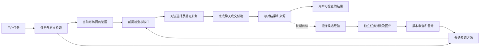

# 超级 Skills：带证据约束的方法运行时

后续体系定义与演进方案见 [Insight Schema 动态注入设计](INSIGHT_RUNTIME_DESIGN.md)。该方案把洞见接入规划、检索、分析和交付，属于待实现设计；下文保留当前方法卡与结构检查的实现说明。

产品目标是让私人助手积累可复用的做事方法，并在当前任务中检查这些方法的适用条件。用户继续正常聊天、研究和写作；方法在后台调用，检查结果可以展开查看。

一个能力单元应包含：任务目标、知识与案例、必要前提、可交付结果、验证方法、反例、失效条件，以及版本和来源。系统既要保存“做过什么”，也要能回答“这次为什么适合这样做、还缺什么、结果怎样核对”。“超级 Skills”是产品方向的名称，不代表这些机制世界首创或目前已经实现完整自我改进。

## 相关工作与研究问题

- [Agent Skills 标准](https://agentskills.io/home) 已包含专业知识、工作流程、脚本和按需加载；知识包与自动触发并非本项目首创。
- [ExpeL](https://arxiv.org/abs/2308.10144)、[ACE](https://arxiv.org/abs/2510.04618)、[ReasoningBank](https://arxiv.org/abs/2509.25140) 已研究从成功和失败中整理、检索或更新经验；自动增加方法卡不能单独构成研究贡献。
- [SayCan](https://say-can.github.io/) 已将任务有用性与当前状态下的可执行性结合；[Self-RAG](https://arxiv.org/abs/2310.11511) 已研究动态检索及支持检查。

值得验证的问题是：**在文档分析和长期个人任务中，把方法前提绑定到当前证据、明确保留未知状态，并按缺口选择下一步，能否减少方法误用，同时提高任务完成质量？** 当前已有实现只是这条研究路线的一个结构检查基础，尚未证明最终回答收益。

## 目标流程

每条箭头都应有明确产物。资料引用支持用户事实，方法引用说明分析方法；方法的存在、引用格式正确以及模型说“成功”都不能替代结果验证。用户确认的记忆提供背景或偏好；它也不能替代任务所需的原文证据。

## 本轮实现：检查当前材料结构

正常 `ResearchService` 回答路径在最终输入预算检查时编译 `method_plan`，绑定本次实际保留的 S 节选和 K 方法卡。相同来源变体的检查结果在一次请求中复用；不增加模型、网络或检索调用。

目前程序能够检查：

- 引用标签是否有效且唯一，节选是否非空。
- 完全重复的节选；重复内容不能作为新增材料计数。
- 多段节选是否来自同一文档；多论文综合至少需要两份不同文档中的不同节选。
- 节选是否截短，当前检查是否因数量上限未覆盖全部材料。

不同文档数量只是材料结构的多样性，不能证明研究独立、指标一致或不存在共用数据。相同文档的不同节选依然可能都是有用证据；去重计数不删除用户原文。

每张卡的自然语言 `required_facts` 和 `stop_conditions` 仍标为 `pending_review`。有 S 标签、关键词重合或足够的文档数量，均不能将这些语义前提改成“已满足”。当前计划的动作是补充材料或核对前提；它不声称已经执行方法、验证因果关系或完成任务。

计划与完整方法卡共同遵守原有 **3500 UTF-8 字节**预算。预算不足时舍弃完整方法卡或整个方法块，保留反例和停止条件，优先保障原文。完整消息仍受 24576 字节预算约束；字节数不等于厂商计费 token 数。增加检查信息可能增加最终 writer 的输入 token，不能据零新增模型调用宣称 token 一定下降。

方法计划随当时的回答快照保存。来源撤回或依据记录不可用时，派生回答和计划一同收起；重启不能用新版方法冒充旧版参考。计划不写入确认记忆或事实图谱。旧 `QueryHarness` 尚未统一到此运行时。

## 下一步算法：按证据义务规划

下面是待实现和验证的设计，不是当前运行时能力。

先把任务拆成可核对的“证据义务”，例如比较两项实验必须核对对象、阶段、指标口径和控制条件。方法声明 `requires`、`produces` 和验证器。程序能精确验证的条件使用代码检查；自然语言判断保留证据位置及人工或模型审查结果，未知不得当作满足。

候选方法仍先通过低成本检索缩小范围。规划器按预计能解决的未闭合义务、已验证前提、实测收益和成本选取少量方法，施加依赖、冲突和预算约束。可先用有界的加权集合覆盖与依赖图排序作为基线。这些是已有算法；研究贡献需要落在证据义务定义、验证机制和真实效果上。

前提不足时，计划可以检索具体缺口、请用户补充、缩小结论或输出待验证假设。上一步经过核对的产物才能满足下一步前提；把几张卡拼接起来不能算完成推理链。规划器不得为了得到低错误率而一律拒绝回答，必须同时测任务完成率与回答覆盖率。

## 经验改进与评测门槛

本轮增加纯函数 `evaluate_method_revision`，检查独立任务上的成对质量、无依据断言、输入 token 和时延。它最多返回“符合进一步审查条件”，不会改写知识包、自动发布新方法或训练模型。用户点赞、模型自评及结构测试不能替代独立结果评测。

当前审查门槛为至少 12 个不同任务 ID 的配对结果、平均质量提高、超过半数任务质量提高、每项任务无依据断言均不增加、平均输入 token 不超过基线 1.1 倍、平均时延不超过 1.2 倍。不同 ID 不证明任务独立，输入评分也不由此函数核验；实际评测协议须保证这些条件。这组门槛是工程上的候选筛选规则，不是统计显著性检验；本轮没有提交真实任务的质量提升结果。

完整经验学习仍需要：真实任务产物与失败原因、候选提炼、个人/项目作用域、验证器、独立任务划分、版本晋升和回退。验证采用相同模型、相同资料与可比预算，并在预先固定的独立任务上比较：无方法、当前 BM25 方法、提示式前提、结构检查、未来完整义务规划。逐步消融，避免把额外上下文或更大模型的收益归给方法算法。

重点报告任务完成质量、无依据断言、条件绑定错误、误用/误拒绝、回答覆盖率、token、模型调用和时延。学习测试按文档族、项目及时间隔离；同一论文的不同 chunk 或重复上传不能充当独立评测任务。真实模型与真实任务的结果才能说明是否有用；单元测试只验证接线、结构检查和预算边界。

当系统能够在未见任务上验证方法更新的收益、检测负迁移并恢复旧版，再讨论持续自我改进。当前实现没有完成 RSI 闭环。
