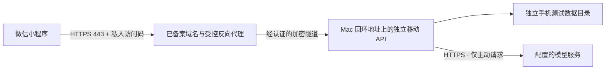

# 微信私人助手：加密接入交付方案

2026-09-22 路线更新：个人主体用户同意先推进[邀请制 HTTPS 网页内测](INVITE_WEB_BETA.md)。本页是此前单人手机后端的加密部署参考，不代表已经部署，也不能把私人访问码分给朋友共用。邀请网页版使用独立身份和每用户 worker，正式小程序发布另有资质前提。

## 当前状态

这是**部署准备方案，不是已经上线的服务**。2026-09-19，开发者工具已生成预览码，用户确认手机扫码能进入。现有手机包默认仍是演示模式；不能把它当成已接通真实 AI。

本次选择：保留 HTTPS 加密连接，不开放局域网明文接口，不关闭微信的域名或证书校验。当前没有自有域名，也没有对外部署后端。

2026-09-20 用户进一步确认：现有账号是测试号，目标是**正式可搜索入口 + 邀请制小范围试用**。本页的私人访问码方案只适用于单人验证，不能直接分发给朋友。正式账号、AI 类目资质与多人发布前置条件见[正式发布准备](WECHAT_MINIPROGRAM.md#发布目标与当前阻塞)。在主体确认前不购买云资源、不注册个人号作为默认替代，也不上传提审。

| 项目 | 状态 |
| --- | --- |
| 五个页面、模拟问答、实体与原文查看 | 开发者工具已验证；用户确认能扫码进入 |
| 主聊天模型 | 本机已配置 `step-5-preview`，不包含在手机包中 |
| 文档向量检索 | 未配置 embedding 服务，不能宣称资料分析已可用 |
| 真实语音 | 尚未配置并验收 ASR / TTS；不是实时通话 |
| HTTPS 服务入口 | 未部署；域名、证书、微信后台权限待完成 |
| 多人账号隔离 | 未完成；共享访问码只能用于本人私人实例 |

## 推荐接入方式

保持资料处理和模型凭据在 Mac 上，公网只开放有明确边界的移动 API：

这是候选部署结构，**没有创建云资源、购买域名、开放端口或建立隧道**。如使用云上反向代理，它会处理解密后的请求；HTTPS 不等于云服务商完全看不到内容。购买或开通前须确认实际服务商、费用、数据处理边界及个人/企业主体资质。

Mac 主动建立加密连接，不直接把桌面管理 API 或整台电脑暴露到公网。可使用 OpenSSH 的反向转发，远端转发端口只监听回环地址，交给云端 HTTPS 代理访问；这不要求开放 Mac 的入站端口。[OpenSSH 反向转发](https://man.openbsd.org/ssh#R)

入口只转发 `/api/v1/mobile/`；拒绝管理接口、未知路径与未认证请求，限制文件大小、并发和超时。代理不缓存会话，不记录 Authorization / 请求正文，不将上传文件缓冲到磁盘。电脑关机或断网时明确报错，不退回模拟回答伪装成功。

## 域名不是唯一前提

微信普通公网请求需要符合平台要求的 HTTPS 域名、有效且受信任的证书及服务器域名配置；`request` 与 `uploadFile` 需按实际用途配置。备案要求与可用服务器产品应以服务商和微信当时规则为准，不能承诺买一个域名就立即可用。[微信网络说明](https://developers.weixin.qq.com/miniprogram/dev/framework/ability/network.html)

基础库存在同网段局域网 IP 通信特例，但本项目本次选择不走明文方案。临时 HTTPS 隧道也不自动等于满足备案与微信白名单要求。[微信局域网说明](https://developers.weixin.qq.com/miniprogram/dev/framework/ability/mDNS.html)

当前 AppID 已验证能生成预览码，用户确认它是测试号；这不证明具备正式发布资格。下一步应先确认可用于 AI 问答类目的非个人主体及正式账号，再核对服务器域名配置能力，避免先买不适用的资源。测试号能力不替代正式发布。[微信测试号说明](https://developers.weixin.qq.com/miniprogram/dev/devtools/sandbox.html)、[AI 类目主体要求](https://docs.cloudbase.net/ai/release/algorithm-filing)

如果采用腾讯云入口，当前备案资源规则要求符合条件的中国内地云资源；轻量服务器的包年包月购买时长至少三个月，备案期间剩余有效期至少一个月，还需满足公网网络条件。个人用户可以使用符合条件的本人资源，不应为此默认购买企业资质或他人的“备案授权码”。实际下单前重新核对条件，不在本方案中承诺价格或获批时间。[腾讯云备案资源要求](https://cloud.tencent.com/document/product/243/18908)、[备案主体与域名要求](https://cloud.tencent.com/document/product/243/18911)

云托管的 `callContainer` 是另一种平台接入协议，可以免配服务器域名，但并非把当前 API 地址换成云域名即可完成；账号资格、可访问环境、收费、上传与语音协议适配需另行核实，不列为现成可用方案。[微信云托管调用指南](https://developers.weixin.qq.com/miniprogram/dev/wxcloudservice/wxcloudrun/src/development/call/mini)

## 接通前的验收顺序

1. 确认符合 AI 类目要求的运营主体、正式账号及服务器域名配置能力；用户本人完成需要扫码、实名、协议同意的步骤。
2. 确认服务商、域名和预算，再购买需要的资源、办理必要备案及证书；不提前承诺备案时间或获批。
3. 启动使用独立数据目录的手机后端，先验证只监听 Mac 回环地址，未带正确访问码不能读取任何会话。
4. 配置受认证的加密代理链，检查入口拒绝桌面/管理 API、未知路径、超大文件和未授权访问。不得把模型 key、微信 AppSecret 或访问码写进前端、二维码、URL 或 Git。
5. 配置微信域名。设置页手动检查连接只验证移动服务协议和鉴权，不发送资料，不调用模型；它不能替代一次真实问答测试。
6. 由用户在手机发送一条非敏感测试问题，核对真实模型响应、断网报错、重复点击和切会话行为；再逐项配置 embedding、上传解析、记忆和语音。
7. 给朋友使用前，补微信登录、邀请名单、逐用户/逐对象授权和资源配额，并确认模型套餐允许该用途。验证两个账号不能互读会话、资料、图谱、记忆和任务；仅客户端隐藏页面不算授权控制，不能分发共用私人访问码。
8. 正式可搜索的交付还需完成小程序备案、实际 AI 类目/隐私材料、审核和发布。邀请制须如实向审核说明并提供完整测试权限；发布后检查账号级搜索设置，私人页面继续禁止内容索引。不承诺审核通过时间、立即收录或搜索排名。[微信发布流程](https://developers.weixin.qq.com/miniprogram/dev/framework/quickstart/release.html)、[微信审核规则](https://developers.weixin.qq.com/miniprogram/product/reject.html)

当前使用 Step Plan 订阅接入。其服务协议限制将订阅服务提供给第三方，除非获得明确许可；因此不默认把本人的订阅转成朋友共用的模型服务。可在确认授权或改用适合该用途的 API 计费方案后再推进。[Step Plan 使用规范 §3](https://platform.stepfun.com/docs/zh/step-plan/paid-service-agreement)

每一步都按实际结果记录。“构建成功”“扫码能进入”“鉴权通过”“真实模型回答”“多人体验版”是不同验收项。
